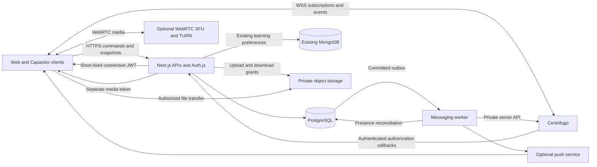
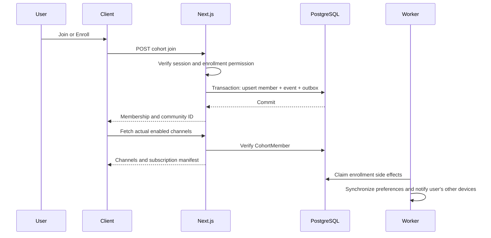
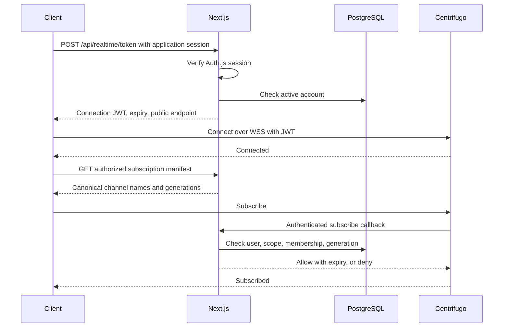
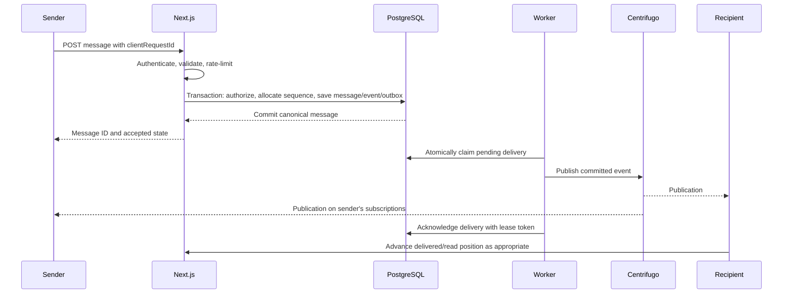
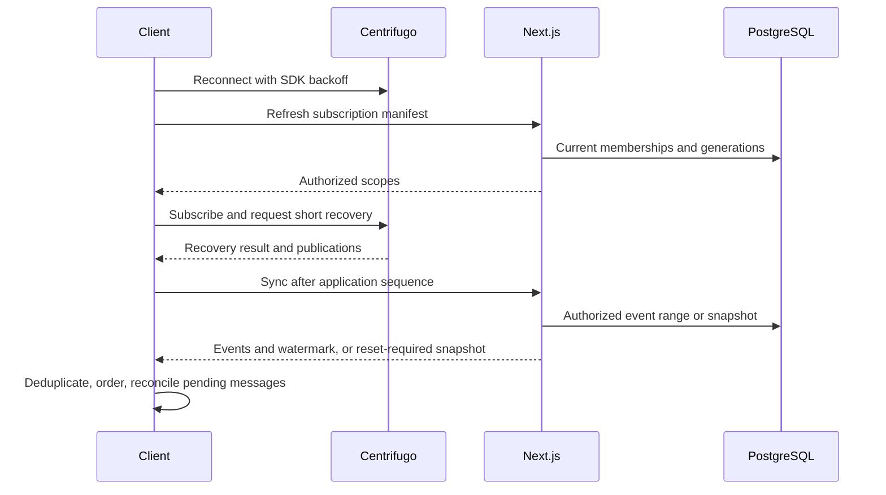

# 1. Executive summary and recommended architecture

**Undone needs a durable messaging backend and a secure real-time delivery layer. Adding Centrifugo alone will not make the existing messaging interfaces functional.**

The recommended design preserves Next.js, Auth.js, Prisma, PostgreSQL, and MongoDB. PostgreSQL remains authoritative for messages, membership, permissions, read positions, and study-session records. Centrifugo distributes authorized events; a dedicated worker publishes committed changes through a transactional outbox.

This plan incorporates the clarified product requirements:

- **Choosing Join/Enroll creates actual cohort membership. That membership automatically grants community-chat access.**
- Public cohort visibility permits discovery according to existing catalog rules; it does not independently grant chat access.
- There is no additional community-enrollment step or duplicate community-membership table.
- DMs and groups contain actual users and persistent messages.
- Mock conversations, invented participants, fabricated activity, artificial unread counts, and simulated delivery states disappear from production messaging and study-room flows.
- Empty accounts show genuine empty states. Failed requests show errors. Unreleased features are hidden or disabled with an accurate explanation.

**Recommended baseline:** Centrifugo OSS **6.10.0**, pinned by image digest during implementation, and JavaScript package **`centrifuge` 5.7.4**. These were the current releases visible during research on **20 October 2026**. The SDK’s documented v5 compatibility includes Centrifugo v6. Version 6.10.0 was newly released, so production adoption requires the staging compatibility and soak tests below. [Server release](https://github.com/centrifugal/centrifugo/releases/tag/v6.10.0), [SDK releases](https://github.com/centrifugal/centrifuge-js/releases), [SDK compatibility](https://github.com/centrifugal/centrifuge-js)

Start with:

1. Existing Next.js hosting for HTTP APIs and rendering.
2. One small, persistent Linux server running Centrifugo and a separately supervised messaging worker.
3. Existing PostgreSQL, subject to connection-budget and backup verification.
4. Centrifugo’s memory engine initially.
5. Redis/Valkey and multiple Centrifugo nodes when availability requirements or measured load justify them.
6. Private object storage and push delivery in subsequent phases.
7. Separate WebRTC infrastructure if voice/video is later approved.

**Minimum production release:** real enrollment, member-only community chats, persistent one-to-one and basic group messaging, history, unread/read positions, reliable sending/retry/reconnection, moderation and blocking controls, accurate study-room participation, and durable personal focus-session records.

Attachments, browser push, richer group administration, shared sprints, and media can follow. Any corresponding unfinished controls must be removed from the production interface.

This is a planning deliverable. No repository files, configuration, packages, schemas, or deployments were changed. Tests were inspected but not executed.

# 2. Repository audit with evidence and file references

## Audit baseline and limits

Inspected checkout: **`bbbe77a26c59c6ebec45a8567adc4e6e20d06c0a`**, together with existing untracked work.

The working directory already contains untracked study-room hooks, utilities, tests, data files, and `docs/plans/`. These are not evidence of deployed functionality. The mounted `StudyRoomScreen` still imports the existing `FocusTimerCard`; the newer local hooks must be reconciled with their owner before implementation.

Read-only inspection established source behavior. It did **not** establish:

- Which commit is deployed.
- Actual production database schema or server versions.
- Hosting account plans, regions, quotas, or invoices.
- Whether existing workers run in production.
- Whether the Compose service has ever been deployed.
- Whether current tests pass.

No secret values from environment files were needed.

## Stack and deployment

Versions below are resolved from [package-lock.json](D:/ThisPC/Documents/SideQuestHQ/undone-site/package-lock.json), rather than inferred from dependency ranges.

| Area | Verified state | Consequence |
|---|---|---|
| Application | Next.js **16.2.11**, React **19.2.4**, TypeScript **5.9.3** | Use App Router handlers and a client-only real-time provider. |
| Runtime | [package.json](D:/ThisPC/Documents/SideQuestHQ/undone-site/package.json) requires Node **>=24 <25** | Worker must use the same supported major. Actual production runtime remains unverified. |
| Authentication | `next-auth` **5.0.0-beta.32**, Prisma adapter | Preserve current auth integration; explicitly test beta-version behavior. |
| PostgreSQL | Prisma/client/adapter-pg **7.9.1**, `pg` **8.23.0** | Prisma 7 configuration and driver adapter are already present. |
| MongoDB | Driver **7.5.0**, Mongoose **9.9.3** | Existing learning/configuration storage remains separate from messaging transactions. |
| Client state | React Query **5.101.4**, Redux Toolkit **2.12.0** installed | Messaging currently primarily uses local React state; use existing React Query infrastructure for server state. |
| Tests | Vitest **4.1.11**, Testing Library, PGlite dependency | Real PostgreSQL and Centrifugo integration tests still need a dedicated messaging harness. |
| Hosting | [vercel.json](D:/ThisPC/Documents/SideQuestHQ/undone-site/vercel.json), Vercel verification scripts, serverless-aware pools | Vercel is an intended target; actual active hosting is unverified. |
| Mobile | [mobile package](D:/ThisPC/Documents/SideQuestHQ/undone-site/packages/mobile/package.json), Capacitor 8 dependencies, static export | Test Android WebView authentication and reconnection separately. |
| Build safety | [next.config.ts](D:/ThisPC/Documents/SideQuestHQ/undone-site/next.config.ts) sets `typescript.ignoreBuildErrors: true` | A successful Next build is insufficient; separate type checking is mandatory. |

Vercel Functions cannot serve as the persistent WebSocket server. Centrifugo therefore belongs on separate persistent infrastructure, while browser clients connect directly to it. [Vercel WebSocket guidance](https://vercel.com/kb/guide/do-vercel-serverless-functions-support-websocket-connections)

## Authentication and authorization

| Finding | Evidence | Classification and required action |
|---|---|---|
| JWT-based application sessions | [auth.config.ts](D:/ThisPC/Documents/SideQuestHQ/undone-site/src/server/infrastructure/auth/auth.config.ts): `session.strategy = 'jwt'`; JWT callback assigns user ID to `sub`; session callback exposes `session.user.id` | Implemented in source. Derive real-time identity exclusively from this verified server session. |
| OAuth providers | Same file configures GitHub and Slack | Implemented; provider configuration and production callbacks unverified. |
| Shared guest accounts | [guestAccount.ts](D:/ThisPC/Documents/SideQuestHQ/undone-site/src/server/infrastructure/auth/guestAccount.ts) accepts two predefined guest email identities | Unsuitable for private production messaging: unrelated visitors can share an identity. Disable production guest messaging and preferably production shared guest sign-in. |
| Auth signing fallback | Both server and [edge auth configuration](D:/ThisPC/Documents/SideQuestHQ/undone-site/src/server/infrastructure/auth/auth.edge.ts) contain a literal fallback secret | Production blocker unless deployment reliably overrides it. Make missing production secrets fail closed. |
| Server identity helpers | [getUser.ts](D:/ThisPC/Documents/SideQuestHQ/undone-site/src/server/infrastructure/auth/getUser.ts), [requireUser.ts](D:/ThisPC/Documents/SideQuestHQ/undone-site/src/server/infrastructure/auth/requireUser.ts) | Reusable; add current account-status checks for messaging. |
| Page protection | [middleware.ts](D:/ThisPC/Documents/SideQuestHQ/undone-site/src/middleware.ts) protects dashboard routes | API authorization remains mandatory; page middleware does not protect arbitrary API calls. |
| Cohort visibility policy | [cohortAccessPolicy.ts](D:/ThisPC/Documents/SideQuestHQ/undone-site/src/server/domain/cohort/cohortAccessPolicy.ts): public published cohorts, creator access, private published member access | Appropriate starting point for content discovery, not sufficient chat authorization. |
| `INVITE_ONLY` mismatch | Prisma enum contains `INVITE_ONLY`; SQL access helper only explicitly handles `PRIVATE` membership; `canReadCohort` type excludes `INVITE_ONLY` | Inconsistent policy requiring explicit enrollment/invitation semantics. |
| Authorization caches | Channel-message GET caches verification for 60 seconds; [permissionsCache.ts](D:/ThisPC/Documents/SideQuestHQ/undone-site/src/server/infrastructure/auth/permissionsCache.ts) is process-local | Cannot provide prompt cross-instance revocation. Remove these caches from sensitive chat decisions or replace with versioned, correctly invalidated authorization. |
| Host-based auth | [auth.environment.ts](D:/ThisPC/Documents/SideQuestHQ/undone-site/src/server/infrastructure/auth/auth.environment.ts) removes configured auth URLs; auth trusts host | Verify trusted proxy headers and allowed deployment hostnames. Do not derive token issuer or allowed origins from arbitrary request headers. |

## Enrollment and community creation

Existing enrollment is real but disconnected from the mock-derived chat list.

- [JoinCohortButton.tsx](D:/ThisPC/Documents/SideQuestHQ/undone-site/src/client/screens/cohort/components/JoinCohortButton.tsx) calls the cohort join endpoint.
- [cohort join route](D:/ThisPC/Documents/SideQuestHQ/undone-site/src/app/api/cohort/[id]/join/route.ts) authenticates, checks accessibility, updates MongoDB preferences, and upserts `CohortMember`.
- Its DELETE removes membership and updates MongoDB visibility preferences.
- The current MongoDB and PostgreSQL operations are not one atomic transaction.
- [cohort.repo.ts](D:/ThisPC/Documents/SideQuestHQ/undone-site/src/server/infrastructure/db/postgres/repositories/cohort.repo.ts) creates a community, `general` and `resources` channels, and creator membership.
- [creationPublication.repo.ts](D:/ThisPC/Documents/SideQuestHQ/undone-site/src/server/infrastructure/db/postgres/repositories/creationPublication.repo.ts) creates creator membership and a community, with `general` conditional on `chatEnabled`.

**Plan:** preserve these real records. Centralize enrollment so a committed `CohortMember` is immediately sufficient for all enabled community channels. MongoDB learning preferences become retryable secondary effects, not prerequisites for chat access.

## Community messaging

| Finding | Evidence | Assessment |
|---|---|---|
| Persistent core models | [schema.prisma](D:/ThisPC/Documents/SideQuestHQ/undone-site/prisma/schema.prisma): `Community`, `Channel`, `Message` | Implemented backend foundation. Community is one-to-one with cohort. |
| Channel listing embeds messages | [channels route](D:/ThisPC/Documents/SideQuestHQ/undone-site/src/app/api/community/[cohortId]/channels/route.ts), `communityRepo.getCommunityChannels` | Returns up to 25 messages per channel; public cohort responses are publicly cacheable. Anonymous visitors can currently receive public-cohort chat through this endpoint. |
| Message GET/POST | [messages route](D:/ThisPC/Documents/SideQuestHQ/undone-site/src/app/api/community/channels/[channelId]/messages/route.ts) | Authenticated, database-backed, but authorizes through cohort visibility instead of actual enrollment. |
| Validation | POST checks truthiness of `content` | Missing strict string, length, whitespace, body-size, and rate-limit enforcement. |
| Pagination | [community.repo.ts](D:/ThisPC/Documents/SideQuestHQ/undone-site/src/server/infrastructure/db/postgres/repositories/community.repo.ts) uses ID cursor and `createdAt` ordering | Needs stable tie-breaking and validated, channel-scoped cursors. |
| ETag | Based on newest message ID/time and result count | Will not correctly represent future edits, reactions, or some deletions. |
| Frontend integration | [useMessage.ts](D:/ThisPC/Documents/SideQuestHQ/undone-site/src/client/screens/dashboard/message/hooks/useMessage.ts) fetches first channel and posts content | Partial. No real-time client; no regular message refresh found in this hook. |
| Optimistic identity | Same hook creates timestamp IDs and does not replace them with the server response | Retry duplicates and future event duplication are likely without reconciliation. |
| False success | Same hook marks a message sent when no `activeChannelId` exists | Must be removed. |
| Channel routing | One mutable `activeChannelId`, while message state is keyed by community | Race risk when switching communities; multiple channels are not represented correctly. |
| Replies/reactions/uploads | Local state, mock attachments, reply context not persisted by POST | Frontend-only. |
| Sidebar/participants/events | [communityMapping.ts](D:/ThisPC/Documents/SideQuestHQ/undone-site/src/client/screens/dashboard/message/utils/communityMapping.ts) invents people, counts, messages, pins, media, and events | Mocked; replace production imports and projections. |

## Direct messages and groups

[message repository](D:/ThisPC/Documents/SideQuestHQ/undone-site/src/client/repositories/messagesRepository.ts) returns mock conversations. Its enrolled-cohort source is [homeRepository.ts](D:/ThisPC/Documents/SideQuestHQ/undone-site/src/client/repositories/homeRepository.ts), which contains fallback cohorts and fabricated metrics.

`useMessage.ts` supplies:

- Scripted DM history.
- LocalStorage messages, drafts, pinning, and muting.
- Local unread overrides.
- A local typing flag.
- Local deletion.
- Mock uploads.
- “Group DM” presentation derived from mock conversation attributes.

[ComposeModal.tsx](D:/ThisPC/Documents/SideQuestHQ/undone-site/src/client/screens/dashboard/message/components/LeftSidebar/ComposeModal/ComposeModal.tsx) searches supplied conversation previews; it does not create persistent conversations.

**No human DM conversation, participant, or group-message model was found in the Prisma schema. No corresponding human DM API was found.** `InteractionMessage` and related “conversation” code belong to the AI/cohort-builder subsystem and must not be repurposed as social chat.

Both desktop and mobile use the same model through [Message.tsx](D:/ThisPC/Documents/SideQuestHQ/undone-site/src/client/screens/dashboard/message/Message.tsx).

## Study rooms

| Finding | Evidence | Assessment |
|---|---|---|
| Persistent rooms and membership | Prisma `StudyRoom`, `RoomParticipant`; `userId @unique` | Database enforces at most one participant row per user. |
| Join/switch/leave | [studyroom route](D:/ThisPC/Documents/SideQuestHQ/undone-site/src/app/api/studyroom/route.ts) | Transactions exist; competing joins are not explicitly serialized or retried. |
| Counts | Increment/decrement `onlineCount` | Tracks explicit operations, not actual connectivity. Crashes can leave stale participants. |
| Room reads | Same route returns participant profiles without authentication, using public cache headers | Must separate public aggregate catalog from authenticated participant detail. |
| ETag | Base64 prefix truncated to 24 characters | Later rooms/participants may change without changing the ETag. Replace with revision or complete-content digest. |
| Seeding | GET checks and seeds rooms; process-local `roomsSeeded` | Request-time writes and cross-instance seeding race. Move to explicit idempotent operational setup. |
| Refresh | [StudyRoomScreen.tsx](D:/ThisPC/Documents/SideQuestHQ/undone-site/src/client/screens/dashboard/studyroom/StudyRoomScreen.tsx) polls every 10 seconds while visible | Partial synchronization only. |
| Activity | Same component generates random activity every 24 seconds | Entirely simulated. |
| Focus timer | [FocusTimerCard.tsx](D:/ThisPC/Documents/SideQuestHQ/undone-site/src/client/screens/dashboard/studyroom/components/FocusTimerCard.tsx) uses a local countdown | Functional local timer; no durable session or shared timing. |
| New hooks | Existing untracked `hooks/`, `utils/`, `data/mockRosters.ts` | Local work, not integrated backend functionality. |
| Voice/video | No relevant media integration found in inspected source/dependencies | Missing. “Voice Spaces” schema comment does not establish media support. |

## Infrastructure, storage, and tests

- [docker-compose.yml](D:/ThisPC/Documents/SideQuestHQ/undone-site/docker-compose.yml) contains only a floating Centrifugo v5 image, host port 8000, and literal example secrets. No secure origins, TLS, health checks, shared engine, or application integration is declared.
- [PostgreSQL client](D:/ThisPC/Documents/SideQuestHQ/undone-site/src/server/infrastructure/db/postgres/client.ts) uses a global Prisma/`pg` pool; production defaults to two connections per process. This does not bound total connections across serverless instances.
- [MongoDB client](D:/ThisPC/Documents/SideQuestHQ/undone-site/src/server/infrastructure/db/mongodb/client.ts) similarly caps each production process at two connections.
- [root-environment.mjs](D:/ThisPC/Documents/SideQuestHQ/undone-site/scripts/root-environment.mjs) treats root `.env` as the local source and exposes `NEXT_PUBLIC_*` values. Real-time secrets must never use that prefix.
- Existing [interaction worker](D:/ThisPC/Documents/SideQuestHQ/undone-site/src/server/interaction-worker.ts), creation worker, and SQL outbox structures provide useful patterns.
- `claimOutbox` in [interaction.repo.ts](D:/ThisPC/Documents/SideQuestHQ/undone-site/src/server/infrastructure/db/postgres/repositories/interaction.repo.ts) selects candidates and updates them without an evident exclusive claim predicate. Do not copy this into a multi-worker chat dispatcher without atomic claiming and fencing.
- [creation.runtime.ts](D:/ThisPC/Documents/SideQuestHQ/undone-site/src/server/infrastructure/storage/creation.runtime.ts) uses private creation metadata plus GridFS. This is not a general chat-attachment service.
- MongoDB `UserChannelConfig` refers to learning modes such as `spark` and `quick`, not chat channels.
- `prisma.config.ts` names `prisma/migrations`, but that directory is absent. Numerous additive SQL files exist instead. Migration baselining is required before choosing commands.
- The inspected GitHub workflow synchronizes planning branches; it is not a comprehensive test/deployment gate.
- Existing community authorization tests and study-room tests mostly mock auth/database calls. They do not prove concurrent database correctness or real multi-user delivery.
- [S6 operator handoff](D:/ThisPC/Documents/SideQuestHQ/undone-site/docs/s6-operator-release-package.md) explicitly leaves shared production deployment gates open. Its cohort-builder verification is not chat verification.

# 3. Current functionality versus missing functionality matrix

“Implemented” below means supported by inspected source, not independently verified in production.

| Capability | Current status | Required production result |
|---|---|---|
| Authenticated user identity | Implemented, with guest/secret risks | Unique real account; fail-closed production configuration |
| Cohort enrollment | Implemented backend | Idempotent enrollment automatically grants chat |
| Community/channel storage | Implemented | Preserve and normalize existing channels |
| Community message persistence | Implemented backend, partial frontend | Canonical IDs, validation, authorization, retries |
| Member-only community chat | Missing as a consistent policy | Enrollment required across reads, writes, subscriptions, search, files |
| Multiple channel selection | Partial | Channel-specific state and history |
| Real-time messaging | Missing | Authorized Centrifugo subscriptions |
| Persistent DMs | Mocked/frontend-only | Real conversations, participants, messages |
| Persistent groups | Mocked presentation | Real group creation and membership |
| Replies and reactions | Frontend-only | Durable scoped records |
| Editing | Missing backend | Versioned edits and audit policy |
| Deletion | Local DM removal only | Authorized tombstones and moderation |
| Read/delivered state | Mocked/local | Precisely defined persisted watermarks |
| Pins/mutes | LocalStorage | Per-user server preferences |
| Search | Local previews | Authorized database history search |
| Attachments | Mocked | Private upload, validation, scanning, authorized access |
| Notifications | Presentation only for messaging | Durable notifications; optional push |
| Typing and online indicators | Mocked/local | Expiring authenticated signals |
| Room joins/leaves | Partially implemented | Serialized, idempotent membership with leases |
| Room presence/counts | Explicit-operation counters | Distinct live users; stale cleanup |
| Peer activity | Simulated | Actual authorized events only |
| Focus timer | Local-only | Accurate local display plus durable session state |
| Shared sprint | Missing | Optional server-authoritative timing |
| Voice/video/screenshare | Missing | Separate media service |
| Reconnection recovery | Missing for chat | SQL reconciliation plus short transport recovery |
| Operational chat monitoring | Missing | Metrics, alerts, worker health, recovery drills |

# 4. Target system architecture and sequence diagrams

## Responsibilities

| Component | Responsibility |
|---|---|
| Browser/Capacitor client | Render server state, optimistic pending messages, one connection per app instance, bounded subscriptions, reconnect and synchronization |
| Next.js APIs | Authenticate, authorize, validate, transact, issue connection tokens, serve snapshots/history |
| Auth.js | Application login and session verification; not a Centrifugo subscription policy |
| PostgreSQL/Prisma | Durable membership, messages, permissions, preferences, receipts, events, outbox, study records |
| Centrifugo | Authenticated connections, authorized subscriptions, event transport, short recovery, ephemeral connection presence |
| Messaging worker | Outbox dispatch, retry/fencing, room reconciliation, expired sessions, notification delivery |
| MongoDB | Existing learning preferences/progress and creation data; no duplicate message authority |
| Private object storage | Attachment bytes, quarantine, lifecycle deletion |
| Push service | Optional background notifications; never the authoritative message store |
| Media server | Optional WebRTC audio/video/screenshare, TURN, media access enforcement |

## Enrollment and automatic community access

**One membership authority:** `CohortMember`.

1. User explicitly chooses Join/Enroll.
2. Server verifies account status and whether enrollment is permitted.
3. Public published cohort: allow enrollment.
4. Private/invite-only cohort: require a valid invitation or authorized administrative action.
5. Transaction upserts membership and records the enrollment event/outbox work.
6. Enabled community channels become accessible through that membership immediately.
7. Response returns the canonical enrollment and community destination.
8. Client invalidates enrollment/home/chat queries and opens the real community.
9. MongoDB preference synchronization retries independently if necessary.

Viewing a cohort or opening a chat URL must not silently enroll the user. Conversely, joining must not require a second chat-membership operation.

## Authentication and subscriptions

Use **connection JWTs plus server-side subscribe/sub-refresh proxies**.

This is preferable here to subscription JWTs because membership changes are frequent and authorization should be checked on every subscription attempt. Do not combine proxy authorization with user-limited channels or subscription JWTs, which can bypass that proxy decision. [Centrifugo permission model](https://centrifugal.dev/docs/server/channel_permissions)

Connection renewal uses the SDK token callback and the existing application session. Subscription renewal independently rechecks current access.

The client owns one provider beneath the authenticated application shell. It must cleanly disconnect and clear user-scoped caches on logout/account change. React Strict Mode must not leave duplicate active connections.

## Durable message flow

**Sent** means PostgreSQL accepted the message. It does not mean Centrifugo published it or a recipient read it.

If publication fails, the HTTP response can still report accepted/sent. The outbox retries. The UI separately indicates a degraded live connection.

## Recovery

Transport offsets are not application message IDs or database cursors. Even successful transport recovery is followed by lightweight application reconciliation.

For initial loading, subscribe and buffer events, obtain a consistent snapshot with a watermark, then apply buffered events above that watermark. This closes the fetch/subscribe race.

## Reliable dispatch choice

| Approach | Assessment |
|---|---|
| Publish directly after DB commit | Simple but loses notifications if the process dies between commit and publish |
| Publish before commit | Can expose messages that later roll back |
| Request-lifecycle background callback | Useful optimization, not a durable delivery guarantee |
| Existing AI `InteractionOutbox` | Wrong ownership boundary; requires AI workspace |
| Dedicated PostgreSQL transactional outbox | **Recommended**; familiar infrastructure and atomicity with messaging state |

Use at-least-once dispatch:

- Atomic claims using `FOR UPDATE SKIP LOCKED` or equivalent guarded SQL.
- Leases, unique lease tokens, and fenced acknowledgements.
- Exponential retry with jitter.
- Per-stream ordering where practical; clients still handle reordering.
- Independent delivery status for each destination.
- Dead-letter handling and alerts for persistent errors.
- No network call inside the message-creation database transaction.

# 5. Centrifugo configuration and security model

## Version and deployment

Replace the floating v5 configuration with an explicit **6.10.0** deployment after staging validation. Record the exact image digest and SDK lockfile version.

Version 6 uses nested configuration; existing v5 environment names must not simply be carried across. Validate against the pinned binary and the [v6 migration guide](https://centrifugal.dev/docs/getting-started/migration_v6).

The following are planned settings, not configuration files to apply now.

## Core settings

| Configuration path | Planned value |
|---|---|
| `client.token.hmac_secret_key` | Independent cryptographically random server secret, at least 32 bytes |
| `client.token.issuer` | Fixed environment-specific issuer |
| `client.token.audience` | Fixed environment-specific real-time audience |
| `client.allowed_origins` | Exact approved web origins; explicitly verified Capacitor origins |
| `client.channel_limit` | 32 |
| `client.user_connection_limit` | 10 per node |
| `client.connection_limit` | Initially 2,000 on the small deployment, subject to load-test reduction |
| `client.connection_rate_limit` | Initially 100 new connections/second/node |
| `client.ping_interval` | `25s` |
| `client.pong_timeout` | `8s` |
| `client.queue_max_size` | 1 MiB |
| `client.recovery_max_publication_limit` | 300 |
| `client.history_max_publication_limit` | 300 |

These paths and node-local connection-limit semantics are documented in the [configuration reference](https://centrifugal.dev/docs/server/configuration). The numerical limits are proposed Undone defaults, not capacity guarantees.

Additional settings:

| Configuration path | Planned value |
|---|---|
| `http_api.key` | Separate server API credential |
| `websocket.message_size_limit` | 64 KiB |
| `websocket.compression` | Disabled initially |
| `health.enabled` | Enabled, private access |
| `prometheus.enabled` | Enabled, private access |
| `admin.enabled` | Disabled |
| `debug.enabled` | Disabled |

The transport and health paths were checked against the [6.10.0 configuration definitions](https://raw.githubusercontent.com/centrifugal/centrifugo/v6.10.0/internal/configtypes/types.go). Prometheus support is documented separately in [observability](https://centrifugal.dev/docs/server/observability).

## Namespace policy

All namespaces:

- Enable `subscribe_proxy_enabled` and `sub_refresh_proxy_enabled`.
- Keep unrestricted subscribe, publish, history, and presence permissions disabled.
- Keep anonymous access and user-limited channel authorization disabled.
- Never enable insecure client mode.
- Do not issue subscription JWTs in this design.

| Namespace | History | Recovery | Presence/join-leave |
|---|---|---|---|
| `user` | 100 events / 5 minutes | Enabled | Presence available to backend; no public roster |
| `dm`, `group` | 100 / 5 minutes | Enabled | Off initially; peer presence provided through application policy |
| `community` | 100 / 5 minutes | Enabled | Off initially to avoid large fan-out |
| `room` | 100 / 5 minutes | Enabled | Presence and join/leave enabled |
| `roomchat` | 100 / 5 minutes | Enabled | Off; participant state comes from `room` |
| `signal` | None | Off | Off; typing expires client-side |

Use `history_size`, `history_ttl`, and `force_recovery` for durable-event namespaces. Room join/leave events are connection events and are not durable participant records. Their delivery is at-most-once; snapshots remain necessary. [Channels](https://centrifugal.dev/docs/server/channels), [history and recovery](https://centrifugal.dev/docs/server/history_and_recovery), [presence](https://centrifugal.dev/docs/server/presence)

## Token and proxy design

- Connection JWT: `sub = User.id`, `iat`, `exp`, fixed `iss` and `aud`.
- Proposed lifetime: five minutes, with refresh jitter.
- Exclude email, biography, private settings, and other unnecessary identity information.
- Store JWTs in memory, never localStorage or URLs.
- Return token responses with `Cache-Control: no-store`.
- Fail renewal if session/account is invalid.
- Never reuse the Auth.js session token or secret as the Centrifugo token/secret.

Centrifugo connection authentication establishes identity, not membership. [JWT authentication](https://centrifugal.dev/docs/server/authentication)

Configure `channel.proxy.subscribe` and `channel.proxy.sub_refresh` to call protected Next.js endpoints. Return a subscription expiry approximately two minutes ahead. Authenticate callbacks with a dedicated static server credential using `http.static_headers`; never forward a client-controlled header under that credential’s name. Use short bounded callback timeouts, initially two seconds. [Proxy configuration](https://centrifugal.dev/docs/server/proxy)

## Access revocation

Short expiry alone is insufficient.

Use a **database-backed access generation** in channel names:

1. Membership removal, group removal, chat disabling, or restrictive visibility change advances the affected scope generation in the same transaction.
2. All newly committed events target the new generation.
3. The proxy rejects old generations and removed users.
4. Worker sends server-side unsubscribe commands for old subscriptions.
5. Retained members receive an inbox invalidation and refresh their manifest.
6. Pending old-generation publications are suppressed or converted into resynchronization notices.
7. HTTP reads/writes immediately enforce current membership.

Serialize message authorization/sequence allocation and membership changes on the affected scope, so a message committed after removal cannot target the previous generation.

Data already delivered cannot be recalled. Content accepted before removal may already be in transit; the guarantee is **no new post-removal content or authorized HTTP access**. Test this exact boundary.

The Centrifugo server API is privileged and bypasses client permissions. Keep it private and use it only from trusted services. [Server API](https://centrifugal.dev/docs/server/server_api)

## Network and secrets

- Public ingress: TLS/WSS endpoint only.
- Block public `/api`, `/metrics`, admin, debug, and internal health access.
- Reverse proxy must support upgrades and idle timeouts longer than heartbeat intervals.
- Exact origins; no wildcard production origins.
- Separate development, staging, and production credentials and channel environments.
- Public client configuration contains only endpoint and non-secret feature flags.
- Server-only variables: signing secret, API key, callback secret, internal endpoint.
- Local development uses the repository’s root `.env` convention.
- Production secret rotation follows the runbook in section 12.

Start with the memory engine. Before adding a second active node, use `engine.type = redis` with authenticated TLS-protected shared storage and the documented Redis address configuration. Memory-engine nodes are not a shared cluster. [Engines and scalability](https://centrifugal.dev/docs/server/engines)

# 6. Database and API change plan

## Core modeling decision

**Reuse existing `Channel` and `Message` for all human chat.**

Introduce `Conversation` for one-to-one/group identity and membership, but do not create a competing direct-message storage implementation.

Extend `Channel` so exactly one parent applies:

- Community.
- Conversation.
- Study room.

Enforce this through nullable parent foreign keys plus a SQL check constraint requiring exactly one parent. Existing community channels retain their IDs and messages.

## Required models and changes

| Model | Planned structure and integrity requirements |
|---|---|
| `User` | Add messaging/account restriction state if no canonical equivalent is found during implementation. Add optional coarse `lastSeenAt`. Do not expose restrictions publicly. |
| `CohortMember` | Retain composite key and roles. This remains the community-chat entitlement. Do not duplicate membership in MongoDB or a new community-member table. |
| `CohortInvitation` | Needed for functioning private/invite-only enrollment: cohort FK, inviter FK, intended recipient or constrained invitation, hashed token, expiry, acceptance/revocation. Unique token hash; expiration index. |
| `Community` | Retain cohort FK and `chatEnabled`. Add access generation for community-wide revocation. |
| `Channel` | Nullable parent FKs with exactly-one-parent check; stable slug, archive/write-policy flags, message counter and event/stream relationship. Unique `(communityId, slug)` where applicable; unique conversation and room parent links for one chat each. |
| `Conversation` | `DIRECT`/`GROUP`, title, creator, timestamps, optional archive state. Direct conversations require a canonical sorted pair key with a unique constraint. |
| `ConversationParticipant` | Composite `(conversationId,userId)` key; role, joined/left/removed timestamps, history visibility boundary. Index `(userId,leftAt,conversationId)`. |
| `ConversationInvitation` | Group invitation lifecycle, recipient, inviter, expiry, acceptance/revocation. Unique active invitation per recipient/group. |
| `Message` | Preserve existing IDs/content; add channel-local `messageSequence`, request ID/hash, reply reference, revision, edited/deleted timestamps and deletion reason class. |
| `ChannelUserState` | Composite `(channelId,userId)`; last-read and delivered message positions, pinned state, mute expiry/preferences. This is state, not membership. |
| `RealtimeStream` | Exactly one typed owner FK: channel, room, or user. Unique owner; generation and event counter. Avoid unchecked free-form polymorphic IDs. |
| `RealtimeEvent` | Stream FK, sequence, event ID, version, type, payload/reference, timestamp. Unique `(streamId,sequence)` and index on retention timestamp. |
| `RealtimeDelivery` | Event FK, destination, status, attempts, due time, lease owner/token/expiry, delivered time, last error class. Unique event/destination; pending/due/lease index. |
| `MessagingRequest` | Scoped mutation idempotency: actor, operation, scope, request ID, payload hash, canonical result reference. Unique composite key. |
| `UserBlock` | Blocker/blocked user FKs, composite unique key, self-block check. |
| `MessageReport` / `ModerationAction` | Reporter/actor FK, target message/scope, reason, state, timestamps; restricted access and audit indexes. |
| `RoomParticipant` | Preserve unique `userId`; add membership generation and lifecycle fields. Represents current selected room, not a raw WebSocket connection. |
| `RoomConnectionLease` | Participant/user FK, server session/tab identifier, current membership generation, expiry, optional Centrifugo client association. Unique session; indexes on expiry and participant. |
| `StudySession` | User FK, optional room FK, start/pause/resume/end state, accumulated duration, revision, end reason. Partial unique index for one active personal session/user. |

Additional integrity requirements:

- `Message`: unique `(channelId,messageSequence)`.
- Message creation: unique `(channelId,authorId,clientRequestId)`; same key with changed payload returns `409`.
- Reply target must belong to the same channel. Prefer a composite FK using `(replyToId,channelId)` against a unique message pair.
- Message cursors use sequence, not timestamp alone.
- Read/delivery positions are monotonic and cannot exceed authorized visible history.
- A direct conversation contains exactly its two real users. Validate creation atomically; use database enforcement where practical.
- Group ownership transfer/removal runs under a conversation lock. Never leave an active group without an owner.
- Read-state foreign keys do not grant access.
- Account deletion must not accidentally cascade-delete shared history without an explicit retention decision. Review the existing `Message.author` cascade before enabling DMs.

## Subsequent feature models

| Model/change | Purpose |
|---|---|
| `MessageReaction` | Unique `(messageId,userId,emoji)`; message/user FKs |
| `PinnedMessage` | Unique channel/message, actor FK; same-channel constraint |
| `MessageRevision` | Optional previous-content audit, restricted and time-limited |
| `UploadedObject` | Owner, opaque storage key, checksum, media type, size, upload/scanning state, expiry |
| `MessageAttachment` | Message/object FKs; same authorized upload scope |
| `MessageMention` | Message/user FKs; unique pair; validated membership |
| `Notification` | Recipient FK, event reference, read state; deduplicated event/recipient/type |
| `NotificationPreference` | Per-user defaults and scope overrides; use `ChannelUserState` for channel mute |
| `PushSubscription` | User/device, endpoint and keys, revocation/last-success metadata; endpoint unique |
| `RoomSprint` | Room FK, authorized controller, timestamps, remaining duration, revision and state |
| `RoomSprintParticipant` | Sprint/user unique pair and actual participation outcome |
| `StudyRoom` settings | Optional shared environment and revision; do not persist each volume slider movement |

## Retention defaults for product approval

These are proposed operational policies, not claims about legal requirements.

| Data | Proposed default |
|---|---|
| Messages | Retain until explicit deletion/account policy; no silent short TTL |
| Deleted message content | Tombstone immediately; purge recoverable content within 30 days unless a documented hold applies |
| Realtime event journal | Seven days, then clients use snapshots |
| Successful delivery records | Seven days |
| Failed/dead-letter deliveries | 30 days and operator review |
| General request deduplication | 30 days; message creation uniqueness retained with message |
| Typing | No database history; expires after five seconds |
| Expired room leases | Remove within one day after reconciliation |
| Personal study records | Initially 12 months, configurable |
| Unattached uploads | Delete after 24 hours |
| Failed/quarantined uploads | Short quarantine, initially seven days |
| Notification records | Initially 90 days |
| Moderation evidence | Restricted retention policy decided before public launch |

Backups and attachment deletion must follow the same documented deletion schedule.

## HTTP API inventory

Names below are proposed contracts. Existing routes are retained where practical.

| Endpoint | Responsibility |
|---|---|
| `POST /api/cohort/:id/join` | Idempotent enrollment; real membership, event/outbox; return community destination |
| `DELETE /api/cohort/:id/join` | Leave, revoke chat, advance generation, update secondary preferences |
| Cohort invitation create/accept/revoke routes | Authorized private/invite-only enrollment |
| `GET /api/community` | Actual communities for current memberships/creator entitlement |
| Existing `GET /api/community/:cohortId/channels` | Member-authorized metadata; remove embedded public chat history |
| Existing channel message GET/POST | Retain and harden; canonical pagination and idempotent persistence |
| `PATCH/DELETE /api/messages/:id` | Versioned edit or tombstone; ownership/moderator checks |
| `PUT/DELETE /api/messages/:id/reactions/:emoji` | Idempotent reaction state |
| Channel pin/unpin routes | Moderator-authorized message pinning |
| `GET/POST /api/conversations` | List actual conversations; create direct/group conversation |
| `GET/PATCH /api/conversations/:id` | Metadata and authorized rename/settings |
| Conversation participant/invitation routes | Add, invite, accept, remove, leave, transfer ownership |
| `GET /api/people` | Restricted real-user discovery, pagination, block/account filtering |
| `PUT /api/channels/:id/read` | Monotonic read position |
| `PUT /api/channels/:id/delivered` | Monotonic recipient receipt |
| `PATCH /api/channels/:id/preferences` | Pin/mute/notification preference |
| `GET /api/channels/:id/search` | Authorized message-history search |
| `POST /api/realtime/token` | Connection JWT from application session |
| `GET /api/realtime/subscriptions` | Authorized canonical channel manifest |
| `POST /api/internal/realtime/subscribe` | Centrifugo callback authorization |
| `POST /api/internal/realtime/sub-refresh` | Revalidate active subscription |
| `GET /api/realtime/sync` | Authorized event delta or snapshot reset |
| `POST /api/channels/:id/typing` | Authenticated, rate-limited ephemeral signal |
| Existing `GET /api/studyroom` | Catalog/aggregate state; no public participant details |
| Existing studyroom POST | Compatibility adapter to new idempotent membership service |
| Room snapshot/join/leave/lease routes | Generation-aware room membership and reconciliation |
| Study-session create/transition/history routes | Durable personal focus state |
| Optional sprint routes | Authorized shared timing |
| Upload initiate/finalize/download routes | Scoped private attachments |
| Notification and push-subscription routes | Preferences, inbox, device registration |
| Block/report routes | Real safety controls |

Common contract requirements:

- Strict schemas and bounded bodies before expensive work.
- Session-derived actor identity.
- Stable machine-readable errors.
- `401`, non-enumerating `404` where appropriate, `409`, `413`, `429`, and retryable `503`.
- Server timestamp, canonical IDs, revisions, pagination watermark.
- Authenticated content uses `private, no-store` initially.
- Browser mutations enforce trusted origin/CSRF protection appropriate to cookie authentication.
- Mobile requests use the existing `apiUrl` abstraction and a verified authenticated transport; origin allowlisting alone is not authentication.

## Migration and rollback

1. Inventory real database version, extensions, schema, existing SQL changes, and migration ledger.
2. Establish a migration baseline; do not assume `prisma migrate deploy` currently represents the database.
3. Back up and rehearse restoration.
4. Add nullable fields/new tables without changing existing message IDs.
5. Backfill channel slugs, message sequences ordered by `(createdAt,id)`, and creator membership where legitimately missing.
6. Identify duplicate channel names and stale participants before adding constraints.
7. Validate constraints after backfill; build large indexes using an appropriately staged PostgreSQL process.
8. Deploy code compatible with old and new records.
9. Enable features gradually.
10. Defer destructive cleanup until after the rollback window.

Do not import localStorage mock messages as real history. Do not bulk-delete database users or messages merely because names resemble fixtures. Any persisted demo-data cleanup needs provenance, a dry-run inventory, and a separate reviewed deletion decision.

# 7. Channel names and event contracts

## Naming

`g{generation}` is a server-issued access generation.

| Scope | Name |
|---|---|
| User inbox | `user:{userId}:g{generation}` |
| Direct conversation | `dm:{conversationId}:g{generation}` |
| Group conversation | `group:{conversationId}:g{generation}` |
| Community channel | `community:{channelId}:g{generation}` |
| Study-room state | `room:{roomId}:g{generation}` |
| Study-room chat | `roomchat:{channelId}:g{generation}` |
| Ephemeral scoped signals | `signal:{scopeType}:{scopeId}:g{generation}` |

Names are not credentials. The backend constructs and validates them; clients cannot select a destination by passing an arbitrary channel string to a publishing API.

Do not create a public global presence roster. Room-list counts can remain an aggregate HTTP projection initially.

## Envelope

Durable application events contain:

- `eventId`
- `schemaVersion`
- `type`
- `streamId`
- `sequence`, serialized as a decimal string if stored as bigint
- `generation`
- `occurredAt`, server time
- `entityId` and `entityRevision`, where applicable
- `clientRequestId`, when reconciling a command
- Minimal `payload`

Ephemeral signals contain `signalId`, authorized scope, server-derived actor, `occurredAt`, and `expiresAt`; they do not consume durable stream sequence numbers.

**D:** persisted transactionally before publication.  
**E:** ephemeral, not persisted.  
For every D event, duplicate `eventId` is ignored and entity revisions prevent stale overwrites. Gaps trigger synchronization.

| Event | Purpose and required payload beyond envelope | Publisher / subscribers | Durability | Reconciliation and retry |
|---|---|---|---|---|
| `message.created` | Canonical message, author projection, message sequence, reply/attachment references | Worker / current channel members | D | Replace optimistic request ID; merge by message ID |
| `message.edited` | Message ID, revision, edited time, safe updated body | Worker / current members | D | Apply newer revision; refetch on gap |
| `message.deleted` | Message ID, revision, tombstone, public deletion class | Worker / current members | D | Clear content/attachments; do not expose moderator notes |
| `reaction.changed` | Message ID, emoji, actor, resulting state/count, revision | Worker / current members | D | Apply resulting state, never blindly increment |
| `message.pinned` / `message.unpinned` | Message ID, pin state, actor | Worker / channel members | D | Refresh canonical pin collection |
| `receipt.delivered` | Recipient ID, highest contiguous delivered message position | Worker / permitted conversation participants | D | Monotonic maximum |
| `receipt.read` | Reader ID, read-through position | Worker / permitted participants | D | Monotonic; cohort-wide individual receipts disabled initially |
| `inbox.changed` | Affected scope and invalidation version, no message body | Worker / one user’s devices | D | Refetch canonical summaries/unread state |
| `preference.changed` | Scope, pin/mute/preferences revision | Worker / same user’s devices | D | Replace with newer state |
| `conversation.created` | Conversation ID and permitted metadata | Worker / actual participants | D | Fetch authorized conversation |
| `conversation.updated` | Name/settings revision | Worker / current participants | D | Revision merge |
| `membership.changed` | Scope, role/state, generation | Worker / affected user and authorized remaining members | D | Refresh manifest; revoke old subscriptions |
| `typing.changed` | Actor, active flag, expiry | API / authorized active scope | E | Expire after five seconds; no replay |
| `presence.changed` | Authorized user ID, coarse online/last-seen state | Presence service / permitted peers | E | TTL and snapshot; not durable evidence |
| Native `join` / `leave` | Centrifugo client/user association | Centrifugo / permitted room subscribers | E | Hint only; deduplicate by user and reconcile snapshot |
| `room.participant.joined` / `.left` | User, membership generation, actual reason class | Worker / room members | D | Result of committed membership/cleanup, not native connection count |
| `room.snapshot.changed` | Room revision and aggregate count | Worker / room members | E | Fetch snapshot; coalesce frequent changes |
| `room.status.changed` | Status or shared setting, revision | Worker / room members | D | Replace newer state |
| `focus.started` / `.paused` / `.resumed` | Session/sprint ID, state, revision, server timestamps, duration | Worker / owner devices; room only when shared | D | Derive timer locally from timestamps |
| `focus.completed` / `.interrupted` | Session ID, terminal state, measured duration, reason | Worker / authorized owner/shared audience | D | Terminal transition once; no invented achievements |
| `attachment.ready` / `.rejected` | Object ID and safe status | Worker / uploader devices | D | Refetch; never distribute quarantined bytes |
| `notification.created` | Notification ID/type/target | Worker / recipient devices | D | Deduplicate and fetch authorized target |

User inbox fan-out for large communities must be batched and coalesced. Do not insert thousands of recipient updates inside the message transaction. Mentions and direct/group notifications are targeted; community unread counts are derived from message/read positions and refreshed through bounded invalidations.

Keep event schemas additive within version 1. Unknown optional fields are ignored. An unknown event type triggers scope invalidation, not a crashed client. A breaking schema version requires a compatibility rollout.

# 8. Feature-by-feature implementation requirements

Legend: **C** Centrifugo transport; **A** application logic; **DB** persistent schema; **S** another service.

## Direct messages and groups

| Feature | Implementation requirement | Ownership / release |
|---|---|---|
| One-to-one creation | Real user lookup, block checks, canonical pair uniqueness; concurrent creation returns same conversation | A+DB; initial |
| Group creation | Actual selected users, creator owner, explicit invitation/add policy, initial maximum 100 members | A+DB; initial |
| History | Channel sequence pagination; stable cursors; no mock fallback | A+DB; initial |
| Live sending | HTTP persistence plus outbox and subscription delivery | A+DB+C; initial |
| Multiple devices/tabs | One connection per app instance; same user inbox; deduplicate receipts and counts | A+C; initial |
| Sent | PostgreSQL commit acknowledged | A+DB; initial |
| Delivered | At least one recipient app instance has received and reconciled through the position and acknowledged it | A+DB+C; subsequent interaction phase |
| Read | Conversation visible/focused and message rendered/read-through position acknowledged | A+DB+C; initial |
| Group receipts | Per-member watermarks; UI can show “read by N,” not falsely “read by everyone” | A+DB; subsequent |
| Presence/last seen | Privacy-controlled coarse state; online does not imply conversation viewing | A+C+DB for last seen; subsequent |
| Typing | Throttle to one update per two seconds; stop/expiry; server-derived identity | A+C; subsequent |
| Replies | Same-channel target; tombstone preview after deletion | A+DB; subsequent |
| Reactions | Unique user/emoji state; idempotent PUT/DELETE | A+DB+C; subsequent |
| Editing | Author-only within proposed 15-minute window; revision precondition | A+DB; subsequent |
| Deletion/moderation | Author/moderator rules; tombstones and audit; initial operator moderation required | A+DB; initial core, richer UI later |
| Pin/mute | Per-user persisted preference, synchronized across devices | A+DB; subsequent |
| History search | PostgreSQL full-text search with channel authorization and pagination | A+DB; subsequent |
| Invitations/roles | Owner/admin/member; only owner transfers ownership; admins cannot remove owner | A+DB; initial basic administration |
| Leaving/removal | Immediate server access loss; generation change; retained users continue normally | A+DB+C; initial |
| Rejoining | New membership boundary; do not silently restore all past group visibility | A+DB; explicit policy |
| Blocking/reporting | Block new DMs and sends; report real messages; restrict spam accounts | A+DB; initial |
| Offline sending | Initially retryable pending UI only; later optional user-scoped IndexedDB queue | A+DB; initial safe retry |
| Attachments | Private scanned uploads | A+DB+S; later |
| Push | Opt-in, mute-aware, content-minimal | A+DB+S; later |

For groups, default history visibility starts at joining. For enrolled cohort communities, default history access includes existing channel history. Removed members lose server access; their already-downloaded content cannot be erased remotely.

Blocking in an existing group does not silently remove either user. Define hidden-content behavior separately; moderator removal remains available.

## Community chats

- Enrollment is the sole normal membership prerequisite.
- Creator membership is created/backfilled as a real `CohortMember`.
- `chatEnabled = false` denies reads, writes, and subscriptions.
- Public discovery remains possible without exposing chat history.
- Private/invite-only enrollment requires invitation validation.
- `general` and any actual configured channels appear from SQL.
- Standard channels inherit cohort membership; no second membership table.
- Announcement channels restrict writing to creator/moderator.
- New channel creation and archiving require moderator/creator permission.
- Mentions target actual current members and generate durable notifications.
- Unread badges use message positions and exclude the user’s own messages.
- Per-user read rosters for large cohorts are deferred for privacy and cost.
- Removing cohort enrollment revokes all its chats.
- Pausing a learning schedule does not revoke membership.
- Existing creator “hide from home” behavior must not accidentally remove ownership.
- All displayed pins, resources, events, and online counts must have an actual source. Hide unsupported sidebar cards.

## Study rooms

**Room participation policy:** one selected room per user globally, with multiple tabs/devices allowed in that same room.

1. Serialize membership changes using a per-user database lock.
2. Join/switch increments a membership generation.
3. Every tab/device attaches a renewable lease to that generation.
4. A stale tab’s leave/heartbeat cannot affect a newer membership.
5. Explicit “Leave room” leaves globally; closing one tab only releases that connection lease.
6. User count is the count of distinct users with valid membership and live leases.
7. Centrifugo presence confirms connection state but does not create durable membership.
8. The worker reconciles active room presence in batches approximately every 15 seconds.
9. Proposed lease lifetime: 90 seconds; heartbeat every 30 seconds while participating.
10. Target stale cleanup: within 120 seconds under healthy infrastructure.
11. During a Centrifugo outage, do not interpret unavailable presence as an empty room. Use valid HTTP leases and mark live state degraded.
12. Mobile suspension eventually marks the user offline; reopening requires reconciliation.

Stop incrementing/decrementing counters based solely on UI actions. Initially derive counts from valid leases; introduce materialized counters only with a repair job and proven invariants.

Focus sessions:

- Store state transitions and timestamps, not per-second ticks.
- Display remaining time from server-adjusted wall-clock deadlines.
- Pause/resume uses revision checks.
- Completion is a single idempotent terminal transition.
- Connection loss does not automatically prove a user stopped studying.
- Explicit room leave or prolonged abandonment applies the documented interruption policy.
- Publish peer activity only from real committed events and user sharing preferences.
- Shared sprints are separate from personal focus timers.
- Shared environment controls require an actual room role; local hooks do not establish authorization.

## Attachments and media

Begin with images and PDFs; add audio/video/files only after MIME-specific controls.

Proposed limits:

- Image/PDF: 10 MiB.
- Audio: 20 MiB.
- Video: 50 MiB, later release.
- Maximum five attachments/message.
- Per-user daily upload quota, initially 100 MiB.

Use upload reservation → direct private upload → checksum/type/size verification → malware scan → ready state → message attachment. Download authorization must recheck message access. Short signed URLs are bearer credentials and remain valid until expiry; use authenticated proxy delivery if immediate revocation is required.

Voice/video/screenshare requires a separate SFU such as LiveKit, TURN, media-specific tokens, device permissions, moderation, and bandwidth monitoring. Centrifugo can carry application events; it does not carry the media stream. Self-hosted media also requires network-port and certificate operations. [LiveKit deployment](https://docs.livekit.io/transport/self-hosting/deployment/)

# 9. Phased engineering roadmap

All paths mentioned here are **future change locations**. Proposed new directories do not exist merely because this plan names them.

Every phase requires focused tests, reviewed migration compatibility, and no mock fallback in released behavior.

| Phase | Work and repository areas | Acceptance / dependency / rollback |
|---|---|---|
| **0. Baseline and decisions** | Recheck checkout and untracked work; capture deployed versions/schema; approve enrollment, history, guest, blocking, and retention policies. Audit `MEMORY/`, existing SQL, host plans. | Done when environment facts and ADRs are explicit. No migration until baseline/restore rehearsal exists. |
| **1. Real identity and membership** | Harden `auth.config.ts` and `auth.edge.ts`; centralize cohort enrollment and chat policy under server domain; refactor join route and creation repositories; add actual community listing. Remove public embedded message history. | Join automatically exposes enabled chats; nonmember cannot read/post/subscribe. Test private invitations, guest denial, creator access. Roll back UI exposure, never restore visibility-only authorization. |
| **2. Durable messaging foundation** | Extend Prisma/SQL with channel scopes, sequences, request deduplication, event journal and delivery outbox. Add messaging repositories and worker. Preserve old IDs. | Duplicate request creates one message; crash after commit is recoverable; two workers cannot own same valid lease. Roll back application flags; retain additive data. |
| **3. Secure Centrifugo infrastructure** | Replace future Compose configuration; persistent service, TLS, private API, health, metrics, pinned versions. | Unauthorized origins/tokens fail; internal endpoints inaccessible publicly; restart tested. Rollback to HTTP delivery with secure messaging APIs. |
| **4. Auth and client connection** | Proposed `src/server/infrastructure/realtime/`, `/api/realtime/`, internal callback routes, `src/client/providers/RealtimeProvider.tsx`; mobile origin/auth verification. | Real users connect; private scopes reject outsiders; token renewal and logout work; no duplicate connection leak. Disable real-time flag to roll back. |
| **5. Real community messaging** | Refactor `useMessage.ts`, `messagesRepository.ts`, `communityMapping.ts`, channel components, current message endpoints. React Query keyed by user/channel. Remove production mock imports. | Two enrolled accounts exchange persistent messages; switch channels safely; empty community stays empty. Depend on phases 1–4. Roll back to authorized HTTP refresh. |
| **6. Real DMs and groups** | Add conversation APIs/repositories, real user discovery, ComposeModal creation flow, real member lists and roles. Use common Message storage. | Direct pair deduplicated; real group survives refresh/devices; removed member loses access. No fake DM/group entries. Feature flag rollback preserves records. |
| **7. Read state and interactions** | Read/delivery positions, unread queries, preferences, replies, reactions, edit/delete revisions, typing and privacy-controlled presence. | Multi-device monotonic state; no fabricated receipts; stale updates cannot overwrite newer ones. Each interaction can be disabled independently. |
| **8. Reliable study rooms** | Replace route counter logic; add leases, serialized switching, worker reconciliation, real activity; integrate existing local timer work with durable StudySession. | One room/user under races; two tabs count once; crash cleanup ≤120 seconds; actual focus history. Rollback to HTTP snapshots/leases, not stale counters. |
| **9. Attachments and notifications** | New private storage adapter, upload lifecycle/scanning, notification records/preferences, optional push service worker/device registration. | Unauthorized file access denied; quarantined file cannot attach; muted channels do not push. Disable uploads/push while retaining data. |
| **10. Shared focus and advanced group features** | RoomSprint, authorized shared environment, fuller invitation/role UI, search, pins/announcements. Voice/video remains a separately estimated project. | Server-time synchronization, role enforcement, real events only. Disable feature flags without dropping records. |
| **11. Failure hardening and observability** | Chaos tests, event-gap recovery, generation revocation, dead letters, alerts, rate limits, audit trails, connection budget. | All failure-injection and security tests pass. No silent data loss or stale-access window beyond stated semantics. |
| **12. Load and capacity validation** | Dedicated SDK-protocol load harness, browser tests, soak tests, hot rooms, reconnect storms, DB/worker profiling. | Selected concurrency target meets SLOs with headroom; measured cost and deployment decision recorded. Scale or reduce release limits if not. |
| **13. Production rollout** | Additive migration, disabled flags, canary cohorts/users, monitored expansion, backup/restore and key-rotation drills. | Release gate passes; 24–48 hour canary healthy; rollback rehearsed. |

### Commands to run later

Existing verification commands:

- `npx tsc --noEmit`
- `npm run lint`
- `npx vitest run src/server/domain/cohort/__tests__`
- `npx vitest run src/app/api/community`
- `npx vitest run src/app/api/studyroom/__tests__`
- `npx vitest run src/client/screens/dashboard/studyroom/__tests__`
- `npm run verify:vercel`
- `npm run build`

The implementation should add explicit scripts such as:

- `test:messaging:integration`
- `test:messaging:e2e`
- `test:messaging:chaos`
- `test:messaging:load`
- `messaging:readiness`
- `messaging:worker`

Those scripts are proposed, not currently available. Integration scripts must refuse production database targets by default.

Centrifugo configuration validation, migration execution, and deployment commands must be documented against the selected image and established database baseline during implementation. They must not be guessed from the current absent migration directory.

# 10. Test matrix and acceptance criteria

## Security and failure matrix

| Risk/scenario | Mitigation location | Observable test |
|---|---|---|
| Public visibility grants chat | Shared chat policy, all APIs/proxies | Public nonmember receives no history, messages, files, or subscription |
| Cross-cohort/conversation access | DB predicates and scope resolution | Substitute foreign IDs in every endpoint; deny without metadata leakage |
| Forged user/channel | Auth helpers, canonical scope parser | Body author/user fields ignored or rejected; arbitrary publish target rejected |
| Replayed removed-member access | Generations, proxy, unsubscribe | Retain old connection and token; no post-removal message delivered |
| Token expiry/leakage | Short TTL, memory storage, logs | Expired token fails; revoked account cannot refresh; logs contain no token |
| Shared guest identity | Auth/messaging admission | Guest cannot create/read private conversations |
| CSRF | HTTP mutation boundary | Foreign origin cannot join, send, react, or mint token using victim cookies |
| Callback forgery | Dedicated server credential | Direct unsigned subscribe callback rejected |
| Spam/flood | Gateway and application budgets | Exceed limits across two app instances; consistent `429` and retry guidance |
| Oversized content | Proxy and schema limits | Large HTTP/WebSocket bodies rejected before expensive DB work |
| Attachment abuse | Storage/quarantine/scanner | MIME mismatch, oversized upload, malware fixture, unauthorized download denied |
| Duplicate submit | Unique request constraint | Retry 20 times with same ID creates one message |
| Changed payload, same ID | Payload hash | Returns `409`, original message unchanged |
| Commit succeeds/publish fails | Outbox | Message remains in SQL; worker restart delivers without second message |
| Publish succeeds/ack fails | Event deduplication | Duplicate publication renders once |
| Out-of-order edit/create | Entity revision + delta sync | Final client equals server snapshot |
| Missing event | Stream watermark | Gap triggers sync; missing message appears |
| Slow consumer | Bounded queues, reconnect sync | Disconnected client recovers without unbounded memory |
| Reconnect storm | SDK jitter, gateway limits | App/DB stay within budgets during mass reconnect |
| Stale room presence | Leases and worker | Browser killed without leave; participant removed within target |
| Concurrent room joins | User lock, generation | Exactly one selected room; no negative counts |
| Multi-tab stale leave | Generation-aware lease commands | Old tab cannot remove newly selected room |
| Database exhaustion | Pool budget, bounded workers | Peak/reconnect load does not exceed database connection allocation |
| MongoDB failure | Secondary-effect retry | Enrollment/chat persists correctly despite preference-sync failure |
| Centrifugo outage | HTTP source of truth | Sends persist; live warning shown; recovery reconciles |
| PostgreSQL outage | Fail closed | No fake successful send, membership, or receipt |
| Auth switch | User-scoped caches | Account B never sees account A’s cached chat |

Proposed initial rate limits:

- Messages: 30/minute/user, burst 10.
- Conversation creation: 10/hour/user.
- Typing: one update/two seconds/scope.
- Token issuance: 12/minute/user plus separate IP protection.
- Search: 30/minute/user.
- Invitations and reports: separate conservative budgets.

These must be centrally enforced. A process-local Map is insufficient across Vercel instances. Start with atomic SQL budgets for low-volume operations; move high-frequency counters to shared Redis when justified.

## Major end-to-end acceptance tests

| Feature | Scenario and expected result |
|---|---|
| Enrollment | A real user joins a public cohort once, retries after a lost response, and gets exactly one membership and immediate community access. |
| Nonmember privacy | Another authenticated user can discover the public cohort but cannot obtain its chat through list, message, search, file, or subscription APIs. |
| Private enrollment | Valid invitation enrolls intended user; expired/replayed/foreign invitation fails. |
| Community chat | Two enrolled browser contexts exchange messages; refresh and a third device show the same canonical history. |
| Multiple channels | Send while switching channels repeatedly; every message lands in its selected channel exactly once. |
| DM creation | Two simultaneous creation requests for the same pair return one real conversation. |
| Group | Owner creates group with actual users; member sends; owner removes one member; remaining users continue and removed user receives no future content. |
| Empty account | No conversations, fake friends, fake activity, or invented unread counts appear. |
| Receipts | Recipient offline: sent only. Recipient reconciles: delivered. Recipient views: read. Sender’s own second tab cannot manufacture recipient delivery. |
| Replies/reactions | Same-channel reply works; foreign-channel reply fails; repeated reaction PUT does not increase count twice. |
| Editing/deletion | Stale edit returns conflict; deletion becomes a tombstone across devices and reloads. |
| Unread | Reading on one device updates others; edits/reactions do not count as new unread messages. |
| Room presence | One user in two tabs counts once; closing one tab retains participation; killing both expires presence. |
| Room switching | Concurrent switches settle to one room with matching snapshot/counts. |
| Focus | Start, pause, refresh, resume and finish across devices; one durable completion and consistent elapsed time. |
| Attachments | Actual approved upload survives refresh; removed participant cannot obtain a new download grant. |
| Push | Opt-in notification arrives for real unread activity; mute suppresses it; denied permission does not break messaging. |
| Recovery | Disconnect beyond Centrifugo history TTL; SQL synchronization restores messages, edits, deletions and read state. |
| Deployment | Restart worker and Centrifugo during traffic; no committed message disappears. |
| Rotation | Rotate credentials in staging; expected reconnect occurs and expired credentials stop working. |

## Proposed release SLOs

Under the chosen tested load and declared region/network conditions:

- Message acceptance p95 ≤750 ms.
- Commit-to-recipient publication p95 ≤1 second, p99 ≤3 seconds.
- Outbox oldest pending age normally <5 seconds.
- No accepted-message loss in failure tests.
- Duplicate events never create duplicate rendered messages.
- Stale-room cleanup ≤120 seconds during healthy service.
- No post-removal newly committed content delivered to removed members.
- Recovery from a 15-minute offline period completes within five seconds for a bounded 500-event delta, otherwise paginates with progress.
- No unresolved critical/high authorization issue.
- Database connections remain below the allocated budget with explicit reserve.

These are acceptance targets to measure, not current performance claims.

# 11. Performance, scalability, and cost estimates

## Workload assumptions

Registered accounts are not concurrent connections.

The following are sizing hypotheses, not observed Undone traffic.

| Assumption | 1,000 registered | 10,000 registered | 100,000 registered |
|---|---:|---:|---:|
| Concurrent users at normal peak | 50 | 500 | 5,000 |
| Connections/user | 1.3 | 1.3 | 1.3 |
| Peak connections | 65 | 650 | 6,500 |
| Active conversations/channels | 25 | 250 | 2,500 |
| Average subscriptions/connection | 4 | 4 | 4 |
| Durable messages/second at peak | 1 | 10 | 100 |
| Additional ephemeral/control events/second | 4 | 40 | 400 |
| Typical durable payload | 1 KiB | 1 KiB | 1 KiB |
| Typical signal payload | 200 bytes | 200 bytes | 200 bytes |
| Average recipients/event | 8 | 8 | 8 |
| Session duration | 45–90 minutes | 45–90 minutes | 45–90 minutes |
| Peak pattern | Evening cohort sessions; 2× bursts | Same | Same, plus large cohort hotspots |
| Illustrative attachment upload/month | 5 GB | 50 GB | 500 GB |
| Illustrative attachment downloads/month | 15 GB | 150 GB | 1.5 TB |
| Voice/video in baseline | None | None | None |

At the largest scenario, nominal peak message and signal fan-out is approximately:

- Messages: `100 × 8 × 1 KiB ≈ 0.8 MiB/s`.
- Signals: `400 × 8 × 200 bytes ≈ 0.64 MB/s`.
- Protocol framing, TLS, receipts, heartbeats, replay, and hotspots add overhead.

A single 500-member active channel violates the “eight recipients” assumption and must be tested separately.

Room leases also matter: if 20% of concurrent users study, 30-second lease renewals produce approximately 0.3, 3.3, and 33 renewals/second before tab duplication and reconciliation.

## Capacity strategy

**Single server:** appropriate when measured memory, CPU, network, reconnect load, and single-node outage tolerance are acceptable. Do not automatically introduce Redis at 10,000 registered users.

**Shared Redis/Valkey:** required before running multiple active Centrifugo nodes with shared delivery/presence. Also useful for distributed rate limits, but do not mix incompatible TTL/eviction policies casually.

**Multiple nodes:** justified by availability requirements, rolling-deployment needs, or measured limits. Add a WebSocket-capable load balancer and test node loss with remaining capacity.

**High availability:** requires more than two Centrifugo nodes. Include resilient Redis, PostgreSQL, workers, network ingress, and monitored backups.

Likely early bottlenecks:

- Serverless PostgreSQL connection multiplication.
- Subscription authorization queries during reconnect storms.
- Unbounded community message previews.
- Per-member unread fan-out.
- Hot-channel sequence locks.
- Poor cursor/search indexes.
- Over-frequent room heartbeat writes.
- Attachment scanning and download traffic.
- Worker backlog and excessive retry.
- Cold-start callback latency.

## Load-testing plan

Use an actual Centrifuge protocol client, not a generic WebSocket echo benchmark.

Test:

1. 65, 650, and 6,500 connections with declared subscription counts.
2. Normal traffic, 2× bursts, and one hot 500-subscriber channel.
3. 25%, 50%, and 100% reconnect over 30 seconds.
4. Worker death before/after publication.
5. Centrifugo restart and Redis disruption.
6. Token/subscription renewal waves.
7. Slow consumers.
8. Database latency injection.
9. A two-hour stress run and 24-hour soak at release target.

Measure connection success, auth callback latency, reconnect attempts, fan-out latency, queue depth/age, publication failures, memory per connection/subscription, CPU, network, PostgreSQL locks/connections/transactions, lease cleanup lag, and HTTP request cost.

## Pricing basis

Prices were retrieved on **20 October 2026**.

For comparison, use a **budgeting conversion of USD 1 = ₹90**. This is an explicit planning assumption, not a quoted market exchange rate. Taxes, foreign-exchange charges, engineering, and existing Undone bills are excluded unless specified.

Centrifugo OSS has no software license fee under Apache 2.0. PRO is optional commercial software; no PRO feature is required by this design. Obtain a current quote if later selected. [License](https://github.com/centrifugal/centrifugo/blob/v6.10.0/LICENSE), [PRO overview](https://centrifugal.dev/docs/pro/overview)

### Deployment comparison

| Option | Assumptions | Monthly USD | Monthly INR | Limits |
|---|---|---:|---:|---|
| Local development | Existing computer, local services | $0 incremental service fees | ₹0 | Electricity/hardware excluded |
| Free pilot | Available Oracle Always Free VM; self-hosted transport/worker; existing DB within free allowances | $0 within limits | ₹0 | Capacity availability and reclamation risk; not an HA promise |
| Small paid transport | DigitalOcean 1 vCPU/2 GiB, Centrifugo + worker, memory engine | **$12 published VM price** | **₹1,080** | Existing Next.js/DB excluded |
| Practical small transport budget | Above plus backup/monitoring allowance | $15–25 estimated | ₹1,350–2,250 | No attachments/media included |
| Small complete infrastructure allowance | Existing app/DB costs provisionally allocated alongside transport | $40–100 estimated | ₹3,600–9,000 | Requires actual account/usage inventory |
| Multi-node illustration | Three $12 nodes, one $12 load balancer, $30 managed Valkey, $12 worker | **$90 component subtotal** | **₹8,100** | No guarantee this handles 6,500 connections; Redis tier is not automatically HA |
| Practical multi-node allowance | Larger compute, resilient shared services, monitoring/backups | $200–600 estimated | ₹18,000–54,000 | PostgreSQL/app overages and media may be additional |

Published DigitalOcean examples: 1 vCPU/2 GiB is $12/month with 2,000 GiB transfer; regional load balancing starts at $12/month; managed Valkey lists 1 GiB at $15 and 2 GiB at $30. [Droplets](https://www.digitalocean.com/pricing/droplets), [load balancers](https://www.digitalocean.com/pricing/load-balancers), [managed databases](https://www.digitalocean.com/pricing/managed-databases)

Oracle documents Always Free compute, but capacity and idle-resource reclamation make it a pilot option rather than a production reliability commitment. This plan does not assume a temporary trial credit is a permanent free tier. [Always Free resources](https://docs.oracle.com/en-us/iaas/Content/FreeTier/freetier_topic-Always_Free_Resources.htm)

**100,000 registered users cannot be promised free hosting.** Even when concurrent connections are modest, database storage, attachment retention, API traffic, and media usage accumulate.

### Attachments

Cloudflare R2 Standard lists:

- $0.015/GB-month.
- $4.50/million Class A operations.
- $0.36/million Class B operations.
- 10 GB-month, one million Class A and ten million Class B operations free monthly.
- Direct R2 internet egress is free; other connected services can add charges. [R2 pricing](https://developers.cloudflare.com/r2/pricing/)

Illustrative storage-only charges, assuming operations remain within free allowance:

| Average retained storage | USD/month | INR/month |
|---|---:|---:|
| 5 GB | $0 | ₹0 |
| 50 GB | $0.60 | ₹54 |
| 500 GB | $7.35 | ₹661.50 |
| 1 TB | $14.85 | ₹1,336.50 |

Monthly uploads are not retained storage: 500 GB uploaded monthly becomes several terabytes if retained. Scanning, thumbnails, transcoding, authorization requests, and backups are additional.

### Push and media

- Firebase Cloud Messaging is listed as no-cost; application workers, notification storage, service-worker development, and any email/SMS service remain separate costs. [Firebase pricing](https://firebase.google.com/pricing)
- Browser Web Push can use standard push endpoints; this does not eliminate implementation and operational effort.
- LiveKit lists a $0 Build plan and Ship starting at $50/month. Its published Ship allowances include 150,000 WebRTC participant-minutes and 250 GB downstream, followed by $0.0005/minute and $0.12/GB. [LiveKit pricing](https://livekit.com/pricing)

Example: 300,000 participant-minutes and 500 GB downstream on those Ship rates:

`$50 + 150,000 × $0.0005 + 250 × $0.12 = $155/month`, approximately **₹13,950**.

This excludes recording, transcription, AI agents, and other add-ons. Ten people in a one-hour room consume 600 participant-minutes.

A self-hosted SFU/TURN pilot might budget **$25–100/month / ₹2,250–9,000**, but this is an engineering estimate, not a quoted managed-service price. Media bandwidth and operational complexity can dominate.

### Engineering effort

Planning estimate, subject to scope and existing-code reconciliation:

- Minimum production scope: **10–16 engineer-weeks**.
- Rich interactions, attachments, push, shared sprints: **6–12 additional engineer-weeks**.
- Voice/video/screenshare: separate **4–8+ engineer-week** project.

At an illustrative blended rate of $1,000–2,500/engineer-week, minimum scope is **$10,000–40,000 / ₹9–36 lakh**. This is a budgeting example, not a contractor quote.

# 12. Deployment, rollback, and operational runbooks

## Production rollout

1. Verify database backup and perform restoration into isolation.
2. Apply reviewed additive schema changes.
3. Deploy compatible APIs and worker with user-facing features disabled.
4. Deploy Centrifugo with private API and approved origins.
5. Run synthetic connection, authorization, send, sync, and room tests.
6. Enable internal accounts and one real cohort.
7. Confirm no mock imports/data appear in released screens.
8. Observe for 24–48 hours.
9. Expand by cohort/user percentage.
10. Monitor outbox age, auth denials, DB saturation, and real-user latency.
11. Enable DMs/groups and study rooms only after their respective gates.
12. Enable optional attachments/push separately.

Suggested independent feature switches: connection transport, community messaging, DMs, groups, room presence, shared sprints, attachments, push.

## Outbox backlog

- Inspect oldest age, error category, lease ownership, destination.
- Verify Centrifugo API authentication/network and schema compatibility.
- Retry transient failures with jitter.
- Quarantine permanent malformed events; alert with event ID.
- Replay using original event IDs.
- Never delete pending events merely to clear an alert.
- If storage is threatened, impose controlled write admission limits and show explicit retryable failure.

## Centrifugo outage

- Continue durable HTTP writes while database and queue budget permit.
- Show “Live updates unavailable.”
- Refresh active scopes through bounded, jittered HTTP synchronization.
- Disable typing/online claims while unavailable.
- Restore service; SDK reconnects and SQL reconciles.
- Do not show mock online users or fabricate delivery.

## PostgreSQL outage

- Fail new mutations clearly.
- Keep local drafts/pending requests distinct from accepted messages.
- Do not publish uncommitted application events.
- Existing subscriptions may remain connected, but authorization refresh fails closed.
- Restore DB, verify integrity, resume dispatcher.

## Room cleanup failure

- Mark presence freshness degraded.
- Inspect lease/reconciliation lag.
- Repair counts from valid membership/leases.
- Expire using generation-aware predicates.
- Do not issue blanket leave operations against all users after a broker outage.

## Secret rotation

For initial HMAC signing:

1. Prepare new secret in application and Centrifugo deployment configuration.
2. Schedule a controlled rotation with short-lived token/reconnect behavior understood.
3. Coordinate rollout, invalidate cached credentials, and force reconnect if necessary.
4. Verify old signatures fail and new issuance succeeds.
5. Avoid claiming seamless overlapping-key rotation unless a supported multi-key/JWKS design has been explicitly implemented.

Rotate server API and callback credentials separately. A brief mismatch should create retryable outbox delay, not lost messages. Never print credentials during diagnosis.

## Rollback

- Disable affected feature flags.
- Preserve all committed messages and additive tables.
- Fall back to secure HTTP history/synchronization.
- Do not restore mock conversations or visibility-only chat authorization.
- Stop incompatible dispatcher versions before deploying older event consumers.
- Retain backwards-compatible event parsing through the rollback window.
- Roll forward to repair data; avoid destructive down migrations.
- Restore backups only for verified corruption/disaster, with a documented data-loss window.

## Monitoring

Alert on:

- Oldest pending event >30 seconds for five minutes.
- Dead-letter creation.
- Worker heartbeat absent.
- Subscription authorization error spikes.
- Connection/reconnect surges.
- Database pool wait or connection-budget exhaustion.
- Room cleanup lag >120 seconds.
- Attachment scanning backlog.
- Push failure/revoked endpoint rates.
- Disk/memory pressure and certificate expiration.

Logs contain event/request IDs, scope type, timings, error classes and revisions—not message bodies, tokens, private profile data, or signed download URLs.

# 13. Major risks, trade-offs, and unresolved questions

| Issue | Recommended decision / remaining verification |
|---|---|
| Enrollment versus visibility | Settled by user requirement: enrollment grants community chat automatically; visibility alone does not. |
| Duplicate community membership | Do not introduce it. Use `CohortMember`. |
| Mock removal scope | Remove all fabricated production messaging/study-room data and mock-derived enrollment sources. Keep fixtures only in explicit tests/story environments. |
| Shared guest accounts | Exclude from private production messaging; decide whether demo sign-in remains elsewhere. |
| Existing data | Inventory before backfill; preserve IDs/history; never infer consent or membership from localStorage. |
| Group history | Default to join-forward access; confirm product preference before implementation. |
| Cohort history | Default to full history for enrolled members. |
| Private/invite-only cohorts | Implement invitation-based enrollment; current helper mismatch must be resolved. |
| Creators and leave | Preserve ownership. “Hide from home” is distinct from leaving or transferring ownership. |
| Proxy authorization | More backend requests than subscription JWTs, but simpler current-membership enforcement. Load-test reconnect/refresh traffic. |
| Access generations | More resubscriptions on removal; chosen to prevent old subscriptions receiving new content. |
| Presence | Eventually consistent liveness; never a permanent attendance ledger. |
| Outbox semantics | At-least-once publication and idempotent clients; no exactly-once claim. |
| Database baseline | Absent migration directory means live-schema inventory is a prerequisite. |
| Existing workers | Useful patterns, but deployment and exclusive-claim behavior require verification. |
| Mobile auth | Remote API default exists, but end-to-end authenticated static-export behavior remains unverified. Block mobile release until tested. |
| Hosting and region | Confirm actual Vercel/DB plans and geography before latency/cost commitment. |
| Centrifugo 6.10.0 freshness | Require compatibility/soak tests; no automatic version floating. |
| Media | Separate project and budget; no voice/video claims in the initial release. |
| Privacy/retention | Product/legal approval required for final retention, reporting access, and account-deletion behavior. |
| Existing untracked room work | Coordinate integration; do not overwrite or treat local prototype behavior as authoritative backend state. |

# 14. Final production-readiness checklist

- [ ] Production authentication requires real, distinct users and configured secrets.
- [ ] Join/Enroll creates one durable membership and automatically enables community chat.
- [ ] Public nonmembers cannot retrieve chat through any endpoint or subscription.
- [ ] Private/invite-only enrollment has a real authorized flow.
- [ ] Creator/moderator roles are consistent and enforced server-side.
- [ ] No production fake DMs, groups, participants, messages, activity, receipts, or unread counts remain.
- [ ] Empty/error states are truthful; unfinished controls are hidden or disabled.
- [ ] Existing community messages and IDs survive migration.
- [ ] Direct and group conversations persist across browsers/devices.
- [ ] Message retries are idempotent.
- [ ] Durable state, event journal, and outbox commit atomically.
- [ ] Worker claiming, fencing, retry, and dead-letter handling pass concurrency tests.
- [ ] Private subscriptions fail closed and membership revocation is tested on existing connections.
- [ ] Reconnection recovers beyond Centrifugo’s history window.
- [ ] Read/unread/delivery semantics are implemented exactly as documented.
- [ ] Multiple tabs count as one room participant.
- [ ] Concurrent joins and stale leaves cannot corrupt room state.
- [ ] Crash cleanup and focus-session persistence meet acceptance targets.
- [ ] Attachments, if enabled, are private, scanned, and access-controlled.
- [ ] Notifications, if enabled, respect actual preferences and membership.
- [ ] Mobile authentication, lifecycle, and reconnect tests pass before mobile release.
- [ ] Type checking, focused tests, integration, multi-user E2E, security, chaos, and load gates pass.
- [ ] Capacity and cost are measured against declared concurrency and fan-out assumptions.
- [ ] Internal APIs/metrics are private; TLS, origins, and secret rotation are verified.
- [ ] Backups, restore, rollback, and outbox replay are rehearsed.
- [ ] Canary deployment passes monitored acceptance.
- [ ] An owner is assigned for alerts, incident response, retention, and post-launch review.