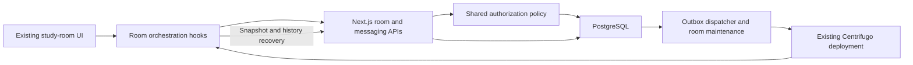
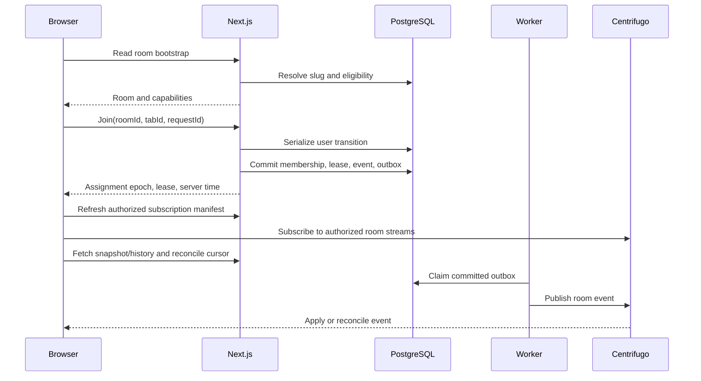

# Study-room backend and frontend integration plan

## 1. Outcome and scope

**The current study-room frontend is not connected end to end.** The repository contains backend building blocks, but the active room screen still renders mock participants, fabricated chat history, local messages, and local shared-environment state.

This requires more than adding API calls. Some existing routes bypass the newer services, and several backend operations need stronger authorization, concurrency control, and event delivery.

The implementation must preserve the recent room redesign while making these features real:

- Database-backed room discovery and stable room URLs.
- Authenticated joining, leaving, switching, and reconnecting.
- Multiple real users and multiple tabs.
- Accurate participants and counts.
- Persistent room chat.
- Durable personal focus sessions.
- Shared sprint and environment synchronization.
- Real goals, tasks, roles, and activity.
- Recovery when browsers, networks, workers, or Centrifugo fail.

**This document is a plan only. No implementation files were changed or tests executed during this audit.**

The inspected checkout is `4fb3e067`, with additional modified and untracked frontend work. Those working-tree changes must be preserved.

---

## 2. Verified gaps in the current implementation

### Repository evidence

| Area | Current implementation | Required correction |
|---|---|---|
| Actual URL | The route is `/studyroom/[roomSlug]`, singular. | Preserve this canonical route. Add a plural redirect only if `/studyrooms/...` links exist or are required. |
| Dynamic room page | [`page.tsx`](D:/ThisPC/Documents/SideQuestHQ/undone-site/src/app/(dashboard)/studyroom/[roomSlug]/page.tsx) resolves rooms through the client-side static catalog and accepts `viewAs`. | Resolve real database rooms; obtain authenticated capabilities from the server. Remove production role overrides. |
| Discovery | [`StudyRoomScreen.tsx`](D:/ThisPC/Documents/SideQuestHQ/undone-site/src/client/screens/dashboard/studyroom/StudyRoomScreen.tsx) uses `ROOM_CATALOG` and `MOCK_ROSTERS`. | Fetch real rooms and real aggregate counts. Keep visual metadata separately. |
| Room screen | [`RoomScreen.tsx`](D:/ThisPC/Documents/SideQuestHQ/undone-site/src/client/screens/dashboard/studyroom/room/RoomScreen.tsx) composes local timer, environment, goals, and mock roster. | Add a room orchestration hook that connects the existing components to authoritative state. |
| Identity and roles | [`deriveParticipants.ts`](D:/ThisPC/Documents/SideQuestHQ/undone-site/src/client/screens/dashboard/studyroom/utils/deriveParticipants.ts) includes `demo-viewer`, query-driven roles, static ownership, and manufactured join times. | Render authenticated identity, actual roles, and database timestamps. |
| Room chat | [`RoomSocial.tsx`](D:/ThisPC/Documents/SideQuestHQ/undone-site/src/client/screens/dashboard/studyroom/room/components/RoomSocial.tsx) initializes `DEFAULT_MESSAGES`; sending appends to component state. | Use persistent messaging APIs and subscriptions. |
| Other fabricated UI | `RoomSocial` uses `participants.length || 3`, a hardcoded current-user study label, and microphone-muted indicators without media state. | Render actual values; remove unsupported media indicators. |
| Join/leave API | [`/api/studyroom`](D:/ThisPC/Documents/SideQuestHQ/undone-site/src/app/api/studyroom/route.ts) still performs older participant/counter operations directly. GET also seeds rooms and publicly caches participant profiles. | Route through the authoritative service; remove GET writes and public participant responses. |
| Client/backend mismatch | [`studyRoomRepository.ts`](D:/ThisPC/Documents/SideQuestHQ/undone-site/src/client/repositories/studyRoomRepository.ts) expects leases and `renew_lease`; the inspected main route does not implement that lifecycle. | Establish one shared contract and route it to the newer service. |
| Lease service | [`studyroom.service.ts`](D:/ThisPC/Documents/SideQuestHQ/undone-site/src/server/domain/studyroom/studyroom.service.ts) has leases and reconciliation, but transactions do not explicitly serialize all competing user transitions. Leave is not generation-fenced. | Serialize transitions and reject stale operations. |
| Cleanup worker | [`messaging-worker.ts`](D:/ThisPC/Documents/SideQuestHQ/undone-site/src/server/messaging-worker.ts) dispatches messaging outbox records. No production call to `reconcileExpiredLeases` was found in `src`. | Schedule and monitor real room reconciliation. |
| Shared environment | [`useSharedEnvironment.ts`](D:/ThisPC/Documents/SideQuestHQ/undone-site/src/client/screens/dashboard/studyroom/hooks/useSharedEnvironment.ts) is local state. Backend environment service exists separately. | Connect them; add atomic revisions and reliable events. |
| Environment service | [`environment.service.ts`](D:/ThisPC/Documents/SideQuestHQ/undone-site/src/server/domain/studyroom/environment.service.ts) lazily writes during reads, checks revisions before a separate update, and does not enqueue room events. | Initialize administratively; use transactional compare-and-update plus outbox. |
| Sprint authority | [`sprint.service.ts`](D:/ThisPC/Documents/SideQuestHQ/undone-site/src/server/domain/studyroom/sprint.service.ts) permits any participant to control rooms with no assigned controllers. | Replace accidental fallback with explicit room-control policy. |
| Personal sessions | [`session.service.ts`](D:/ThisPC/Documents/SideQuestHQ/undone-site/src/server/domain/studyroom/session.service.ts) persists sessions, but transitions lack expected-version checks. Completion awards the entire target duration. | Enforce concurrency and honest elapsed-time semantics. |
| Subscription manifest | [`manifest.service.ts`](D:/ThisPC/Documents/SideQuestHQ/undone-site/src/server/domain/messaging/manifest.service.ts) uses literal `g1` for room streams and checks lowercase `active`; room seeding uses uppercase `ACTIVE`. | Normalize status and resolve actual stream generations. |
| Subscription authorization | [`proxy-auth.service.ts`](D:/ThisPC/Documents/SideQuestHQ/undone-site/src/server/domain/messaging/proxy-auth.service.ts) checks participant rows, without a live-lease check in the inspected room branches. | Require current authorized participation and unexpired leases. |
| Message authorization | [`message.service.ts`](D:/ThisPC/Documents/SideQuestHQ/undone-site/src/server/domain/messaging/message.service.ts) checks room status in its room branch, without checking sender participation there. | Enforce room eligibility and live membership inside the domain service. |
| Tasks | [`useUnifiedTasks.ts`](D:/ThisPC/Documents/SideQuestHQ/undone-site/src/client/hooks/useUnifiedTasks.ts) uses the browser storage adapter shared with other screens. | Preserve shared task behavior while adding authenticated server persistence. |
| Schema compatibility | [`messaging-phase8-studyroom.sql`](D:/ThisPC/Documents/SideQuestHQ/undone-site/prisma/messaging-phase8-studyroom.sql) uses snake_case columns for several fields, while inspected Prisma fields lack matching field mappings. | Verify deployed schema before migration or rollout; reconcile mappings safely. |

**The earlier completion ledger is not sufficient evidence of a working room experience.** Runtime wiring, actual database compatibility, and multi-user behavior must be demonstrated independently.

---

## 3. Architecture and authoritative state

Reuse the existing Next.js, Prisma/PostgreSQL, messaging outbox, Centrifugo transport, and client realtime provider.

Do not create another independent chat stack or a second WebSocket connection for study rooms.



### Ownership boundaries

| State | Authority |
|---|---|
| Room identity, slug, availability, scope, controllers | PostgreSQL |
| Current room assignment and tab leases | PostgreSQL |
| Participant count | Distinct users with valid matching leases; cached counts are derived |
| Messages, reactions, edits, read positions | Existing durable messaging models |
| Personal session transitions and credited time | PostgreSQL |
| Shared sprint and environment | PostgreSQL |
| Private tasks and saved goals | Authenticated application persistence |
| Shared public goal/status | Explicit room-safe projection |
| Typing | Ephemeral, authenticated, rate-limited |
| Audio playback permission, personal mute, local volume | Browser |
| Panel visibility, unsent draft, temporary animation state | Browser |
| Event transport | Centrifugo; never the durable database |

### Cohort access

Use one entitlement policy:

- Global study rooms: available to authenticated, eligible non-guest accounts.
- Cohort rooms: access follows the cohort’s existing visibility, enrollment, and restrictions.
- Joining/enrolling in a cohort grants access to its enabled rooms and chats.
- Opening a room does not silently enroll someone in a private cohort.
- Room presence is a current occupancy record, **not a separate chat-membership entitlement system**.
- Leaving or losing cohort access immediately removes permission to use its rooms.

---

## 4. Core contracts and lifecycle

### Room bootstrap

Add a read-only endpoint:

`GET /api/studyroom/[roomSlug]`

Return:

- Room ID, stable slug, title, status, scope, visual preset key.
- Authenticated viewer ID and capabilities.
- Current room assignment, if any.
- Room chat channel ID.
- Shared environment and revision.
- Current sprint and revision.
- Personal active session.
- Server time.
- Relevant stream identifiers and snapshot cursors.

Return sensitive roster/history only after the applicable authorization and participation checks.

A GET must never create a room, join a user, or initialize persistent environment records.

### Joining



Use an explicit join action on room entry. Opening a different room while already participating elsewhere must show a switch confirmation.

React Strict Mode, retries, and remounts must not create duplicate membership or repeated switching.

### Lease rules

Retain the existing proposed timings initially:

- Lease duration: 90 seconds.
- Renewal: approximately every 30 seconds, with jitter.
- Reconciliation: at most every 15 seconds.
- Operational cleanup target: absent users removed within 120 seconds under healthy infrastructure.

Every mutation must include enough identity to reject stale work:

`roomId + tabId + assignmentEpoch + requestId`

Use an assignment epoch that does **not reset after deletion/rejoin**. A persistent user-level counter or durable assignment record is preferable to a counter stored only on a deletable participant row.

Distinguish:

- **Assignment epoch:** fences an individual user’s old requests.
- **Realtime stream generation:** controls a shared stream’s subscription identity.

They must not be conflated.

### Leaving and switching

- Normal navigation away releases this tab’s lease.
- Other active tabs in the same room preserve the participant.
- A clearly labeled “leave on all devices” action releases all leases.
- Switching changes the user’s room globally and informs older tabs.
- Old tabs stop renewal and show “Your active room changed.”
- Late leave/renew requests cannot remove or recreate a newer assignment.
- Tab-close requests are best effort. Lease expiry provides correctness.

---

## 5. API and database work

### API inventory

| Endpoint | Planned responsibility |
|---|---|
| `GET /api/studyroom` | Real eligible room catalog; safe metadata/counts; no profiles in public caches; no seeding |
| `GET /api/studyroom/[roomSlug]` — new | Bootstrap and capabilities |
| `POST /api/studyroom` | Validated join, renew, leave, switch actions routed through one domain service |
| `GET /api/studyroom/roster?roomId=…` | Authorized live roster, roles, public statuses, server time |
| `GET/POST/PATCH /api/studyroom/session` | Personal focus lifecycle with version checks and request deduplication |
| `GET /api/studyroom/session/history` — new | User-owned paginated focus history |
| Existing environment endpoint | Authorized snapshot and revision-checked updates |
| Existing sprint endpoints | Start, join, leave, pause, resume, stop with validated state transitions |
| `PATCH /api/studyroom/[roomSlug]/status` — new | Publish the caller’s public goal/status with privacy controls |
| Existing messaging APIs | Room messages and interactions through shared authorization |
| Room event recovery endpoint — new or existing journal adapter | Cursor-based reconciliation or explicit snapshot reset |
| Private task API — new if no suitable existing persistence contract exists | User-owned task CRUD, revisioning, import |
| Existing realtime token/manifest endpoints | Refresh room subscriptions after participation changes |

The existing message endpoint path contains `community/channels`. Either generalize its implementation with a neutral route alias or introduce `/api/channels/[channelId]/messages` backed by the same domain service. Preserve compatibility; do not copy the messaging implementation.

### Required database changes

Reuse existing models wherever possible.

| Model/area | Required change |
|---|---|
| `StudyRoom` | Stable unique slug; explicit normalized status; optional cohort relationship; visual preset key |
| Room assignment | Persistent monotonic epoch or durable assignment identity that survives leaving |
| `RoomParticipant` / `RoomLease` | Matching room/epoch integrity; indexed active-lease lookup; fenced mutations |
| `StudySession` | Version-checked transitions; actual elapsed time; distinguish focus/break if both are persisted |
| Active session integrity | Partial unique constraint allowing at most one ACTIVE/PAUSED personal session per user |
| `RoomSprint` | Atomic revisions; partial unique constraint for one active/paused sprint per room |
| `RoomEnvironment` | Persist the actual frontend environment contract; atomic revision updates |
| Public participant state | Explicit public goal/status fields or a scoped companion record; revision and expiry semantics |
| Private goals/tasks | User-owned records only where existing persistence cannot be reused; no room-wide task payloads |
| `RealtimeEvent` / outbox | Room membership, environment, sprint, and session events using existing infrastructure |
| Controllers | Explicit roles; no implicit authority from missing controller rows |

Before introducing constraints, identify and resolve conflicting historical rows without deleting user data arbitrarily.

Verify all SQL names against Prisma mappings and the deployed database. The observed phase-8 column mismatch is a **release blocker until resolved**.

---

## 6. Event contracts and reconciliation

Use the existing namespaces:

- `room:<roomId>:g<streamGeneration>`
- `roomchat:<channelId>:g<streamGeneration>`
- Existing authenticated per-user stream for private session and assignment changes.

Clients obtain names from the server manifest.

Common durable envelope:

`eventId, schemaVersion, type, streamId, sequence, occurredAt, entityId, entityRevision, payload`

| Event | Audience | Persistence and client behavior |
|---|---|---|
| `room.participant.joined` | Authorized active room users | Commit membership and event together; reconcile roster |
| `room.participant.left` | Authorized active room users | Include explicit/switch/expiry reason; remove only matching membership identity |
| `room.roster.changed` | Authorized active room users | Versioned roster/count invalidation after repair or bulk changes |
| `room.assignment.changed` | Affected user | Durable private event; older tabs stop renewal |
| `room.participant.status.changed` | Authorized active room users | Only explicitly public goal/status; reject older revisions |
| `room.environment.updated` | Authorized active room users | Snapshot or revisioned payload; update shared controls |
| `room.sprint.updated` | Authorized active room users | State, revision, deadline, server time; no per-second events |
| `study.session.updated` | Session owner | Private durable session snapshot; synchronize devices |
| Existing message events | Authorized room-chat subscribers | Reuse message IDs, sequences, revisions, deduplication |
| Typing | Authorized room-chat subscribers | Ephemeral; expires locally; no journal |
| Task/goal changes | Owner only | Private invalidation or versioned event |

All durable mutations must enqueue events within the same transaction as state changes.

Delivery is **at least once**:

- Deduplicate by event/message ID.
- Reject older entity revisions.
- Detect stream-sequence gaps.
- Recover from the event journal or reload a consistent snapshot.
- Treat Centrifugo history recovery as an optimization.
- On expired cursors, return an explicit reset requirement.

For bootstrap races, subscribe and buffer publications, fetch a snapshot with a defined cursor, then apply only later events. Do not assume an ordinary set of unrelated queries produces a consistent snapshot.

### Revocation

HTTP authorization must fail immediately after access removal.

For sockets:

- Trigger server-side unsubscribe/disconnect for affected users.
- Recheck authorization during subscription renewal.
- For strict confidentiality during failed unsubscribe delivery, advance the affected stream generation and publish future events only to the new generation.
- Refresh eligible users’ manifests.
- State and test the resulting revocation window; do not claim proxy checks alone instantly revoke an established subscription.

---

## 7. Existing UI: required behavior for every control

| UI/component | Required behavior |
|---|---|
| Discovery cards | Real rooms/counts; no sampled fake peers |
| Room title/switcher | Database room identity; confirmed, fenced switching |
| People list | Real roster; one row per user; actual role and join time |
| Host badge | Server capability/role only |
| Invite/share | Canonical clean URL; never copy `viewAs`; private-room links do not bypass enrollment |
| Chat composer | Durable send with request ID; pending/failed/sent states; preserve draft on failure |
| Chat history | Keyset pagination, reconnect recovery, real authors and timestamps |
| Emoji/reaction controls | Real mutation or remove unavailable action |
| Chat options | Implement permitted actions; remove empty handlers |
| Focus start/pause/resume | Server transition; optimistic UI reconciled with response |
| Reset/skip | Explicit interruption/transition; never award unfinished focus time |
| Timer settings | Persist user preference; changing an active session requires an explicit rule |
| Shared sprint | Separate from personal timer; opt-in participant association |
| SceneDock | Controller-authorized shared update, persisted and broadcast |
| Music settings | Persist supported source metadata; validate URLs and align frontend/backend provider support |
| Sound remix | Decide shared preset/mix versus personal gain; persist only shared settings |
| Personal mute/volume | Local preference; never changes other users’ playback |
| Goal editor | Private by default; public projection only after explicit sharing |
| Tasks | Same real user-owned task data across study room, home, and notes |
| Activity feed | Real durable actions; no invented accomplishments |
| Leave dialog | Accurate consequences for this tab, personal session, and shared sprint |
| Microphone/video indicators | Remove unless actual media infrastructure exists |

Music source synchronization does not guarantee synchronized third-party playback. Browser autoplay consent and personal playback controls remain necessary.

Voice/video is a separate media project; Centrifugo does not supply media transport.

---

## 8. Sequential implementation roadmap — 13 phases

Each phase requires reviewed evidence before dependent work begins. Parallel work is permitted only after shared contracts are fixed.

### Phase 1 — Baseline, contracts, and preservation

**Work**

- Inventory current modified/untracked files and preserve the redesign.
- Read both study-room and messaging memory documents against actual source.
- Verify deployed table/column names, migrations, worker process, and realtime provider placement.
- Record room scope, controller policy, history policy, switch semantics, and session credit rules.
- Create a control-to-endpoint checklist from Section 7.

**Parallel assignments**

- Agent A: schema and service audit.
- Agent B: UI/control inventory.
- Agent C: tests, runtime wiring, and deployment audit.
- Integrator: final shared contracts and conflicts.

**Acceptance:** every displayed control has an authority and implementation owner; schema discrepancies are documented.

**Rollback:** documentation-only phase.

### Phase 2 — Stable room identity and safe catalog

**Work**

- Add/backfill stable slugs without replacing room IDs.
- Normalize status values across services, manifests, and schema.
- Associate rooms with cohort scope where applicable.
- Ensure every real room has its channel, stream, environment, and deliberate controller policy.
- Move initialization out of GET into explicit provisioning.
- Replace static discovery data with the real catalog.
- Keep background/scene catalogs as legitimate presentation assets.

**Tests:** slug collisions, renamed rooms, disabled rooms, private scope filtering, GET performs no writes.

**Acceptance:** a database room appears in discovery and opens by slug; nonexistent rooms return 404.

**Dependency:** Phase 1.

**Rollback:** disable dynamic discovery while retaining additive fields; never restore public profile leakage.

### Phase 3 — Unified room authorization and bootstrap

**Work**

- Implement one policy used by bootstrap, roster, join, messaging, environment, sprint, search, and realtime proxy.
- Enforce cohort enrollment rather than separate chat membership.
- Deny shared guest accounts.
- Replace `viewAs`, `demo-viewer`, and static ownership with server capabilities.
- Add read-only bootstrap.

**Parallel assignments:** server policy/API; frontend capability rendering; negative authorization tests.

**Acceptance:** outsiders cannot read/post/subscribe; eligible users can join; query parameters cannot grant control.

**Rollback:** disable room entry; retain hardened authorization.

### Phase 4 — Correct membership, leases, and cleanup

**Work**

- Refactor main POST route to call the lease-aware service.
- Serialize join/switch/renew/leave per user, including first join.
- Use persistent assignment epochs and idempotency keys.
- Fence tab-specific and global leave.
- Enforce active room status and matching unexpired lease authorization.
- Add maintenance scheduling with bounded batches and monitored execution.
- Coordinate sweep and renewal so cleanup cannot delete freshly renewed participation.
- Produce membership events transactionally.

**Tests:** parallel joins, switch versus renewal, old leave after switch, expiry versus renewal, duplicate request.

**Acceptance:** one active room per user, two tabs count once, no stale request damages newer state, cleanup meets the 120-second target.

**Rollback:** turn off entry if lifecycle fails; do not return to increment/decrement-only counters.

### Phase 5 — Connect the actual room screen

**Work**

- Introduce a room orchestration hook around the existing repository and realtime context.
- Implement states: loading, eligible, joining, joined, reconnecting, switched elsewhere, denied, unavailable.
- Manage tab identity, renewal, route transition cleanup, and logout.
- Pass real data into existing visual components.
- Refresh subscription manifest after assignment changes.
- Prevent late responses from a previous room populating the new screen.

**Tests:** Strict Mode, refresh, deep link, back navigation, account switch, two tabs, slow responses.

**Acceptance:** opening the actual `/studyroom/[roomSlug]` experience creates real participation and renders a real roster.

**Rollback:** feature flag room entry; preserve the redesigned components.

### Phase 6 — Room events and recovery

**Work**

- Remove hardcoded room `g1` manifest entries.
- Wire room mutations through the existing event journal/outbox.
- Add snapshot/cursor recovery.
- Implement subscription cleanup and authorization loss handling.
- Add bounded HTTP fallback while realtime is unavailable.
- Distinguish “reconnecting” from “not authorized.”

**Tests:** worker crash after commit, duplicate publication, dropped event, out-of-order revisions, expired history, broker restart.

**Acceptance:** clients converge without refresh; committed changes survive publishing failures.

**Rollback:** authenticated HTTP snapshots and history refresh remain usable.

### Phase 7 — Persistent room chat

**Work**

- Remove `DEFAULT_MESSAGES` and local-only send behavior.
- Reuse `Channel`, `Message`, reactions, read state, and outbox.
- Harden room access inside every messaging domain operation.
- Add real history, optimistic send, failed-send retry, and pagination.
- Use stable request IDs across retries.
- Implement or remove every visible chat action.

**Parallel assignments:** API authorization; UI/message adapter; multi-user tests.

**Acceptance:** two real accounts exchange messages; refresh/device change preserves history; unauthorized access fails; an empty room has empty chat.

**Rollback:** retain authorized HTTP chat while realtime is disabled.

### Phase 8 — Durable personal focus sessions

**Work**

- Connect `usePomodoro` presentation to server session commands.
- Add expected versions and atomic state transitions.
- Enforce one active/paused session using database integrity.
- Compute countdown from server deadline and estimated clock offset.
- Distinguish focus time, breaks, interruption, and completion.
- Prevent early completion from crediting an entire target duration.
- Finalize expired sessions through maintenance or guarded reconciliation.
- Preserve an ongoing personal session when leaving a room unless the user explicitly stops it; separate its historical room association from current presence.

**Tests:** competing devices, clock skew, sleeping tab, early completion, repeated completion, pause/resume races.

**Acceptance:** the same user sees consistent timer state on another device and accurate durable history.

**Rollback:** disable new session starts while retaining history and safe terminal actions.

### Phase 9 — Shared sprints and environment

**Work**

- Connect existing sprint routes to visible shared-session UI.
- Keep personal sessions distinct from shared sprint state.
- Make sprint revisions and active-sprint uniqueness atomic.
- Replace permissive controller fallback.
- Connect scene, music, and ambience controls to persisted environment updates.
- Require revisions; resolve 409 conflicts by reloading authoritative state.
- Align frontend IDs and provider formats with backend validation.
- Broadcast changes through the outbox.

**Parallel assignments:** sprint service/UI; environment service/UI; role/concurrency tests.

**Acceptance:** authorized changes appear on another participant’s screen; unauthorized users cannot change shared settings; refresh preserves settings.

**Rollback:** freeze shared controls and retain the last valid environment.

### Phase 10 — Real goals, tasks, status, and activity

**Work**

- Persist private goals and user-owned tasks.
- Reuse the unified task interface across home, notes, and rooms.
- Audit existing notes persistence before adding another task store.
- Support idempotent import of local tasks after confirming account ownership; never silently upload ambiguous shared-browser data.
- Publish only explicitly shared goals/status.
- Remove published goal text when privacy changes.
- Build activity from real events and durable sessions.
- Remove fabricated study labels and microphone indicators.

**Tests:** account isolation, import retry, multi-device edits, privacy change, logout cache clearing.

**Acceptance:** tasks survive devices; private goals never appear in room responses/events; no fake participant activity remains.

**Rollback:** disable sharing/import while preserving private records and local recovery data.

### Phase 11 — Security, errors, and operational completion

**Work**

- Validate all inputs, payload sizes, duration limits, scene IDs, and supported URLs.
- Apply rate limits to joins, renewals, chat, typing, and shared controls.
- Verify CSRF/origin behavior for authenticated mutations.
- Ensure anonymous/public caches never include participant profiles or private state.
- Add metrics for renewal failures, reconciliation lag, outbox age, join latency, version conflicts, and authorization failures.
- Exercise room access revocation and old socket behavior.
- Add readiness checks for actual dependencies.

**Acceptance:** malicious requests fail; private data remains scoped; failures are visible and actionable.

**Rollback:** disable individual mutations with feature flags; retain security checks.

### Phase 12 — Integrated multi-user and load validation

**Work**

- Run actual route/browser tests against disposable PostgreSQL and real Centrifugo.
- Use at least three accounts and multiple browser contexts.
- Test one hot room and distributed rooms.
- Test lease traffic independently from message traffic.
- Exercise reconnect storms and worker/broker downtime.
- Compare UI counts with authoritative lease queries.
- Record measured results, not inferred capacity.

**Initial proposed staging target:** 100 concurrent users, 150 tabs, 10 rooms, plus a 100-user hot-room test. Increase only after baseline correctness.

**Acceptance targets:** healthy-network room changes visible within two seconds; no duplicate durable message from retries; no unauthorized delivery; cleanup within 120 seconds; stable database connection use.

**Rollback:** reduce release concurrency or delay launch when targets fail.

### Phase 13 — Controlled rollout and handoff

**Work**

- Rehearse schema repair/additive migrations and backup restoration.
- Deploy compatible backend and workers before enabling the frontend.
- Provision actual room records and controllers.
- Enable internal accounts, then a small real cohort.
- Monitor for 24–48 hours before expansion.
- Verify session totals, counts, message persistence, and permission revocation.
- Update repository memory to describe the actual runtime path.
- Produce a control-by-control acceptance report.

**Acceptance:** the full release gate below passes with real users and real services.

**Rollback:** disable room entry or individual features, retain data, keep maintenance running, and use secure HTTP fallback where available.

---

## 9. Test and verification plan

### Required end-to-end cases

| ID | Scenario | Observable result |
|---|---|---|
| ROOM-01 | Open a database room by slug | Correct real room loads; no static-only dependency |
| ROOM-02 | Two accounts join | Both see each other and count 2 |
| ROOM-03 | One account opens two tabs | One participant, two leases |
| ROOM-04 | Close one tab | Participant remains |
| ROOM-05 | Crash all tabs | Participant disappears within cleanup target |
| ROOM-06 | Switch rooms, then deliver old leave | New membership survives |
| ROOM-07 | Concurrent switch requests | One authoritative assignment; no ghost leases |
| ROOM-08 | Private cohort outsider opens URL | No roster/history/subscription access |
| ROOM-09 | Enroll in eligible cohort | Enabled room/chat becomes accessible without extra chat membership |
| ROOM-10 | Remove cohort access while connected | API access fails and old realtime access is revoked |
| CHAT-01 | Send, refresh, open another device | Exactly one persistent message is visible |
| CHAT-02 | Commit succeeds, publishing fails | Message survives; later event or reconciliation reveals it |
| CHAT-03 | Duplicate/out-of-order events | No duplicates or regression |
| FOCUS-01 | Start/pause/resume from two devices | Versioned consistent state |
| FOCUS-02 | Complete early or retry completion | No fabricated credited time or duplicate terminal record |
| SPRINT-01 | Controller starts/pauses shared sprint | Participants see consistent server-time state |
| ENV-01 | Controller changes scene/music | Other users update; refresh preserves selection |
| ENV-02 | Two concurrent environment edits | One valid update; conflicting writer receives 409 |
| PRIV-01 | Private goal/task exists | Another user cannot fetch or receive it |
| PRIV-02 | Shared goal becomes private | Projection is removed from room state |
| FAIL-01 | Broker unavailable | Explicit degraded state; authorized HTTP recovery works |
| FAIL-02 | Database unavailable | No fabricated successful join/send/session completion |
| UI-01 | Empty room | Zero peers and empty chat; no fallback sample data |

### Commands to run later

These are verification instructions, not commands executed during this audit:

```text
npx prisma validate
npx tsc --noEmit
npx vitest run src/server/domain/studyroom
npx vitest run src/app/api/studyroom
npx vitest run src/client/screens/dashboard/studyroom
npx vitest run src/server/infrastructure/realtime
npm run messaging:worker:check
npm run build
```

Add route/browser and real-database integration suites in the repository’s agreed test harness. If browser testing is not already configured, configure it during implementation and document its exact command.

`messaging:worker:check` verifies imports only; it does not prove database connectivity, dispatch, reconciliation scheduling, or room functionality.

Do not run destructive tests or test migrations against production.

---

## 10. Release gate

The integration is complete only when all of the following are demonstrated:

- [ ] The real `/studyroom/[roomSlug]` screen is connected.
- [ ] Discovery and room identity come from PostgreSQL.
- [ ] No production mock roster, sample message, fake identity, fabricated count, or query-driven role remains.
- [ ] Existing frontend redesign is preserved.
- [ ] Cohort access follows enrollment and visibility policy.
- [ ] Join, renew, switch, leave, expiry, and revocation work under concurrency.
- [ ] Multiple tabs count as one person.
- [ ] Room chat persists across refreshes and devices.
- [ ] Personal focus history reflects actual elapsed time.
- [ ] Shared sprints and environment changes synchronize.
- [ ] Tasks and private goals remain account-isolated.
- [ ] Every visible control works or is explicitly removed.
- [ ] PostgreSQL schema matches the Prisma client.
- [ ] Maintenance and outbox workers are running and monitored.
- [ ] Network recovery and service-outage tests pass.
- [ ] Real multi-user browser tests pass against the actual room route.
- [ ] Rollback preserves durable user data.
- [ ] Documentation records measured evidence rather than marking isolated backend services as end-to-end completion.
