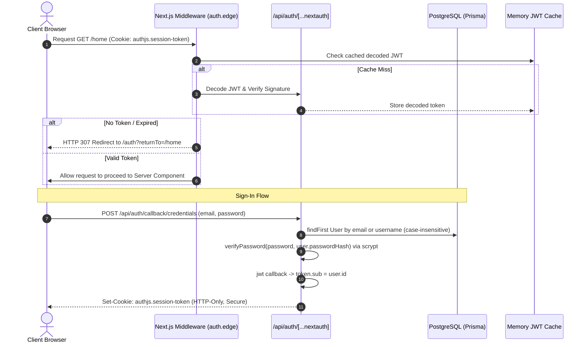
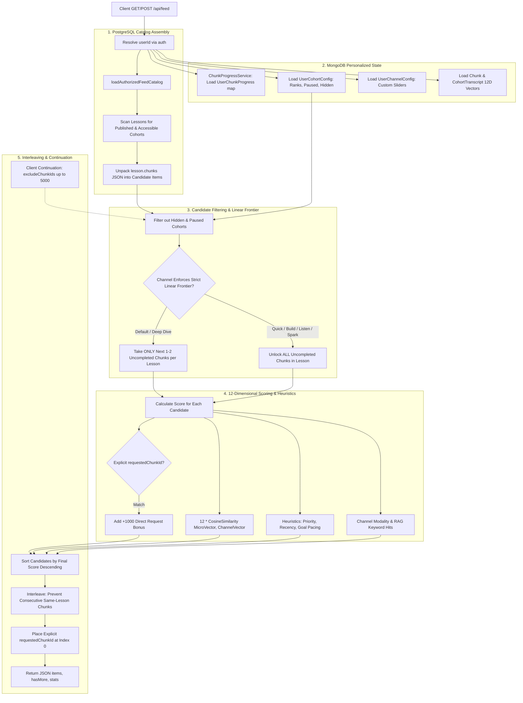
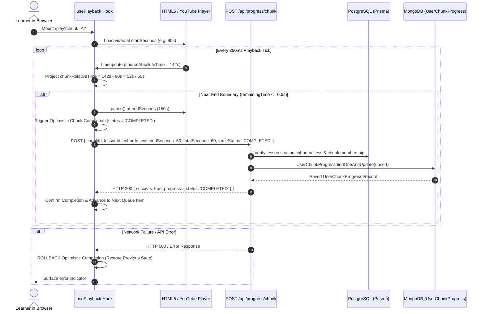
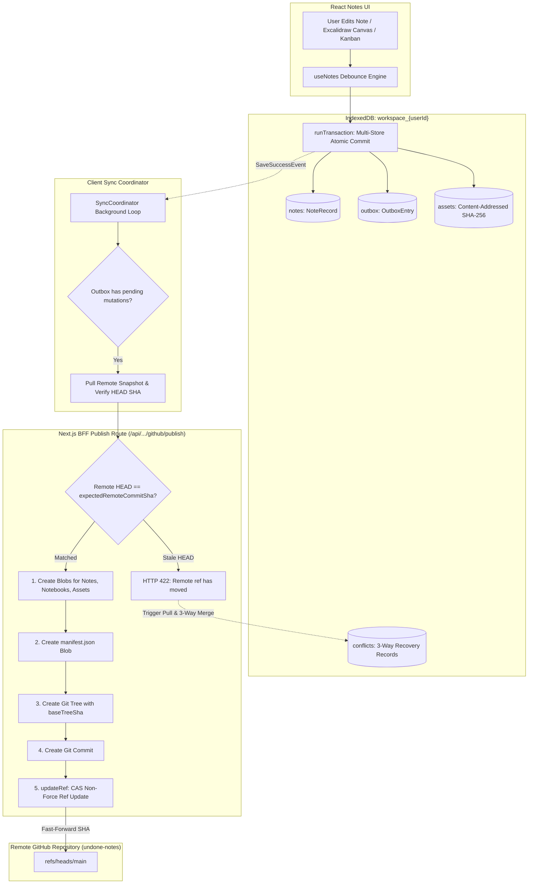

# The Undone Engineering Manual: Complete Architecture & Implementation Deep-Dive

> **Audience:** Core Engineering & System Maintainers.  
> **Status:** Authoritative System Specification & Code Walkthrough.  
> **Base Target:** Full Production Stack (Next.js 15/16 App Router, Node 24, PostgreSQL via Prisma, MongoDB via Mongoose, Web Workers, IndexedDB).  
> **Excluded Subsystems (Deferred):** `/messages` (Centrifugo chat) and `/studyroom` (Web Audio / multi-presence).

---

## Table of Contents
1. [Executive Architecture & Global System Topography](#1-executive-architecture--global-system-topography)
2. [Database Architecture & Dual-Store Topography (PostgreSQL + MongoDB)](#2-database-architecture--dual-store-topography-postgresql--mongodb)
3. [Authentication, Identity & Authorization Subsystem](#3-authentication-identity--authorization-subsystem)
4. [Cohort Creation & AI Interaction Builder Pipeline](#4-cohort-creation--ai-interaction-builder-pipeline)
5. [The Feed Recommendation & Discovery Engine](#5-the-feed-recommendation--discovery-engine)
6. [The Feed Player (`/play`) & Progress Loop](#6-the-feed-player-play--progress-loop)
7. [Home Dashboard & Derived Completion Engine](#7-home-dashboard--derived-completion-engine)
8. [Personal Workspace & Notes (Local-First Durability + GitHub Sync)](#8-personal-workspace--notes-local-first-durability--github-sync)
9. [End-to-End Traces & Failure Modes ("What Happens When...")](#9-end-to-end-traces--failure-modes-what-happens-when)

---

## 1. Executive Architecture & Global System Topography

Undone is structured around a **3-Layer Architecture** designed to tame LLM non-determinism with deterministic transactional engines:
1. **Layer 1: Directive (Intent / Goals)**: High-level requirements, user prompts, curriculum goals, and learning requests.
2. **Layer 2: Orchestration (Agentic Decision Making)**: Next.js API route adapters and the background `InteractionWorker` loop running Gemini models to interpret intent, call validated tools, and stage mutations.
3. **Layer 3: Execution (Deterministic Engines)**: Pure algorithmic pipelines (SHA-256 hashing, DAG schedulers, text chunkers, the 12-dimensional vector feed scoring engine, and Git Data API CAS sync).

```mermaid
flowchart TD
    subgraph Client ["Client Device / Browser"]
        CP[LearningPromptBar & Extractors]
        PL[Play Screen & usePlayback]
        HM[Home Dashboard & useHome]
        NT[Personal Workspace IndexedDB]
    end

    subgraph Edge ["Next.js BFF / Edge Middleware"]
        MW[middleware.ts: Auth & Path Guards]
        RT_INTAKE[/api/cohort-builder/intake]
        RT_FEED[/api/feed]
        RT_PROG[/api/progress/chunk]
        RT_NOTES[/api/personal-workspace/github/*]
    end

    subgraph Worker ["Background Execution Worker"]
        IW[interaction-worker.ts]
        DAG[text-job-plan DAG Processor]
        GEMINI[Gemini Flash Lite Interaction Model]
    end

    subgraph PostgreSQL ["PostgreSQL (Prisma) - Source of Truth"]
        USERS[(users, accounts, sessions)]
        COHORTS[(cohorts, seasons, lessons)]
        WS[(interaction_workspaces, runs, events)]
        JOBS[(cohort_text_jobs, artifacts)]
    end

    subgraph MongoDB ["MongoDB (Mongoose) - Learner State & Enrichment"]
        UCP[(UserChunkProgress: Canonical Completions)]
        UCC[(UserCohortConfig: Ranks & Pauses)]
        UCH[(UserChannelConfig: Sliders & Prefs)]
        VEC[(Chunk & CohortTranscript: 12D Vectors)]
    end

    subgraph Remote ["External Services"]
        GH[GitHub Git Data API: Blobs, Trees, Commits, Refs]
        YT[YouTube Video & Transcripts]
    end

    CP -->|POST JSON < 3.5MB| RT_INTAKE
    RT_INTAKE -->|pg_advisory_xact_lock| WS
    IW <-->|Claim & Heartbeat Leases| WS
    IW -->|DAG Jobs| JOBS
    IW <-->|20s Timeout / 1200 Tokens| GEMINI
    IW -->|releaseWorkspace Transaction| COHORTS

    PL -->|GET Feed Candidates| RT_FEED
    RT_FEED -->|Scan Published Lessons| COHORTS
    RT_FEED -->|Read Progress & Prefs| UCP
    RT_FEED -->|Read Prefs & Sliders| UCC
    RT_FEED -->|Optional 12D Vectors| VEC

    PL -->|POST Completed Chunk| RT_PROG
    RT_PROG -->|Verify Access & Chunk ID| COHORTS
    RT_PROG -->|Upsert Status COMPLETED| UCP

    HM -->|SSR: loadHomeForUser| COHORTS
    HM -->|Join All Unique Chunk IDs| UCP

    NT <-->|CAS Sync 422 Retries| RT_NOTES
    RT_NOTES <-->|Blobs & Tree Commits| GH
```

### Physical Directory Map & Responsibilities
- `src/app/`: Next.js App Router endpoints. Route groups `(creation)` and `(dashboard)` organize screen layouts without polluting the public URL structure.
- `src/client/`: All React 19 UI code, custom hooks (`usePlayback`, `useHome`, `useLocalWorkspace`), screen orchestrators, and browser storage drivers (IndexedDB).
- `src/server/domain/`: Pure business logic and domain repositories (e.g., `cohort-builder`, `feed`, `home`, `progress`).
- `src/server/infrastructure/`: Concrete database connections (`postgres/client.ts`, `mongodb/client.ts`), NextAuth configuration, Gemini AI adapters, and GitHub Git Data API clients.
- `src/shared/`: Isomorphic types, runtime Zod validation schemas, and deterministic mathematical algorithms (the 12D pedagogical vector engine, feed scoring, SHA-256 hash).
- `packages/interaction-builder/`: Reusable workspace state-machine engine handling revisions, journaling, events, runs, steps, and tool execution.

---

## 2. Database Architecture & Dual-Store Topography (PostgreSQL + MongoDB)

Undone runs on a **dual-database paradigm**. Understanding the strict ownership boundary between PostgreSQL and MongoDB is vital:

| Concern | Primary Store | Rationale |
|---|---|---|
| **Identity & Auth** | PostgreSQL (`User`, `Account`) | Relational ACID constraints, unique email/username indices, foreign keys to courses. |
| **Course Catalog & Structure** | PostgreSQL (`Cohort`, `Season`, `Lesson`) | Hierarchical tree with strict ownership, permissions, and visibility rules. |
| **AI Workspaces & Job DAGs** | PostgreSQL (`InteractionWorkspace`, `CohortTextJob`) | Deterministic state-machine auditing, sequential event stream, row-level locks. |
| **Learner Chunk Progress** | MongoDB (`UserChunkProgress`) | Ultra-high write frequency (scrubbing, heartbeats, completions), flat key-value lookups. |
| **User Course Ranks & Preferences** | MongoDB (`UserCohortConfig`, `UserChannelConfig`) | Per-user dynamic dashboard ordering, flexible slider vectors, arbitrary custom configurations. |
| **Vectors & Semantic Transcripts** | MongoDB (`Chunk`, `CohortTranscript`) | 12-dimensional pedagogical vectors, dense embedding arrays, and deep transcript caches. |

---

### 2.1 PostgreSQL Implementation (Prisma + `pg.Pool`)

Located in [`src/server/infrastructure/db/postgres/client.ts`](file:///d:/ThisPC/Documents/SideQuestHQ/undone-site/src/server/infrastructure/db/postgres/client.ts).

To prevent connection exhaustion in serverless environments (e.g., Vercel Lambdas) while preserving pool throughput in local Node processes, Prisma is wrapped around `@prisma/adapter-pg` with a singleton pool:

```typescript
export const getPostgresPoolConfig = (overrides?: Partial<PoolConfig>): PoolConfig => {
  const isServerless = process.env.VERCEL === '1' || process.env.AWS_LAMBDA_FUNCTION_NAME !== undefined || process.env.NODE_ENV === 'production';
  return {
    connectionString: process.env.DATABASE_URL,
    max: Number(process.env.DATABASE_POOL_MAX) || (isServerless ? 2 : 10),
    idleTimeoutMillis: isServerless ? 10000 : 30000,
    connectionTimeoutMillis: 5000,
    keepAlive: true,
    statement_timeout: 15000, // 15-second query hard-stop
    ...overrides,
  };
};
```

#### Key PostgreSQL Schema Entities (from `prisma/schema.prisma`)

1. **`Cohort` -> `Season` -> `Lesson` Hierarchy**:
   - `Cohort`: Represents the published course. Key columns: `id`, `creatorId`, `title`, `visibility` (`PUBLIC` | `PRIVATE` | `INVITE_ONLY`), `isPublished`, `creationSettings` (JSON storing release hashes).
   - `Season`: Logical grouping/module within a cohort (`order` int, `title`).
   - `Lesson`: An addressable lesson module. **Crucial detail:** Chunks are stored as a JSON array inside the `chunks` column:
   ```prisma
   model Lesson {
     id           String     @id @default(cuid())
     seasonId     String
     title        String
     duration     Int        // Total duration in seconds
     order        Int
     lessonType   LessonType @default(VIDEO)
     isPublished  Boolean    @default(false)
     videoId      String?    // e.g., YouTube video ID
     videoUrl     String?
     sourceUrl    String?
     chunks       Json?      // Retained chunk array: [{ id, startSeconds, endSeconds, ... }]
     season       Season     @relation(fields: [seasonId], references: [id], onDelete: Cascade)
   }
   ```
   *Why JSON for chunks in SQL?* Lessons are delivered as atomic, versioned snapshots. Storing chunks as a nested JSON structure allows the feed engine to fetch an entire lesson's chunk curriculum in a single sequential query without joining tens of thousands of individual chunk rows.

2. **The Workspace & Agentic Interaction Models**:
   - `InteractionWorkspace`: The draft state of a cohort.
     - `id`: Deterministic UUID.
     - `ownerId`: Foreign key to `User.id`.
     - `snapshot`: Full JSON representation of the draft (`CohortWorkspace`), including current audience, title, generated lessons, and journey state.
     - `revision`: Monotonically increasing integer (used for optimistic concurrency / Compare-And-Swap).
     - `sequence`: Global event cursor.
   - `InteractionRequest`: Idempotency receipts. Stores `(workspaceId, actorId, operation, requestId)` alongside `payloadHash` and `response` JSON.
   - `InteractionRun` & `InteractionStep`: Tracks asynchronous execution of LLM prompts by background workers, recording token usage, timestamps, and model tool calls.
   - `CohortTextJob` & `CohortTextArtifact`: The directed acyclic graph (DAG) representing the pipeline from raw source text down to assembled lessons.

---

### 2.2 MongoDB Implementation (Mongoose Client & Models)

Located in [`src/server/infrastructure/db/mongodb/client.ts`](file:///d:/ThisPC/Documents/SideQuestHQ/undone-site/src/server/infrastructure/db/mongodb/client.ts) and [`src/server/database/mongo/models/`](file:///d:/ThisPC/Documents/SideQuestHQ/undone-site/src/server/database/mongo/models/).

Connection hygiene is maintained using a global connection cache (`global.mongooseCache`) with strict timeouts (`serverSelectionTimeoutMS: 5000`, `maxIdleTimeMS: 10000`).

#### 1. `UserChunkProgress` (The Authoritative Learner Ledger)
Path: `src/server/database/mongo/models/UserChunkProgress.ts`.
```typescript
{
  userId: { type: String, required: true, index: true },
  chunkId: { type: String, required: true, index: true },
  lessonId: { type: String, required: true },
  cohortId: { type: String, required: true },
  status: { 
    type: String, 
    enum: ['NOT_STARTED', 'IN_PROGRESS', 'COMPLETED', 'SKIPPED'],
    default: 'NOT_STARTED' 
  },
  watchedSeconds: { type: Number, default: 0 },
  totalSeconds: { type: Number, default: 0 },
  completedAt: { type: Date, default: null },
  lastWatchedAt: { type: Date, default: Date.now }
}
// Compound unique index guaranteeing idempotency:
UserChunkProgressSchema.index({ userId: 1, chunkId: 1 }, { unique: true });
UserChunkProgressSchema.index({ userId: 1, cohortId: 1 });
```

#### 2. `UserCohortConfig` (Dashboard Ordering & Pause States)
Path: `src/server/database/mongo/models/UserCohortConfig.ts`.
```typescript
{
  userId: { type: String, required: true, index: true },
  cohortId: { type: String, required: true }, // Normalized ID (e.g. stripped of prefix)
  rank: { type: Number, default: 0 },         // Contiguous order on Home: 1..N active, N+1..N+M paused
  isPaused: { type: Boolean, default: false },
  pausedUntil: { type: Date, default: null },
  pausedReason: { type: String, default: null },
  dailyGoalMinutes: { type: Number, default: 20 },
  scheduleDays: { type: [String], default: ['Mon', 'Wed', 'Fri'] }
}
UserCohortConfigSchema.index({ userId: 1, cohortId: 1 }, { unique: true });
```

#### 3. `Chunk` & `CohortTranscript` (12-Dimensional Pedagogical Vectors)
Path: `src/server/database/mongo/models/Chunk.ts` and `CohortTranscript.ts`.
- `vector`: An array of exactly 12 floating point numbers between `0.0` and `1.0`:
  `[cognitive_load, practicality, visual_dependence, scaffolding, linearity, novelty, abstraction, pacing, rigor, interactivity, breadth, emotional_energy]`.
- Used in feed scoring calculations when calculating alignment between learner channel settings and chunk instructional styles.

---

## 3. Authentication, Identity & Authorization Subsystem

Undone uses **Auth.js (NextAuth v5)** with custom extensions for JWT caching, constant-time password verification, and creator auto-provisioning.



### 3.1 Auth Configuration & The JWT Strategy Mandate
Located in [`src/server/infrastructure/auth/auth.config.ts`](file:///d:/ThisPC/Documents/SideQuestHQ\undone-site/src/server/infrastructure/auth/auth.config.ts).

**The Core Rule:** Even though `adapter: PrismaAdapter(prisma)` is attached, the session strategy is explicitly locked to `strategy: 'jwt'`:
```typescript
export const { handlers, auth, signIn, signOut } = NextAuth({
  basePath: '/api/auth',
  adapter: PrismaAdapter(prisma),
  providers: [
    GitHub({ ... }),
    Slack({ ... }),
    Credentials({
      name: 'Credentials',
      credentials: { email: { type: "text" }, password: { type: "password" } },
      async authorize(credentials) {
        // 1. Guest Account Branch
        if (emailInput === 'guest@undone.com') {
          return await getGuestAccount(emailInput, prisma.user);
        }
        // 2. Normal User Lookup with scrypt verification
        const clean = emailInput.trim().toLowerCase();
        const foundUser = await prisma.user.findFirst({
          where: {
            OR: [
              { email: clean },
              { username: { equals: clean.replace(/^@+/, ''), mode: 'insensitive' } },
            ],
          },
        });
        if (!foundUser || !foundUser.passwordHash) return null;
        if (!verifyPassword(passwordInput, foundUser.passwordHash)) return null;
        return { id: foundUser.id, name: foundUser.name, email: foundUser.email, username: foundUser.username };
      }
    })
  ],
  session: { strategy: 'jwt' }, // MANDATORY: NextAuth disables Credentials provider if database sessions are active!
  jwt: {
    async decode(params) {
      if (!params.token) return null;
      const cached = getCachedJwt(params.token);
      if (cached) return cached;
      const decoded = await defaultDecode(params);
      if (decoded) setCachedJwt(params.token, decoded);
      return decoded;
    }
  },
  callbacks: {
    async jwt({ token, user }) {
      if (user) {
        token.sub = user.id; // Map SQL user.id into token.sub
        token.username = (user as any).username ?? 'guest';
      }
      return token;
    },
    async session({ session, token }) {
      if (session.user && token?.sub) {
        session.user.id = token.sub; // Expose session.user.id to React components and API routes
        (session.user as any).username = token.username;
      }
      return session;
    }
  }
});
```

### 3.2 Password Hashing Architecture
Located in [`src/server/infrastructure/auth/password.ts`](file:///d:/ThisPC/Documents/SideQuestHQ/undone-site/src/server/infrastructure/auth/password.ts).

Passwords are NOT hashed with bcrypt. Instead, they use Node’s native `crypto.scrypt` with a random 16-byte salt:
- Stored format: `scrypt:<salt_hex>:<derived_key_hex>`
- Key derivation parameters: `N = 16384`, `r = 8`, `p = 1`, key length = 64 bytes.
- Verification uses `crypto.timingSafeEqual` to eliminate timing attacks.

### 3.3 Creation Owner Resolution (`getCreationOwner`)
Located in [`src/server/infrastructure/auth/getCreationOwner.ts`](file:///d:/ThisPC/Documents/SideQuestHQ/undone-site/src/server/infrastructure/auth/getCreationOwner.ts).

When a creator creates a course, the system must guarantee that a corresponding SQL `User` record exists in PostgreSQL:
1. Calls `getUser()` (cached via React `cache()` for the lifecycle of that request).
2. Tries `prisma.user.findUnique({ where: { id: user.id } })`.
3. If not found by ID but `user.email` exists, looks up by email.
4. If still missing, automatically performs a `prisma.user.upsert` to provision the creator record on the fly.
5. Returns the authoritative SQL `ownerId` string, or `null` if database access fails.

---

## 4. Cohort Creation & AI Interaction Builder Pipeline

This is the most complex subsystem in Undone. It spans client-side browser extractors, idempotent database transactions, background worker execution, directed acyclic graphs (DAGs), and transactional publishing.

```mermaid
flowchart TD
    subgraph Browser ["Client-Side Browser Extraction"]
        INPUT[Creator Prompt + Links/Files]
        EXT_PDF[pdfClientExtractor: Canvas + Worker Text]
        EXT_YT[youtubeClientExtractor: Captions API]
        EXT_WEB[webClientExtractor: Server Sanitized DOM]
        EXT_GH[githubClientExtractor: Octokit Files]
        BUDGET{Text Budget <= 3MB?}
        INPUT --> EXT_PDF & EXT_YT & EXT_WEB & EXT_GH
        EXT_PDF & EXT_YT & EXT_WEB & EXT_GH --> BUDGET
    end

    subgraph Intake ["Intake API & PG Locking"]
        RT_INTAKE[/api/cohort-builder/intake]
        XACT_LOCK[pg_advisory_xact_lock on workspaceId]
        IDEMP_CHECK{InteractionRequest Exists?}
        CREATE_WS[Create InteractionWorkspace snapshot]
        APPEND_MSG[Append InteractionMessage with Source Refs]
        DISPATCH[dispatchInteractionExecution]

        BUDGET -->|POST stream <= 3.5MB| RT_INTAKE
        RT_INTAKE --> XACT_LOCK
        XACT_LOCK --> IDEMP_CHECK
        IDEMP_CHECK -- Yes (Same Hash) --> RETURN_SAVED[Return 202 Cached Response]
        IDEMP_CHECK -- Yes (Diff Hash) --> THROW_409[Throw IDEMPOTENCY_MISMATCH]
        IDEMP_CHECK -- No --> CREATE_WS --> APPEND_MSG --> DISPATCH
    end

    subgraph WorkerLoop ["interaction-worker.ts Loop"]
        POLL[Claim Lease on InteractionRun]
        AI_CALL[Gemini Flash Lite 20s/1200 Tokens]
        TOOL_PLAN[cohortDomain.plan -> Action Validation]
        CAS_COMMIT[Commit Action under expectedRevision]
        SSE[Broadcast Event via /api/interaction/v1/.../events]

        DISPATCH -.-> POLL
        POLL --> AI_CALL
        AI_CALL -->|Tool: add_lesson / set_audience| TOOL_PLAN
        TOOL_PLAN --> CAS_COMMIT
        CAS_COMMIT --> SSE
    end

    subgraph DAG ["Text Job DAG (Processing)"]
        ACQ[Acquisition] --> EXT[Extraction]
        EXT --> UND[Understanding]
        UND --> CHK[Chunking: 60s windows, 15s overlap]
        CHK --> ANA[Analysis: 12D vectors]
        ANA --> ASMB[Assembly: Final Lesson Projection]
    end

    subgraph Release ["Release to Learners"]
        REL_SVC[releaseWorkspace: FOR UPDATE Lock]
        VAL_READY{validateCohortReadiness}
        MAT_COHORT[materializeLearnerCohort: Cohort, Season, Lesson with chunks JSON]

        ASMB --> REL_SVC
        REL_SVC --> VAL_READY
        VAL_READY -- Passed --> MAT_COHORT
    end
```

---

### 4.1 Client-Side Source Extraction & Size Budgets
Located in [`src/client/lib/sourceExtractors/`](file:///d:/ThisPC/Documents/SideQuestHQ/undone-site/src/client/lib/sourceExtractors/) and [`src/client/components/global/Composer/useComposerAttachments.ts`](file:///d:/ThisPC/Documents/SideQuestHQ/undone-site/src/client/components/global/Composer/useComposerAttachments.ts).

To protect serverless Lambda CPU limits and prevent payload timeouts:
- **PDFs**: Rendered on the user’s machine using `pdfjs-dist/build/pdf.worker.min.mjs`. Page 1 is drawn to a hidden `<canvas>` to generate a thumbnail; text spans are parsed in the browser. Scanned PDFs without OCR throw an explicit error rather than inventing text.
- **YouTube**: Captions are fetched from `/api/import/youtube/transcript?videoId=...` and grouped into ~90s windows. If captions are missing, it falls back to video chapter titles with an `estimatedIntervals: true` metadata flag.
- **GitHub**: Fetches up to 25 repository files directly from GitHub REST API with a `pLimit(6)` concurrency gate.
- **Web Pages**: The server proxies the raw HTML (stripping `<script>`, `<style>`, `<noscript>`, `<svg>`), and the browser's native `DOMParser` extracts clean article text.
- **Strict Budget Ceiling**: The client enforces `MAX_TOTAL_TEXT_BYTES = 3,000,000` (3MB). The server's stream reader (`route.ts`) hard-aborts if incoming bytes exceed `3,500,000` (returning HTTP 413 `INPUT_TOO_LARGE`).

---

### 4.2 Idempotent Intake Transaction (`acceptCohortIntake`)
Located in [`src/server/infrastructure/db/postgres/cohort-intake.ts`](file:///d:/ThisPC/Documents/SideQuestHQ/undone-site/src/server/infrastructure/db/postgres/cohort-intake.ts).

When a creator clicks "Plan" or "Generate":
1. **Deterministic Identity**: The `workspaceId` is derived deterministically:
   ```typescript
   const workspaceId = deterministicUuid(`cohort-intake:${ownerId}:${body.requestId}`);
   const payloadHash = computePayloadHash(body);
   ```
2. **Advisory Transaction Lock**: Before the workspace row even exists, PostgreSQL locks the workspace namespace:
   ```sql
   SELECT pg_advisory_xact_lock(hashtextextended($workspaceId, 0))::text
   ```
3. **Idempotency Gate**: Checks `interactionRequest` table. If the same `requestId` was submitted with the exact same payload, it immediately returns the prior response. If the payload hash differs, it rejects with `IDEMPOTENCY_MISMATCH`.
4. **Draft Initialization**: Calls `repo.createWorkspace()` with the initial state from `initialCohort(body.prompt, { mode, sources })`.
5. **Initial User Turn**: Appends an `InteractionMessage` storing the user prompt and source references (`parts: [{ type: 'text', text: body.prompt }, ...sourceRefs]`).
6. **Execution Scheduling**:
   - In **Plan Mode**: Schedules an immediate interactive assistant run (`scheduleRun: true`).
   - In **Search Mode**: Enqueues background DAG generation jobs via `enqueueJourneyJobPlanInTransaction`.
7. **Execution Dispatch**: Calls `dispatchInteractionExecution()` to wake up any active local or cloud background workers.

---

### 4.3 The Worker Execution Loop (`interaction-worker.ts`)
Located in [`src/server/interaction-worker.ts`](file:///d:/ThisPC/Documents/SideQuestHQ/undone-site/src/server/interaction-worker.ts).

The background worker operates in a non-blocking loop:
1. **Interactive Run Priority**: Calls `repo.claimRun({ leaseOwner: workerId, leaseToken, leaseDurationMs: 60_000 })`. Interactive assistant runs are always claimed *before* bulk DAG jobs to ensure user chat never lags behind background text crunching.
2. **Heartbeat Thread**: Spawns an interval timer every 15 seconds to heartbeat `interactionRun.leaseExpiresAt`.
3. **Model Turn Execution**:
   - System prompt is built via `cohortAssistantPrompt(parsedSnapshot, current.revision)`.
   - Invokes `COHORT_CHAT_MODEL` (default: `gemini-3.5-flash-lite`).
   - Guardrails: **20-second hard timeout**, **1,200 max output tokens**, **zero SDK retries** (worker-level recovery handles failure).
4. **Tool Execution & Action Planning**:
   - The model calls tools such as `add_lesson`, `set_audience`, `edit_presentation`, or `draft_curriculum`.
   - Each tool generates an action passed into `cohortDomain.plan(snapshot, action)`.
   - If valid, the new snapshot is committed to PostgreSQL with an optimistic revision check:
     `UPDATE interaction_workspaces SET snapshot = $newSnapshot, revision = revision + 1 WHERE id = $id AND revision = $expectedRevision`.
5. **Real-time Event Streaming**: The worker writes to `InteractionEvent`. Clients subscribed to the SSE stream at `/api/interaction/v1/workspaces/[id]/events` receive atomic wire events (`eventId`, `type`, `revision`, `payload`).

---

### 4.4 The Directed Acyclic Graph (DAG) for Text Processing
Located in [`src/server/domain/cohort-builder/text-job-plan.ts`](file:///d:/ThisPC/Documents/SideQuestHQ/undone-site/src/server/domain/cohort-builder/text-job-plan.ts).

Source documents pass through 6 distinct stages:
```text
Acquisition -> Extraction -> Understanding -> Chunking -> Analysis -> Assembly
```
- **Chunking Algorithm (`text-pipeline.ts`)**:
  - Groups video observations toward roughly 60-second intervals.
  - Enforces a 24 KiB UTF-8 safe boundary per evidence unit.
  - **Playback Overlap Rule**: Generates up to **15 seconds of playback overlap** before the next chunk to give learners narrative continuity. **Critical invariant:** The underlying retained source evidence text boundaries remain pristine and exact; overlap is applied *only* to the player's timestamp schedule!
- **Lease Fencing & Acceptance**:
  - Workers lease a job with an explicit lease fence token.
  - When committing an artifact (`text-job-acceptance.ts`), the transaction validates that the lease has not expired and that prerequisite artifact hashes match.

---

### 4.5 Cohort Materialization & Release (`releaseWorkspace`)
Located in [`src/server/domain/cohort-builder/release-service.ts`](file:///d:/ThisPC/Documents/SideQuestHQ/undone-site/src/server/domain/cohort-builder/release-service.ts) and [`delivery.adapter.ts`](file:///d:/ThisPC/Documents/SideQuestHQ/undone-site/src/server/domain/cohort-builder/delivery.adapter.ts).

When a creator clicks "Publish":
1. Locks the `interaction_workspaces` row `FOR UPDATE`.
2. Validates `validateCohortReadiness`: checks that curriculum has at least 1 lesson, all source evidence is valid, and public requirements are met.
3. **Downgrade Guard**: Prevents an already public cohort from being downgraded to private.
4. Materializes relational records inside a single PostgreSQL transaction:
   - Creates/Updates `Cohort` row.
   - Creates `Season` rows.
   - Creates `Lesson` rows, serializing all chunk definitions into the `Lesson.chunks` JSON column.
   - Enrolls creator into `CohortMember` with role `CREATOR`.
   - Initializes default `Community` and `#general` channel.
5. Advances the workspace lifecycle to `released` and journey step to `published`.

---

## 5. The Feed Recommendation & Discovery Engine

The feed subsystem answers: **"Which chunk should this specific learner watch next?"**

It lives in:
- Route: [`src/app/api/feed/route.ts`](file:///d:/ThisPC/Documents/SideQuestHQ/undone-site/src/app/api/feed/route.ts)
- Catalog Loader: [`src/server/domain/feed/feedCatalog.ts`](file:///d:/ThisPC/Documents/SideQuestHQ/undone-site/src/server/domain/feed/feedCatalog.ts)
- Engine & Scoring: [`src/shared/feed/feedEngine.ts`](file:///d:/ThisPC/Documents/SideQuestHQ/undone-site/src/shared/feed/feedEngine.ts) and [`feedScoring.ts`](file:///d:/ThisPC/Documents/SideQuestHQ/undone-site/src/shared/feed/feedScoring.ts)



### 5.1 Step 1: Catalog Assembly from PostgreSQL
The route calls `loadAuthorizedFeedCatalog({ userId, cohortId, lessonId })`:
- Scans `prisma.lesson` for published lessons where the parent cohort is published and accessible to the user (via `accessibleCohortWhere(userId)`).
- Parses the `lesson.chunks` JSON array.
- Validates chunk schemas and normalizes `durationMethod`, `startSeconds`, `endSeconds`, and `timeRangeLabel`.

### 5.2 Step 2: Personalized State Enrichment from MongoDB
The route connects to MongoDB and fires parallel reads:
1. `ChunkProgressService.getUserProgressMap(userId, allChunkIds)`: Returns a Map of all progress records (`status`, `watchedSeconds`, `completedAt`).
2. `UserCohortConfig.find({ userId })`: Finds user cohort rankings, pause states (`isPaused`, `pausedUntil`), and hidden courses.
3. `UserChannelConfig.findOne({ userId })`: Retrieves user channel slider preferences.
4. `CohortTranscript` & `Chunk`: Retrieves optional 12D vector embeddings.

### 5.3 Step 3: Candidate Selection & The Linear Frontier
In [`src/shared/feed/feedEngine.ts`](file:///d:/ThisPC/Documents/SideQuestHQ/undone-site/src/shared/feed/feedEngine.ts):
- Cohorts marked `isHidden` or currently paused (`isPaused && pausedUntil > now`) are stripped from candidates.
- **The Strict Linear Frontier**:
  - In `default` or `deep_dive` channels, courses must be consumed sequentially.
  - The engine finds the *first uncompleted, unserved chunk* in each lesson. It selects at most 1–2 frontier candidates and ignores the rest of that lesson!
  - If a chunk was already served in the current browsing session (tracked via `excludeChunkIds`), the frontier automatically advances to the next chunk.
- **Non-Linear Discovery Channels**:
  - In `quick`, `build`, `listen`, `explore`, or when a search query `q` is active, the strict linear frontier is relaxed: *all* uncompleted chunks across all lessons become eligible candidates.

### 5.4 Step 4: 12-Dimensional Scoring Matrix
Every candidate chunk is scored:
$$\text{Total Score} = (12 \times \text{HybridVectorScore}) + \text{HeuristicScore} + \text{ModalityBonus} + \text{RAGScore} + \text{OverrideBonus}$$

1. **The 12 Pedagogical Dimensions**:
   - `0: cognitive_load`, `1: practicality`, `2: visual_dependence`, `3: scaffolding`, `4: linearity`, `5: novelty`, `6: abstraction`, `7: pacing`, `8: rigor`, `9: interactivity`, `10: breadth`, `11: emotional_energy`.
2. **Channel Modality Modifiers**:
   - **`quick` channel**: Penalizes chunks longer than 3 minutes. Heavily rewards short, fast-paced chunks ($\le 90$s).
   - **`listen` channel**: Heavily penalizes high visual dependence (`visual_dependence > 0.6`). Rewards audio-friendly, conversational explanations.
   - **`build` channel**: Rewards high practicality (`practicality > 0.7`) and interactivity.
   - **`deep_dive` channel**: Rewards high rigor, abstraction, and cognitive load.
3. **RAG Search Bonus**: If user provided a query `q`, `computeRagContextScore` performs keyword matching across lesson titles, chunk titles, and transcript bodies. Matches provide up to $+8.0$ bonus.
4. **Direct Overrides**:
   - If user navigated to a deep link (`?chunk=A2`), that chunk receives a **$+1000$ bonus** and is structurally locked at **Index 0** in the final response.

### 5.5 Step 5: Interleaving & The Continuation Protocol
- **Interleaving**: The sorted pool is processed to prevent learner fatigue. The engine ensures the learner does not receive 3 chunks in a row from the same lesson or cohort if alternatives exist.
- **Continuation Protocol (No Brittle Page Offsets)**: Pagination in dynamic feeds with changing progress cannot use `page=2` (which causes duplicate or skipped items). Instead, the client sends `POST /api/feed` with `excludeChunkIds: string[]` (up to 5,000 IDs). The engine simply omits these IDs and pushes the linear frontier forward.

---

## 6. The Feed Player (`/play`) & Progress Loop

Located in:
- Screen: [`src/app/(dashboard)/play/page.tsx`](file:///d:/ThisPC/Documents/SideQuestHQ/undone-site/src/app/(dashboard)/play/page.tsx) and [`src/client/screens/dashboard/play/PlayScreen.tsx`](file:///d:/ThisPC/Documents/SideQuestHQ/undone-site/src/client/screens/dashboard/play/PlayScreen.tsx)
- Engine Hook: [`src/client/screens/dashboard/play/hooks/usePlayback.ts`](file:///d:/ThisPC/Documents/SideQuestHQ/undone-site/src/client/screens/dashboard/play/hooks/usePlayback.ts)
- Progress Route: [`src/app/api/progress/chunk/route.ts`](file:///d:/ThisPC/Documents/SideQuestHQ/undone-site/src/app/api/progress/chunk/route.ts)
- Progress Service: [`src/server/domain/progress/chunkProgress.service.ts`](file:///d:/ThisPC/Documents/SideQuestHQ/undone-site/src/server/domain/progress/chunkProgress.service.ts)



### 6.1 The Dual-Clock Coordinate System
A frequent source of bugs in video learning platforms is conflating the video's absolute timeline with the chunk's relative timeline:
- **Source-Absolute Time**: The actual timestamp within the underlying MP4 or YouTube video file (e.g., from `01:30` to `02:30`, spanning seconds `90` to `150`).
- **Chunk-Relative Time**: What the learner sees on screen (e.g., `00:00` to `01:00`).

`usePlayback.ts` strictly decouples them:
```typescript
// Seeking and video loading use Source-Absolute seconds:
mediaPlayer.seekTo(activeChunk.startSeconds + offset);

// The learner's progress bar and timer use Chunk-Relative seconds:
const chunkDuration = Math.max(1, activeChunk.endSeconds - activeChunk.startSeconds);
const chunkCurrentTime = Math.min(chunkDuration, Math.max(0, playerCurrentTime - activeChunk.startSeconds));
```
**Boundary Enforcement**: An active interval timer checks `playerCurrentTime >= activeChunk.endSeconds - 0.25`. As soon as the playback passes the end boundary, the player pauses the video, marks the chunk complete, and automatically transitions to the next item in the queue.

### 6.2 Completion Auto-Threshold & Idempotent Write
Located in [`src/server/domain/progress/chunkProgress.service.ts`](file:///d:/ThisPC/Documents/SideQuestHQ/undone-site/src/server/domain/progress/chunkProgress.service.ts).

A chunk is marked `COMPLETED` when:
1. `isEligibleForAutoCompletion`: The learner watched at least **85%** of the chunk duration, OR has less than **15 seconds** remaining and watched at least **50%**.
2. Or the player explicitly passes `forceStatus: 'COMPLETED'`.

When `POST /api/progress/chunk` receives the completion:
1. Verifies authorization: checks `session.user.id`.
2. Validates relational integrity in PostgreSQL:
   ```typescript
   const lesson = await prisma.lesson.findFirst({
     where: {
       id: item.lessonId,
       season: { cohortId: item.cohortId, cohort: accessibleCohortWhere(userId) },
     },
     select: { chunks: true },
   });
   ```
   It checks that the chunk ID actually exists in the lesson's `chunks` JSON. If someone attempts to forge progress for an arbitrary chunk ID, it is rejected with HTTP 400.
3. Commits to MongoDB via `UserChunkProgress.findOneAndUpdate`:
   ```typescript
   await UserChunkProgress.findOneAndUpdate(
     { userId, chunkId },
     {
       $set: {
         userId, chunkId, lessonId, cohortId,
         status: nextStatus,
         watchedSeconds: effectiveWatched,
         totalSeconds: effectiveTotal,
         lastWatchedAt: new Date(),
         ...(isNewlyCompleted ? { completedAt: new Date() } : {})
       }
     },
     { upsert: true, returnDocument: 'after' }
   );
   ```

---

## 7. Home Dashboard & Derived Completion Engine

Located in:
- Page & SSR Loader: [`src/app/(dashboard)/home/page.tsx`](file:///d:/ThisPC/Documents/SideQuestHQ/undone-site/src/app/(dashboard)/home/page.tsx)
- Domain Service: [`src/server/domain/home/home.service.ts`](file:///d:/ThisPC/Documents/SideQuestHQ/undone-site/src/server/domain/home/home.service.ts)
- Client Hook: [`src/client/screens/dashboard/home/hooks/useHome.ts`](file:///d:/ThisPC/Documents/SideQuestHQ/undone-site/src/client/screens/dashboard/home/hooks/useHome.ts)
- Preferences Route: [`src/app/api/user/cohort-config/route.ts`](file:///d:/ThisPC/Documents/SideQuestHQ/undone-site/src/app/api/user/cohort-config/route.ts)

### 7.1 Pure Derived Completion (Why Completion % is NOT in the Database)
One of the most critical architectural designs in Undone: **Course completion percentage is NEVER stored as a column in the database.**

Storing `percentageCompleted` in the database creates massive cache synchronization bugs whenever lessons are updated or chunk definitions change. Instead, Home **derives** completion on the fly during SSR using the pure predicate `retainedLessonCompleted`:

```typescript
export function retainedLessonCompleted(
  ids: string[],
  lessonId: string,
  cohortId: string,
  progress: ReadonlyMap<string, CompletionRecord>,
): boolean {
  return (
    ids.length > 0 &&
    ids.every((id) => {
      const saved = progress.get(id);
      return (
        saved?.lessonId === lessonId &&
        saved.cohortId === cohortId &&
        saved.status === 'COMPLETED'
      );
    })
  );
}
```

#### The Exact Mathematical Calculation in `loadHomeForUser(userId)`
1. Fetches all cohorts the user is enrolled in (or created) from PostgreSQL.
2. Extracts every unique chunk ID from every lesson across all seasons.
3. Performs a single batch lookup against MongoDB:
   `ChunkProgressService.getUserProgressMap(userId, Array.from(allChunkIds))`.
4. Derives lesson completions:
   - For every lesson, extracts its unique retained chunk IDs.
   - If *any* chunk in a lesson is incomplete, that lesson counts as **0** (incomplete).
   - Only when *every* chunk in that lesson has `status === 'COMPLETED'` does the lesson count as **1** (complete).
5. Derives course percentage:
   $$\text{Cohort Progress \%} = \text{Math.round}\left( \frac{\sum \text{Completed Lessons}}{\text{Total Lessons in Cohort}} \times 100 \right)$$
   *(If total lessons is 0, percentage is 0%).*

*Worked Example:*
A course has 2 lessons.
- Lesson 1 has chunks `[C1, C2]`.
- Lesson 2 has chunk `[C3]`.
- Learner finishes `C1`.
  - Lesson 1: `[C1 (done), C2 (pending)]` -> Incomplete (0/2).
  - Lesson 2: `[C3 (pending)]` -> Incomplete.
  - **Home Dashboard displays: 0%**.
- Learner finishes `C3`.
  - Lesson 1: Incomplete.
  - Lesson 2: `[C3 (done)]` -> Complete (1/2).
  - **Home Dashboard displays: 50%**.
- Learner finishes `C2`.
  - Lesson 1: Complete.
  - Lesson 2: Complete.
  - **Home Dashboard displays: 100%** (and the course automatically moves to "Recently Completed").

---

### 7.2 Active vs. Paused Cohorts & Mutation Synchronization
- **Course Ordering Ranks in MongoDB (`UserCohortConfig`)**:
  - Active courses have contiguous positive ranks: `1, 2, 3, ... N`.
  - Paused courses are assigned ranks immediately behind active courses: `N + 1, N + 2, ... N + M`.
- **Atomic Pause / Resume (`cohortOrder.service.ts`)**:
  - Pausing a course moves it to `isPaused: true`, sets `pausedUntil` (or indefinite), and shifts all other active courses forward so no gaps exist in ranks `1..N`.
- **Client In-Flight Mutation Guard (`useHome.ts`)**:
  - `mutationPendingRef`: A synchronous ref in `useHome` that immediately blocks any concurrent card actions in the same tick (`'A change is still saving. Please wait.'`).
  - Updates local state optimistically, sends `POST /api/user/cohort-config`, and calls `router.refresh()` upon server acknowledgement. If the server write fails, it rolls back to the prior snapshot.

---

## 8. Personal Workspace & Notes (Local-First Durability + GitHub Sync)

Located in:
- Shared Contracts: [`src/shared/personal-workspace/contracts.ts`](file:///d:/ThisPC/Documents/SideQuestHQ/undone-site/src/shared/personal-workspace/contracts.ts)
- Local IndexedDB Engine: [`src/client/personal-workspace/local/database.ts`](file:///d:/ThisPC/Documents/SideQuestHQ/undone-site/src/client/personal-workspace/local/database.ts)
- Local Atomic Repository: [`src/client/personal-workspace/local/repository.ts`](file:///d:/ThisPC/Documents/SideQuestHQ/undone-site/src/client/personal-workspace/local/repository.ts)
- Sync Coordinator: [`src/client/personal-workspace/sync/coordinator.ts`](file:///d:/ThisPC/Documents/SideQuestHQ/undone-site/src/client/personal-workspace/sync/coordinator.ts)
- GitHub Publish BFF Route: [`src/app/api/personal-workspace/github/publish/route.ts`](file:///d:/ThisPC/Documents/SideQuestHQ/undone-site/src/app/api/personal-workspace/github/publish/route.ts)
- GitHub Pull BFF Route: [`src/app/api/personal-workspace/github/pull/route.ts`](file:///d:/ThisPC/Documents/SideQuestHQ/undone-site/src/app/api/personal-workspace/github/pull/route.ts)



### 8.1 The Local-First Principle
In Undone, **the browser’s IndexedDB is the authoritative source of truth**. Notes do NOT rely on a remote database to exist. You can edit offline, switch notebooks, or sketch on canvases without network access.

Database configuration:
- Database Name: `workspace_${userId}` (account-scoped, rejects empty IDs).
- Object Stores:
  1. `notebooks`: Notebook metadata (`id`, `title`, `order`, `color`).
  2. `notes`: Note records (discriminated union: Canvas, Kanban, or Markdown).
  3. `assets`: Content-addressed binary blobs (images, drawings) keyed by SHA-256.
  4. `outbox`: Monotonically incrementing mutation queue waiting for remote synchronization.
  5. `editor_buffers`: Keystroke emergency backup buffers.
  6. `conflicts`: 3-way conflict storage (`base`, `local`, `remote`) for branched states.
  7. `metadata`: Stores `githubRemoteCommitSha`, sync timestamps, and account keys.
  8. `schedules`: Scheduled tasks and reminders.

### 8.2 The Transactional Outbox Pattern
Every user mutation is committed atomically across the entity store and the outbox store inside one single IndexedDB transaction:
```typescript
await db.runTransaction(['notes', 'outbox'], 'readwrite', async (stores) => {
  await stores.notes.put(updatedNote);
  await stores.outbox.put({
    id: crypto.randomUUID(),
    clientTimestamp: new Date().toISOString(),
    mutationType: 'update',
    entityType: 'note',
    entityId: updatedNote.id,
    payload: updatedNote,
    status: 'pending',
    retryCount: 0,
    generation: nextGeneration,
  });
});
```
If anything throws (e.g. disk quota exceeded), the note AND the outbox entry roll back together. There is never an outbox mutation without a saved local note.

### 8.3 4-Step Git Data API CAS Publication (`publish/route.ts`)
When `SyncCoordinator` flushes the outbox to GitHub, it uses low-level Git Data APIs rather than high-level file APIs:
1. **Compare-And-Swap (CAS) Head Check**:
   - Client sends its `expectedRemoteCommitSha`.
   - Server reads `refs/heads/main`. If `currentHead !== expectedRemoteCommitSha`, it immediately halts and returns HTTP 422 `{ conflict: true }`.
2. **Blob Creation**: Uploads new assets, notebook JSONs, note JSONs, and task JSONs as Git blobs via `POST /repos/{repo}/git/blobs`.
3. **Manifest Creation**: Compiles a canonical `manifest.json` tracking SHA-256 hashes of all files in the workspace and creates its blob.
4. **Tree Creation**: Calls `POST /repos/{repo}/git/trees` passing `base_tree: parentCommit.treeSha` and the array of new blob entries.
5. **Commit Creation**: Calls `POST /repos/{repo}/git/commits` referencing the new tree and parent commit.
6. **Ref Update**: Calls `PATCH /repos/{repo}/git/refs/heads/main` with `{ sha: newCommitSha, force: false }`.

### 8.4 Stale-Head (422) Conflict Handling
If another device pushed changes while this device was offline:
1. The server rejects the publish with HTTP 422 `Remote ref has moved`.
2. The coordinator catches the 422 and immediately calls `/api/personal-workspace/github/pull`.
3. It compares dirty local records with the remote manifest:
   - If local and remote diverged from the same base, the conflicting versions are stored in the local IndexedDB `conflicts` store.
   - The dirty local edits *remain active* on screen so the user never loses keystrokes.
4. It rebuilds the commit on top of the newly pulled remote HEAD SHA and retries publication.

---

## 9. End-to-End Traces & Failure Modes ("What Happens When...")

### 9.1 Trace 1: A Creator Submits "Teach SQL Joins" and Publishes
1. **Intake POST**: Browser calls `POST /api/cohort-builder/intake` with `{ prompt: "Teach SQL Joins", mode: "plan" }`.
2. **PostgreSQL Advisory Lock**: Server locks hash of `deterministicUuid('cohort-intake:${ownerId}:${requestId}')`.
3. **Idempotency**: Checked against `InteractionRequest`. New workspace row created in `InteractionWorkspace`. Initial snapshot generated.
4. **Worker Pickup**: Background worker claims run, calls Gemini Flash Lite (`COHORT_CHAT_MODEL`).
5. **Curriculum Draft**: Model invokes tool `draft_curriculum`. Worker validates tool through `cohortDomain.plan`, writes lessons to snapshot, and increments `revision`.
6. **Event SSE**: Client receives event and renders curriculum editor.
7. **Release**: Creator clicks "Publish". Route `/api/cohort-builder/release` calls `releaseWorkspace`:
   - Locks row `FOR UPDATE`.
   - Validates readiness (lessons > 0, evidence valid).
   - In one transaction: creates `Cohort`, `Season`, and `Lesson` rows (chunks serialized into `Lesson.chunks` JSON).
   - Marks workspace `released`. Course is now visible in `/explore` and available to the feed engine.

---

### 9.2 Trace 2: A Learner Plays Chunk A2 and Checks Home Dashboard
1. **Player Deep Link**: Learner opens `/play?cohort=C1&lesson=L1&chunk=A2`.
2. **Feed Route**:
   - `loadAuthorizedFeedCatalog` scans PostgreSQL `Lesson.chunks`. Chunk `A2` is found.
   - `feedEngine.ts` scores candidate `A2`. Since it matches `requestedChunkId`, it gets $+1000$ points and is locked at Index 0.
3. **Playback Clock**: `usePlayback` mounts HTML5 video, seeks to `A2.startSeconds` (e.g. 60s). Learner bar reads `00:00 / 01:00`.
4. **Video Completion**: Video hits `A2.endSeconds` (120s). Player pauses.
5. **Progress Call**: Browser fires `POST /api/progress/chunk`:
   - Server checks PostgreSQL `Lesson.chunks` to verify `A2` belongs to `L1` in accessible cohort `C1`.
   - Commits `status: 'COMPLETED'` to MongoDB `UserChunkProgress`.
6. **Home Recalculation**: Learner navigates to `/home`:
   - SSR `loadHomeForUser` loads all lessons in cohort `C1`.
   - Evaluates `retainedLessonCompleted(uniqueChunkIds, lessonId, cohortId, progressMap)`.
   - If `A2` was the final uncompleted chunk in `L1`, `L1` is now complete!
   - Cohort completion percentage ticks up from 0% to 50%.

---

### 9.3 System Failure Modes & Diagnostics Cheatsheet

| Symptom | Probable Root Cause | Exact File & Inspection Point |
|---|---|---|
| **Intake click does nothing; no network error** | Client text budget exceeded (>3MB) or draft not restored | Inspect `useComposerAttachments.ts` (`MAX_TOTAL_TEXT_BYTES`) and `LearningPromptBar.tsx` (`draftRestored` flag). |
| **Workspace loads, but AI assistant never replies** | Background worker is offline or run was not claimed | Check if worker process is running (`npm run interaction:worker:check`). Inspect `InteractionRun` table in PostgreSQL for lease status. |
| **Course published, but Feed says "Content unavailable" (503)** | Missing/malformed chunk JSON in PostgreSQL `Lesson.chunks` | Inspect `delivery.adapter.ts`. Query `SELECT id, chunks FROM "lessons" WHERE "id" = ...` to check if `chunks` is a valid JSON array. |
| **Video plays correct audio/video, but timer is wrong** | Absolute source time vs relative chunk time confusion | Inspect `usePlayback.ts`. Check `chunkRelativeTime = playerTime - activeChunk.startSeconds`. |
| **Watched chunk, but Home % remains 0%** | Lesson has other unfinished chunks | Inspect `home.service.ts` (`retainedLessonCompleted`). Remember: a lesson requires **100% of its chunks** to be completed before Home awards completion. |
| **Notes edits exist locally, but not on phone/GitHub** | Outbox mutation pending or CAS 422 ref conflict | Open DevTools -> Application -> IndexedDB -> `workspace_${userId}` -> `outbox`. If entries have `status: 'pending'`, inspect `/api/personal-workspace/github/publish`. |
| **Home crashes with database error** | MongoDB connection timeout on serverless | Inspect `src/server/infrastructure/db/mongodb/client.ts`. Check `MONGODB_URI` environment variable and `serverSelectionTimeoutMS`. |

---
*(End of Engineering Manual)*
