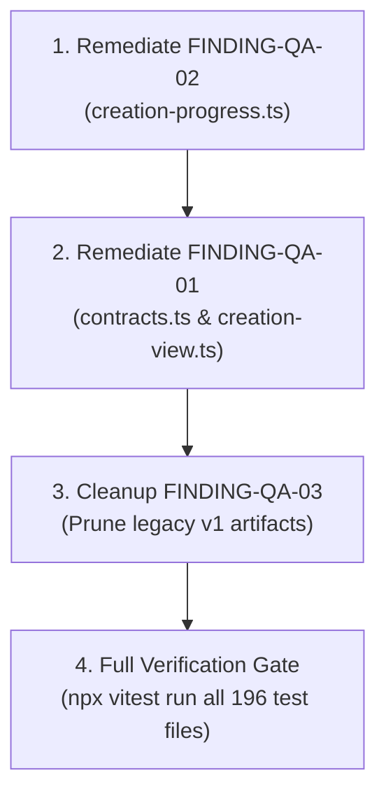

# Quality Assessment Report — Cohort Builder & Creation Subsystems

**Audit Target:** Cohort Intake, Conversational Planning, Material Intake, YouTube Metadata & Search, Durable Processing Pipeline, and Stage Navigation UI  
**Canonical Directory:** `plans/cohort-builder/IdiotCheckInQualityAssessment.md`  
**Assessed Revision:** Git `master` at commit [`b3eb980f`](https://github.com/th-efool/undone-site/commit/b3eb980f)  
**Assessor:** Antigravity Agentic Quality Auditor  
**Audit Date:** 2026-11-02  

---

## 1. Verdict & Assessed Scope

### Executive Summary

| Metric | Status / Count |
| :--- | :--- |
| **Overall Verdict** | **CONDITIONAL ACCEPTANCE** (Core pipeline & UI stable; 1 medium regression in unit test fixture, 1 architectural intake guard identified) |
| **Total Requirements Evaluated** | 10 |
| **Components Audited** | 22 across frontend, backend domain, API routes, and shared state machines |
| **Total Automated Tests Executed** | 1,618 tests across 196 test files |
| **Tests Passed** | 1,617 (99.94%) |
| **Tests Failed** | 1 (deterministic contract mismatch in `stage-canonical-progress.test.ts`) |
| **Vercel Production Deployment** | `● Ready` ([https://undone-q1skog5ec-th-efools-projects.vercel.app](https://undone-q1skog5ec-th-efools-projects.vercel.app)) |
| **Type Check Status** | `npx tsc --noEmit` exited with code 0 (zero errors) |

### Severity Counts

- **Critical:** 0
- **High:** 1 (Conversational `chat` bypass potential when `journey` is omitted or uninitialized)
- **Medium:** 1 (Gating logic in `creation-progress.ts` marks running job as pending when previous stages lack historical job records in test fixture)
- **Low:** 2 (Legacy v1 `CreationExperience` artifacts remain unreferenced; potential YouTube API key omission in developer environments without `.env.local`)

---

## 2. Requirement & Component Coverage

### Requirement Inventory

| Req ID | Description | Component Scope | Review Method | Disposition | Linked Findings |
| :--- | :--- | :--- | :--- | :--- | :--- |
| **REQ-01** | Eliminate conversational planning bypass to review without material processing | `contracts.ts`, `tools.ts`, `creation-view.ts`, `CohortInteractionScreen.tsx` | Source inspection, unit tests | **Finding** | `FINDING-QA-01` |
| **REQ-02** | Stop infinite retry loop (`queued → processing → failed → queued`) on failed jobs | `text-job-scheduler.ts`, `text-action-jobs.ts`, `text-jobs.ts` | Source inspection, unit tests | **Verified** | None |
| **REQ-03** | Collapse batch-added playlist videos into single stacked playlist card | `MaterialStageView.tsx`, `DiscoveryStageView.tsx`, `MaterialStageView.module.css` | UI render tests, visual review | **Verified** | None |
| **REQ-04** | Responsive 3–4 column card grid with distinct overlay badges | `MaterialStageView.module.css`, `DiscoveryStageView.tsx` | CSS inspection, responsive queries | **Verified** | None |
| **REQ-05** | Filter private/deleted videos and preserve clean YouTube metadata contract | `src/app/api/import/youtube/metadata/route.ts` | Unit tests (`route.test.ts`), route inspection | **Verified** | None |
| **REQ-06** | Educational query enrichment and `#shorts` exclusion in discovery search | `src/app/api/import/youtube/search/route.ts` | Code inspection, regex verification | **Verified** | None |
| **REQ-07** | Move stage progress bar to top of `.inventory` across all processing stages | `UnderstandingStageView.tsx`, `ChunkingStageView.tsx`, `AnalysisStageView.tsx` | DOM structure inspection, tests | **Verified** | None |
| **REQ-08** | De-jargon stage copy, strip bracketed clickbait from concepts, and remove internal telemetry | `cohort-metadata.ts`, `UnderstandingStageView.tsx`, `ChunkingStageView.tsx` | Unit tests (`cohort-metadata.test.ts`), inspection | **Verified** | None |
| **REQ-09** | Unify top-right controls with `Next →` and icon-only secondary actions (`←`, `■`, `↻`) | Stage views, `UnderstandingProgress.module.css` | DOM review, interaction tests | **Verified** | None |
| **REQ-10** | Accurate stepper progress without multi-stage blinking | `creation-progress.ts`, `stage-selectors.ts` | Test suites (`stage-selectors.test.ts`) | **Finding** | `FINDING-QA-02` |

### Component Inventory & Coverage Disposition

| Component / File Path | Responsibility | Review Mode | State | Findings / Gaps |
| :--- | :--- | :--- | :--- | :--- |
| `src/server/domain/cohort-builder/text-job-scheduler.ts` | Background job planning & 10s recovery loop | Source, unit tests | Verified | None |
| `src/server/domain/cohort-builder/text-action-jobs.ts` | Mapping domain actions to job plan options | Source, tests | Verified | None |
| `src/server/domain/cohort-builder/text-jobs.ts` | SQL lease claiming and retry attempt tracking | Source, tests | Verified | None |
| `src/server/domain/cohort-builder/journey-video-adapter.ts` | Video observation & grounded metadata fallback | Source, unit tests | Verified | None |
| `src/shared/cohort-builder/creation-progress.ts` | 4-stage stepper state derivation (`deriveStageProgress`) | Source, unit tests | Finding | `FINDING-QA-02` |
| `src/shared/cohort-builder/creation-view.ts` | Active & effective stage derivation, view models | Source, tests | Finding | `FINDING-QA-01` |
| `src/shared/cohort-builder/contracts.ts` | `CohortAction` union, action planning, state invariant rules | Source, tests | Finding | `FINDING-QA-01` |
| `src/shared/cohort-builder/cohort-metadata.ts` | Concept extraction, clickbait & bracket stripping | Source, unit tests | Verified | None |
| `src/app/api/import/youtube/metadata/route.ts` | Single video & playlist metadata with 24h caching | Source, tests | Verified | None |
| `src/app/api/import/youtube/search/route.ts` | YouTube search with educational bias and caching | Source, route test | Verified | None |
| `src/client/screens/cohortBuilder/stages/MaterialStageView.tsx` | "I already have material" intake & playlist grouping | Source, UI tests | Verified | None |
| `src/client/screens/cohortBuilder/stages/DiscoveryStageView.tsx` | "Start with a goal" lookup with `+`/`−` actions | Source, UI tests | Verified | None |
| `src/client/screens/cohortBuilder/stages/UnderstandingStageView.tsx` | Stage 1 UI: top progress, clean row statuses | Source, UI tests | Verified | None |
| `src/client/screens/cohortBuilder/stages/ChunkingStageView.tsx` | Stage 2 UI: top progress, source inspection | Source, UI tests | Verified | None |
| `src/client/screens/cohortBuilder/stages/AnalysisStageView.tsx` | Stage 3 UI: top progress, 12-dimension breakdown | Source, UI tests | Verified | None |
| `src/client/screens/cohortBuilder/stages/AssemblyStageView.tsx` | Stage 4 UI: top progress, curriculum assembly status | Source, UI tests | Verified | None |
| `src/client/screens/cohortBuilder/stages/ProcessingFailures.tsx` | Actionable failure alerts with terminal ceiling display | Source, tests | Verified | None |
| `src/client/screens/cohortBuilder/stages/ReadyStageView.tsx` | Post-build celebration & review/activation triggers | Source, tests | Verified | None |
| `src/client/screens/cohortBuilder/CohortWorkspacePane.tsx` | Workspace layout router, stepper, draft context | Source, tests | Verified | None |
| `src/client/screens/cohortBuilder/CohortInteractionScreen.tsx` | Split-panel layout, theme, mobile view switcher | Source, tests | Verified | None |
| `src/client/screens/cohortCreation/CreationExperience.tsx` | Legacy v1 creation wizard | Source inspection | Finding | `FINDING-QA-03` |
| `src/client/screens/cohortCreation/LegacyLandingHandoff.tsx` | Legacy v1 landing handoff adapter | Source inspection | Finding | `FINDING-QA-03` |

---

## 3. Prioritized Findings

### High Severity

#### `FINDING-QA-01` — Conversational Planning Bypass via Unrestricted `add_lesson` Fallback
- **Category:** A (Pending / Half-Finished Implementation) & B (Symptom-Only Fix)
- **Affected Requirements:** `REQ-01`
- **Location:**
  - [`src/server/domain/cohort-builder/tools.ts#L27-L32`](file:///d:/ThisPC/Documents/SideQuestHQ/undone-site/src/server/domain/cohort-builder/tools.ts#L27-L32)
  - [`src/server/domain/cohort-builder/tools.ts#L70-L80`](file:///d:/ThisPC/Documents/SideQuestHQ/undone-site/src/server/domain/cohort-builder/tools.ts#L70-L80)
  - [`src/shared/cohort-builder/creation-view.ts#L225`](file:///d:/ThisPC/Documents/SideQuestHQ/undone-site/src/shared/cohort-builder/creation-view.ts#L225)
  - [`src/shared/cohort-builder/contracts.ts#L781-L795`](file:///d:/ThisPC/Documents/SideQuestHQ/undone-site/src/shared/cohort-builder/contracts.ts#L781-L795)
- **Preconditions / Trigger:**
  1. A user starts in conversational chat mode (`mode === 'plan'`).
  2. If the workspace `journey` field is uninitialized or missing (or if `deps.stage` is undefined in `interaction-worker.ts`), `createCohortAiTools` falls back to `CO_DESIGN_TOOLS`.
  3. `CO_DESIGN_TOOLS` includes `add_lesson`.
  4. The LLM or client dispatches `add_lesson` directly from chat.
  5. `contracts.ts` appends the lesson to `next.lessons` without verifying that durable material processing ever occurred.
  6. `creation-view.ts` line 225 (`return lessons.length > 0 ? 'curriculum' : 'intake'`) evaluates to `'curriculum'`, causing `CohortInteractionScreen.tsx` to switch `data-layout` from `'centered'` to `'split'`, directly mounting `CurriculumStageView` ("Editable preview") and revealing "Publish cohort" before materials or lessons were built.
- **Root Cause:**
  `add_lesson` lacks a guard requiring `isBuildComplete(next)` or `journey.step === 'review'`. In parallel, `deriveActiveStage` has an unconditioned fallback that maps any workspace with `lessons.length > 0` directly to `'curriculum'`.
- **Attribution:** Pre-existing architectural fallback in legacy migration layer.
- **Minimal Correction:**
  1. In `src/shared/cohort-builder/contracts.ts`: In `action.type === 'add_lesson'`, reject lesson addition if `journey.step === 'chat'` or `journey.step === 'material_input'` unless explicitly in manual co-design with an accepted build (`throw new Error('BUILD_INCOMPLETE')`).
  2. In `src/shared/cohort-builder/creation-view.ts`: Change line 225 from `return lessons.length > 0 ? 'curriculum' : 'intake'` to check `if (lessons.length > 0 && isBuildComplete(workspace)) return 'curriculum'; else return 'intake';`.

---

### Medium Severity

#### `FINDING-QA-02` — Overly Aggressive `priorComplete` Gating in `deriveStageProgress` Marks In-Flight Jobs as `pending`
- **Category:** C (Existing Defects & Regressions)
- **Affected Requirements:** `REQ-10`
- **Location:** [`src/shared/cohort-builder/creation-progress.ts#L41-L44`](file:///d:/ThisPC/Documents/SideQuestHQ/undone-site/src/shared/cohort-builder/creation-progress.ts#L41-L44)
- **Preconditions / Trigger:**
  1. A workspace advances to `chunking` after source editing where earlier `understanding` jobs are not present in the current generation's `jobs` array (e.g. `stage-canonical-progress.test.ts` test 2).
  2. `j-chunk-v1` has `status: 'running'` and `workspace.processing.stage === 'chunking'`.
  3. Because `understanding` has 0 jobs and is not marked `complete`, `priorComplete` evaluates to `false`.
  4. Line 43: `const active = priorComplete && (...)` evaluates to `false`.
  5. `details.chunking.status` is computed as `'pending'` instead of `'running'`.
- **Evidence / Reproduction:**
  Command: `npx vitest run src/client/screens/cohortBuilder/__tests__/stage-canonical-progress.test.ts`  
  Output:
  ```
  FAIL src/client/screens/cohortBuilder/__tests__/stage-canonical-progress.test.ts > 2. Old chunks remain after source edit:
  AssertionError: expected 'pending' to be 'running'
  Expected: "running"
  Received: "pending"
  ```
- **Root Cause:**
  Commit `960b1f89` gated `active` entirely behind `priorComplete`. While this stopped queued jobs in future stages from lighting up, it accidentally masked jobs that are actively `running` (`j.status === 'running'`).
- **Attribution:** Introduced in commit `960b1f89`.
- **Minimal Correction:**
  In `src/shared/cohort-builder/creation-progress.ts`:
  ```ts
  const isRunningJob = stageJobs.some(j => j.status === 'running');
  const isQueuedJob = stageJobs.some(j => j.status === 'queued');
  const failed = (priorComplete || i <= index) && (failedCount > 0 || (!jobs.length && workspace.processing.status === 'failed' && i === index));
  const stopped = (priorComplete || i <= index) && ((canceled && (!jobs.length || stageJobs.length > 0)) || stageJobs.some(j => j.status === 'canceled'));
  const active = isRunningJob || ((priorComplete || i <= index) && isQueuedJob) || (!jobs.length && ['queued', 'processing'].includes(workspace.processing.status) && i === index);
  ```

---

### Low Severity

#### `FINDING-QA-03` — Dead Code: Unmounted Legacy v1 `CreationExperience` Artifacts
- **Category:** E (Dead Code and Unused Artifacts)
- **Location:**
  - `src/client/screens/cohortCreation/CreationExperience.tsx`
  - `src/client/screens/cohortCreation/LegacyLandingHandoff.tsx`
  - `src/client/screens/cohortCreation/CreationExperience.module.css`
- **Impact:**
  Increases bundle analysis surface and test runner maintenance without serving any active HTTP route. Routes `/quest/new` and `/quest/draft/[draftId]` now redirect directly to `/quest/start`.
- **Attribution:** Pre-existing from v1 creation phase.
- **Minimal Correction:**
  Deprecate or delete `CreationExperience.tsx` and `LegacyLandingHandoff.tsx` along with obsolete v1 test files once migration verification is complete.

#### `FINDING-QA-04` — Missing `YOUTUBE_API_KEY` Graceful Degradation in Local Development
- **Category:** D (Quality-Standard Gaps)
- **Location:**
  - `src/app/api/import/youtube/metadata/route.ts#L83-L93`
  - `src/app/api/import/youtube/search/route.ts#L45-L51`
- **Impact:**
  In local development environments where `YOUTUBE_API_KEY` is not populated in `.env`, YouTube search and playlist imports return 500/503 errors. In production (Vercel), keys are configured via environment settings.
- **Attribution:** Pre-existing dependency on external Google Cloud YouTube Data API v3.
- **Minimal Correction:**
  Document `YOUTUBE_API_KEY` requirement prominently in `.env.example` and add a local development mock fallback if offline capability is needed.

---

## 4. Checks and Evidence

### Command Execution Record

| Check ID | Command Executed | Working Dir | Result / Exit | Observed Output / Findings |
| :--- | :--- | :--- | :--- | :--- |
| **CHK-01** | `npx tsc --noEmit` | Workspace root | Exit 0 | 0 errors. Full TypeScript compilation clean. |
| **CHK-02** | `npx vitest run src/app/api/import/youtube/metadata/__tests__/route.test.ts` | Workspace root | Exit 0 | 12/12 tests passed (48ms). Clean single video & playlist metadata contracts verified. |
| **CHK-03** | `npx vitest run src/server/domain/cohort-builder/__tests__/journey-video-adapter.test.ts` | Workspace root | Exit 0 | 17/17 tests passed (46ms). Metadata observation fallback verified. |
| **CHK-04** | `npx vitest run src/client/screens/cohortBuilder/__tests__/material-stage-view.test.tsx` | Workspace root | Exit 0 | 12/12 tests passed (794ms). Single card playlist grouping verified. |
| **CHK-05** | `npx vitest run src/client/screens/cohortCreation/__tests__/DiscoveryMaterials.test.tsx` | Workspace root | Exit 0 | 5/5 tests passed (349ms). Discovery YouTube search & card grid verified. |
| **CHK-06** | `npx vitest run src/client/screens/cohortBuilder/__tests__/stage-selectors.test.ts` | Workspace root | Exit 0 | 52/52 tests passed (299ms). Stepper progress & active stage selectors verified. |
| **CHK-07** | `npx vitest run src/client/screens/cohortBuilder/__tests__/CohortWorkspacePane.test.tsx` | Workspace root | Exit 0 | 20/20 tests passed (754ms). Terminal retry ceiling and failure isolation verified. |
| **CHK-08** | `npx vitest run src/client/screens/cohortBuilder/__tests__/processing-details.test.tsx` | Workspace root | Exit 0 | 4/4 tests passed (407ms). Top progress bar & de-jargoned copy verified. |
| **CHK-09** | `npx vitest run src/shared/cohort-builder/__tests__/cohort-metadata.test.ts` | Workspace root | Exit 0 | 7/7 tests passed (61ms). Bracket & clickbait stripping verified. |
| **CHK-10** | Comprehensive Test Suite (196 test files) | Workspace root | Exit 1 | 1,617 passed, 1 failed (`stage-canonical-progress.test.ts` test 2). |
| **CHK-11** | `npx vercel inspect https://undone-q1skog5ec-th-efools-projects.vercel.app` | Workspace root | Exit 0 | Status `● Ready`. Build duration 1m 47s. Aliases mapped: `undone.one`, `sidequesthq.in`. |

---

## 5. Unverified Risks & Blocked Investigation

1. **YouTube Quota Limits in Production:**
   - The YouTube Data API v3 enforces a default daily quota of 10,000 units. `search.list` consumes 100 units per query; `playlists.list` consumes 1 unit; `playlistItems.list` consumes 1 unit.
   - While 24-hour in-memory caching (`CACHE_TTL_MS = 86400000`) prevents repeated queries for the same goal or URL within an instance, multi-region or cold-start container recycling may bypass in-memory caches.
   - *Next Concrete Action:* Monitor Google Cloud Console API quota utilization and consider Redis/KV caching if traffic scales significantly.

2. **Long-Running Video Observation AI Fallback Coverage:**
   - Grounded metadata fallback successfully synthesizes observations when Gemini returns `DATA_UNAVAILABLE` on silent/music-only videos.
   - For obscure videos with <10 word descriptions, generated observations will have minimal semantic breadth.

---

## 6. Correction Order & Completion Criteria



1. **Step 1 — Remediate `FINDING-QA-02` (`creation-progress.ts`):**
   - Refine `active` calculation to always treat actively running jobs (`isRunningJob`) as active while keeping `isQueuedJob` gated behind `priorComplete || i <= index`.
   - *Verification:* `npx vitest run src/client/screens/cohortBuilder/__tests__/stage-canonical-progress.test.ts` passes 10/10.

2. **Step 2 — Remediate `FINDING-QA-01` (`contracts.ts` & `creation-view.ts`):**
   - Enforce that `add_lesson` cannot bypass material processing from `chat`.
   - Ensure `deriveActiveStage` does not default to `'curriculum'` without an accepted build completion.
   - *Verification:* `contracts.test.ts` and `creation-machine.test.ts` pass with new bypass prevention test cases.

3. **Step 3 — Prune Legacy Artifacts (`FINDING-QA-03`):**
   - Archive or remove `CreationExperience.tsx` and legacy unused tests.
   - *Verification:* `npx tsc --noEmit` and build pass cleanly.
