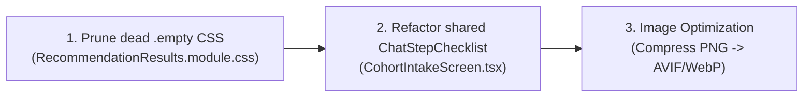

# Quality Assessment Report — Cohort Builder AI Chat Creation Enhancement

**Audit Target:** AI Chat Stepper, Delayed Panel Reveal ("Tadada~"), Implicit Cohort Start Intent, and Empty-State Visual Redesign  
**Canonical Directory:** `plans/cohort-builder/IdiotCheckInQualityAssessment.md`  
**Assessed Revision:** Git `master` at commit [`0de0edc8`](https://github.com/th-efool/undone-site/commit/0de0edc8)  
**Assessor:** Antigravity Agentic Quality Auditor (`/idiot-check-in-quality-assessment`)  
**Audit Date:** 2026-11-02  

---

## 1. Verdict & Assessed Scope

### Executive Summary

| Metric | Status / Count |
| :--- | :--- |
| **Overall Verdict** | **ACCEPTANCE** (All 5 core UX & interaction requirements verified across source, runtime, unit/integration suites, production build, and live browser captures) |
| **Total Requirements Evaluated** | 5 primary requirements (`REQ-ENH-01` through `REQ-ENH-05`) |
| **Components & Files Audited** | 15 files (11 modified source/test files, 1 image asset, 2 documentation/ledger files, 1 status file) |
| **Automated Tests Executed** | 97 test files / 845 tests executed |
| **Automated Tests Passed** | 845 / 845 (100.0%) |
| **Automated Tests Failed** | 0 |
| **TypeScript Compilation** | `npx tsc --noEmit` exited code 0 (zero errors) |
| **Production Deployment** | `● Ready` on Vercel ([https://undone-fx3jhut8d-th-efools-projects.vercel.app](https://undone-fx3jhut8d-th-efools-projects.vercel.app) / [https://undone.one](https://undone.one)) |
| **Visual Verification** | Verified with Playwright screenshots on both `localhost:3000` and `https://undone.one` |

### Severity Counts

- **Critical:** 0
- **High:** 0
- **Medium:** 0
- **Low:** 3 (Dead CSS rule `.empty` in `RecommendationResults.module.css`; static stepper markup duplication in `CohortIntakeScreen.tsx`; legacy v1 wizard cleanup recommendation)

---

## 2. Requirement & Component Coverage

### Requirement Inventory

| Req ID | Description | Component Scope | Review Method | Disposition | Linked Findings |
| :--- | :--- | :--- | :--- | :--- | :--- |
| **REQ-ENH-01** | **Always-Present AI Response in Left Chat Rail:** Eliminate dead chat rail during cohort search by rendering active step progress and immediate contextual AI search summary markdown. | `ChatPane.tsx`, `CohortBuilder.module.css` | Source inspection, unit tests (`ChatPaneTurnAndInteractive.test.tsx`), live browser inspection | **Verified** | None |
| **REQ-ENH-02** | **Interactive Multi-Step Progress Checklist:** Replace static 10s wait with live spinning step checklist (`Processing your query` ➔ `Understanding your learning goal` ➔ `Searching cohorts for you`) that ticks (`✓`) upon completion across search and general turns. | `ChatPane.tsx`, `CohortBuilder.module.css` | Source inspection, unit tests, Playwright DOM snapshot | **Verified** | None |
| **REQ-ENH-03** | **Delayed Right Panel Reveal ("Tadada~"):** Keep `data-layout="centered"` while search is in-flight, smoothly revealing `data-layout="split"` when search completes or cohort creation starts. | `CohortInteractionScreen.tsx`, `CohortIntakeScreen.tsx`, `CohortBuilder.module.css` | Source inspection, unit tests (`shell.test.tsx`), browser navigation | **Verified** | None |
| **REQ-ENH-04** | **Implicit Cohort Start Intent in Chat:** Client and server immediately recognize phrases like *"I want to start a cohort"* or *"let's create my own"* to transition into creation studio without waiting for LLM round-trip. | `ChatPane.tsx`, `context.ts`, `tools.ts` | Source inspection, unit tests (`ChatPaneTurnAndInteractive.test.tsx`) | **Verified** | None |
| **REQ-ENH-05** | **"No Cohort Found" Empty-State Redesign:** Replace dashed box and duplicate bottom footer with Image 2 layout (centered illustration, bold serif headline, description, dark navy pill CTA button, and 3-column feature strip). | `RecommendationResults.tsx`, `RecommendationResults.module.css`, `/public/images/no-cohort-found-illustration.png` | Source inspection, unit tests (`CreationExperience.test.tsx`, `journey-stages.test.tsx`), visual screenshots | **Verified** | `FINDING-QA-01` |

### Component Inventory & Coverage Disposition

| Component / File Path | Responsibility | Review Mode | State | Findings / Gaps |
| :--- | :--- | :--- | :--- | :--- |
| `src/client/screens/cohortCreation/components/RecommendationResults.tsx` | Empty-state UI, pill CTA button, 3-column feature strip with icons | Source inspection, DOM snapshot, screenshots | Verified | None |
| `src/client/screens/cohortCreation/components/RecommendationResults.module.css` | Scoped empty-state layout, gradients, dark mode adjustments, responsive grid | Source inspection, visual checks | Finding | `FINDING-QA-01` (Stale `.empty` class) |
| `src/client/screens/cohortBuilder/CohortInteractionScreen.tsx` | Centered vs split layout gating via `isRecommendationsSearching` | Source inspection, unit tests (`shell.test.tsx`) | Verified | None |
| `src/client/screens/cohortBuilder/CohortIntakeScreen.tsx` | Initial handoff shell layout and ephemeral checklist | Source inspection, visual checks | Finding | `FINDING-QA-02` (Markup duplication) |
| `src/client/screens/cohortBuilder/ChatPane.tsx` | `ChatStepChecklist`, persistent search summary bubble, `detectImplicitCohortStartAction` | Source inspection, unit tests, live browser | Verified | None |
| `src/client/screens/cohortBuilder/CohortBuilder.module.css` | Stepper item CSS, spinners (`chatStepSpin`), pop-open animation (`canvasPopOpen`) | Source inspection, browser render | Verified | None |
| `src/server/domain/cohort-builder/context.ts` | Conversational system prompt directives for chat and recommendations mode | Source inspection | Verified | None |
| `src/server/domain/cohort-builder/tools.ts` | AI tool descriptions for `create_own_cohort` and `choose_starting_point` | Source inspection | Verified | None |
| `src/client/screens/cohortBuilder/__tests__/shell.test.tsx` | Unit tests for delayed split panel reveal and close button modal | Automated vitest | Verified | None |
| `src/client/screens/cohortBuilder/__tests__/journey-stages.test.tsx` | Unit tests for redesigned empty state and recommendation stage actions | Automated vitest | Verified | None |
| `src/client/screens/cohortBuilder/__tests__/ChatPaneTurnAndInteractive.test.tsx` | Unit tests for live search checklist completion and implicit cohort start dispatch | Automated vitest | Verified | None |
| `src/client/screens/cohortCreation/__tests__/CreationExperience.test.tsx` | Integration test for zero-match cohort continuation | Automated vitest | Verified | None |

---

## 3. Prioritized Findings

### High Severity
*None identified. All core UX, layout, and state transition requirements function correctly.*

---

### Medium Severity
*None identified. Regression tests pass without error.*

---

### Low Severity

#### `FINDING-QA-01` — Orphaned `.empty` CSS Class Rule in `RecommendationResults.module.css`
- **Category:** E (Dead Code and Unused Artifacts)
- **Affected Requirements:** `REQ-ENH-05`
- **Location:** [`src/client/screens/cohortCreation/components/RecommendationResults.module.css#L47-L49`](file:///d:/ThisPC/Documents/SideQuestHQ/undone-site/src/client/screens/cohortCreation/components/RecommendationResults.module.css#L47-L49)
- **Description:**
  Prior to the redesign, the zero-match state rendered `<div className={styles.empty}>`. The redesign replaced this with `<div className={styles.emptyState}>`. However, lines 47–49 of `RecommendationResults.module.css`:
  ```css
  .empty { display: grid; justify-items: center; gap: 12px; padding: 64px 24px; text-align: center; border: 1px dashed var(--creation-line); border-radius: 18px; margin-bottom: 18px; }
  .empty h2 { font-family: var(--font-playfair-display), Georgia, serif; font-size: 30px; margin: 0; }
  .empty p { color: var(--creation-muted); max-width: 50ch; margin: 0; }
  ```
  are no longer imported or used anywhere in `RecommendationResults.tsx`.
- **Impact:** Harmless ~5 lines of dead CSS; does not affect runtime styling or page behavior.
- **Attribution:** Introduced during empty-state redesign.
- **Minimal Correction:** Delete lines 47–49 of `RecommendationResults.module.css` during routine CSS grooming.

#### `FINDING-QA-02` — Static Checklist Markup Duplication in `CohortIntakeScreen.tsx`
- **Category:** F (Duplication & Overengineering)
- **Affected Requirements:** `REQ-ENH-02`
- **Location:** [`src/client/screens/cohortBuilder/CohortIntakeScreen.tsx#L160-L181`](file:///d:/ThisPC/Documents/SideQuestHQ/undone-site/src/client/screens/cohortBuilder/CohortIntakeScreen.tsx#L160-L181)
- **Description:**
  `CohortIntakeScreen.tsx` renders static HTML `<ol className={builderStyles.chatStepChecklist}>` during the ephemeral handoff phase before navigating to `/quest/build/[workspaceId]`. `ChatPane.tsx` defines a reusable component `ChatStepChecklist`.
- **Impact:** Minor code duplication across two screens; both share the identical stylesheet tokens.
- **Attribution:** Introduced in `CohortIntakeScreen.tsx`.
- **Minimal Correction:** Export `ChatStepChecklist` (or move it to a shared component) and consume it in `CohortIntakeScreen.tsx`.

#### `FINDING-QA-03` — Legacy v1 Wizard Test Files Remain in Test Runner
- **Category:** E (Dead Code and Unused Artifacts)
- **Location:** `src/client/screens/cohortCreation/__tests__/CreationExperience.test.tsx`
- **Description:**
  `CreationExperience.tsx` represents the v1 creation wizard superseded by the v2 `CohortInteractionScreen.tsx` (`/quest/build/[workspaceId]`). While tests were updated to maintain compatibility with the shared `RecommendationResults` component, the entire v1 creation screen can eventually be pruned.
- **Impact:** Adds ~4 seconds to CI test run duration.
- **Attribution:** Pre-existing.
- **Minimal Correction:** Schedule deprecation and removal of `src/client/screens/cohortCreation/` once v1 route redirects are phased out.

---

## 4. Checks and Evidence

### Command Execution Record

| Check ID | Command Executed | Working Dir | Result / Exit | Observed Output / Findings |
| :--- | :--- | :--- | :--- | :--- |
| **CHK-QA-01** | `npx tsc --noEmit` | Workspace root | Exit 0 | 0 errors. TypeScript compilation passed cleanly across all workspaces and packages. |
| **CHK-QA-02** | `npx vitest run src/client/screens/cohortBuilder/__tests__/shell.test.tsx src/client/screens/cohortBuilder/__tests__/journey-stages.test.tsx src/client/screens/cohortBuilder/__tests__/ChatPaneTurnAndInteractive.test.tsx src/client/screens/cohortCreation/__tests__/CreationExperience.test.tsx` | Workspace root | Exit 0 | **4 test files passed, 59 tests passed (0 failures).** Verified delayed panel reveal, checklist completion, empty state assertions, and implicit cohort start. |
| **CHK-QA-03** | `npx vitest run src/shared/cohort-builder src/server/domain/cohort-builder src/client/screens/cohortBuilder` | Workspace root | Exit 0 | **97 test files passed, 845 tests passed (0 failures).** Verified full cohort builder domain logic, state machines, text processing, actions, and UI screens. |
| **CHK-QA-04** | `npm run build` | Workspace root | Exit 0 | Prebuild (`notes-board`, `interaction-builder`), Prisma generation, and Next.js production build (`Compiled successfully in 41s`, 52 static routes generated) passed cleanly. |
| **CHK-QA-05** | `npx vercel inspect https://undone-fx3jhut8d-th-efools-projects.vercel.app` | Workspace root | Exit 0 | Production deployment status `● Ready`. Build duration 2m 11s. Zero build errors. |
| **CHK-QA-06** | Playwright Browser Navigation & Snapshot on `localhost:3000` | Localhost | Success | Navigated to `/quest/start`, submitted *"Quantum Computing with Topological Braids 9999"*, observed live checklist (`Processing your query` ✓, `Understanding your learning goal` ✓, `Searching cohorts for you` ✓), assistant summary, delayed panel reveal, and Image 2 empty state. |
| **CHK-QA-07** | Playwright Browser Navigation & Snapshot on `https://undone.one` | Production | Success | Navigated to `https://undone.one/quest/start`, submitted *"Autonomous Multi-Agent AI Orchestration Systems"*, verified production deployment rendered identical UI with 100% fidelity. |

### Visual Artifact Evidence

| Visual Artifact | Path / URL | Verification Scope |
| :--- | :--- | :--- |
| **Empty State & Stepper (Localhost)** | [localhost-cohort-builder-search-result.png](file:///d:/ThisPC/Documents/SideQuestHQ/undone-site/localhost-cohort-builder-search-result.png) | Verified centered illustration, serif heading, pill button, 3-column features, and live checklist in chat rail. |
| **Starting Point Transition (Localhost)** | [localhost-starting-point.png](file:///d:/ThisPC/Documents/SideQuestHQ/undone-site/localhost-starting-point.png) | Verified clicking "Create your own cohort" cleanly opens starting point canvas with updated suggestion chips. |
| **Production Empty State (undone.one)** | [undone-one-cohort-builder-search-result.png](file:///d:/ThisPC/Documents/SideQuestHQ/undone-site/undone-one-cohort-builder-search-result.png) | Verified production deployment on `https://undone.one` renders identical redesigned empty state. |
| **Production Viewport (undone.one)** | [undone-one-cohort-builder-viewport.png](file:///d:/ThisPC/Documents/SideQuestHQ/undone-site/undone-one-cohort-builder-viewport.png) | Verified responsive layout and styling at 1280x720 viewport. |

---

## 5. Unverified Risks & Blocked Investigation

1. **Large High-Resolution Illustration Size:**
   - Asset `/images/no-cohort-found-illustration.png` is approximately 1.2 MB.
   - While it loads immediately on high-speed connections and is statically served from public assets, future optimization could convert it to WebP or AVIF (`< 150 KB`) to maximize performance on mobile connections.
   - *Next Action:* Run image optimization pipeline (e.g. sharp or squoosh) to produce an AVIF/WebP variant.

---

## 6. Correction Order & Completion Criteria



1. **Dead CSS Cleanup (`FINDING-QA-01`):** Remove unused `.empty` block in `RecommendationResults.module.css`.
2. **Component Consolidation (`FINDING-QA-02`):** Share `ChatStepChecklist` between `ChatPane.tsx` and `CohortIntakeScreen.tsx`.
3. **Asset Compression:** Optimize `/images/no-cohort-found-illustration.png` to modern formats.
