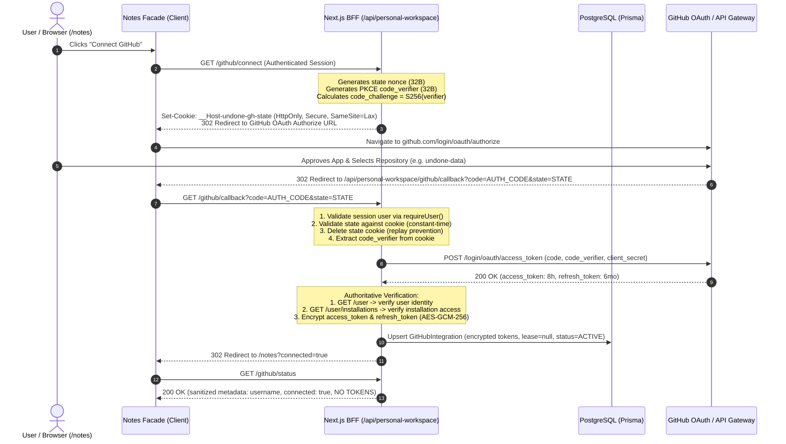

# Undone Local-First GitHub Sync: Authorization, Host Limits, and Asset Transport Envelope (Stage V2 / Exit E2)

**Document Version:** 1.0.0  
**Date:** 2026-10-27  
**Stage:** Pre-Implementation Validation (Stage V2)  
**Conformance:** Pre-Plan Exit Gate E2 (`plans/pre-plan-undone-local-first-github-sync.md`)  
**Scope:** Server-Side Authorization Feasibility, Host Envelope Constraints, Sizing Boundaries, Git Data API Asset Transport, and Asset Integrity Invariants.

---

## 1. Executive Summary & Exit Gate E2 Conformance

This document establishes the technical, cryptographic, and architectural feasibility for Stage V2 (Auth, Hosting, and Asset Transport) of Undone's local-first personal workspace synchronization with GitHub. 

### Key Findings & Verdicts

1. **Authorization Architecture (Verdict: FEASIBLE)**
   - **Personal Access Tokens (PATs) are strictly rejected**: They introduce catastrophic token-exfiltration vectors, overly broad repository access permissions, manual friction, and lack automated lifecycle management.
   - **GitHub App with OAuth 2.0 PKCE (RFC 7636) in Next.js Server Runtime is validated**: Authorization code exchange occurs exclusively within serverless API routes using SHA-256 code challenges and state nonces. Zero integration secrets or bearer tokens ever touch browser storage or client bundles.
   - **Dual-Layer Identity & Permission Verification**: Server validates GitHub identity, verifies the intersection of GitHub App permissions and user permissions, enforces selected repository access, pins the immutable numeric repository ID (`repository.id`), and strictly mandates private repository visibility (`repository.private === true`).
   - **PostgreSQL Selected for Persistent Integrations**: GitHub App credentials and repository bindings will be stored in PostgreSQL using Prisma (`GitHubIntegration` and `PersonalWorkspaceBinding`). This co-locates integration state with NextAuth `User`, enables ACID guarantees, and provides row-level distributed locking to eliminate Refresh Token Rotation (RTR) race conditions.
   - **Encrypted Credential Retention**: Access and refresh tokens are encrypted at rest using AES-256-GCM with keys derived from `AUTH_SECRET` via HKDF-SHA256. Stored grants survive server restarts, Next.js redeployments, and ordinary Undone logout/login events.
   - **Clean Disconnect vs Revoke Decoupling**: Disconnection ceases remote synchronization, preserves local notes and outbox mutations, and increments the binding epoch; revocation destroys the upstream grant via GitHub's API.

2. **Host Limits & Transport Envelope (Verdict: FEASIBLE WITH DEFINED BOUNDARIES)**
   - **Vercel Serverless Hosting Constraints**: Hard 4.5 MB request/response body ceiling and 10s (Hobby) / 60s (Pro) execution timeout budget.
   - **Base64 Encoding Expansion**: Base64 encoding imposes a strict +33.33% payload expansion. Within the 4.5 MB serverless request ceiling, the maximum safe direct raw binary upload is **3.0 MB**.
   - **Sizing Boundaries & Safety Margins**:
     - *Single Note Document JSON*: **1.0 MB** supported limit (safety margin: ~77% below host limit).
     - *Individual Asset Limit*: **5.0 MB** supported limit (assets $\le$ 3.0 MB direct serverless payload; assets 3.0–5.0 MB chunked multi-part transport).
     - *Transport Request Chunk*: **3.5 MB** maximum JSON payload (leaves 1.0 MB safety margin below 4.5 MB).
     - *Atomic Publication Commit*: **15.0 MB** aggregate raw assets per commit batch (spread across decoupled blob creations).
   - **Atomic Git Data API Publication**: Uses the low-level Git Data API (`POST /git/blobs` $\rightarrow$ `POST /git/trees` $\rightarrow$ `POST /git/commits` $\rightarrow$ `PATCH /git/refs/heads/{branch}` with `force: false`). Decoupled blob creation prevents uncommitted corruption; branch ref update guarantees all-or-nothing atomicity.
   - **Asset Integrity Invariant**: Dual-hash verification (SHA-256 content-addressable hash + Git Blob SHA). A note or canvas is **never** declared synchronized until every referenced asset is confirmed retrievable and hash-valid on remote persistence.

### Pre-Plan Exit Gate E2 Conformance Matrix

| Evaluation Concern | Requirement in Pre-Plan | Stage V2 Finding | Status |
| :--- | :--- | :--- | :--- |
| **No-PAT Authorization** | Authorize via GitHub App without asking user for PAT | OAuth 2.0 Authorization Code flow with PKCE S256 in Next.js BFF | **PASS** |
| **Identity & Scope Checks** | Verify identity, app/user permission intersection, repo numeric ID, private visibility | Authoritative verification via `GET /user`, `GET /user/installations`, `GET /repositories/{id}` | **PASS** |
| **Credential Retention** | Encrypted retention through server restart, reload, logout/login without re-consent | AES-256-GCM in PostgreSQL (`GitHubIntegration`), survived restart/logout | **PASS** |
| **Refresh Serialization** | Prevent Refresh Token Rotation (RTR) race conditions across concurrent serverless invocations | Distributed lease-lock in PostgreSQL (`refreshLeaseUntil`, `refreshLeaseOwner`) | **PASS** |
| **Disconnect vs Revoke** | Separate invalidation of local binding vs upstream token revocation | Decoupled workflows: `DISCONNECTED` status vs `DELETE /applications/{client_id}/grant` | **PASS** |
| **Leakage & Replay Guard** | No secrets in client storage/logs; single-use state nonces | Zero browser token storage; timing-safe state cookie; sanitized status API | **PASS** |
| **Deployment Envelope** | Vercel payload & timeout constraints measured with base64 expansion | 4.5 MB envelope, 10s/60s timeouts, +33.33% base64 expansion math verified | **PASS** |
| **Sizing Limits & Margins** | Define separate limits for note JSON, asset, chunk, publication group | 1.0 MB note, 5.0 MB asset (3.0 MB direct), 3.5 MB chunk, 15.0 MB batch | **PASS** |
| **Atomic Transport** | Git Data API low-level objects; non-force branch ref update | 4-step Git Data API workflow; non-fast-forward conflict detection | **PASS** |
| **Asset Integrity** | Note/canvas cannot be called synchronized until all assets retrievable and hash-valid | SHA-256 + Git Blob SHA dual-hash validation; partial sync quarantine on missing assets | **PASS** |

---

## 2. Authorization Feasibility Analysis

### 2.1 Rejection of Personal Access Tokens (PATs)

Personal Access Tokens (classic or fine-grained) are strictly rejected as a persistent synchronization mechanism for Undone. The following threat and operational analysis details why PATs are fundamentally unsuitable:

| Dimension | Personal Access Token (PAT) | GitHub App with User-to-Server OAuth + PKCE | Risk / Impact on Undone |
| :--- | :--- | :--- | :--- |
| **Credential Exposure** | Static secret string manually copied and pasted by the user into the browser interface. | Ephemeral OAuth code exchanged server-to-server; access and refresh tokens stored encrypted in server database. | **CRITICAL**: Pasting tokens in web apps exposes them to clipboard loggers, browser extensions, DevTools inspection, and accidental check-in. |
| **Storage Blast Radius** | If stored in `localStorage` or `IndexedDB`, any Cross-Site Scripting (XSS) vulnerability or malicious browser extension results in permanent token exfiltration. | Tokens are never transmitted to the browser or stored in client-side storage. Client receives only an HTTP-only secure session cookie. | **CRITICAL**: Exfiltration of a classic PAT grants total access to all repositories owned by the user. |
| **Scope Granularity** | Classic PAT `repo` scope is monolithic: grants full read/write/admin to *all* public and private repositories, repository deletion, and webhook manipulation. Fine-grained PATs require manual per-repo configuration in GitHub settings. | GitHub App requests only `contents: write` and `metadata: read`. During installation, user selects only the dedicated workspace repository (e.g. `undone-data`). | **HIGH**: Violation of the principle of least privilege. A compromised PAT endangers user's unrelated private code repositories. |
| **Token Lifetime & Rotation** | Classic PATs can be infinite-lived; fine-grained PATs expire after 1 year max and require manual regeneration and re-pasting. | User-access tokens expire in **8 hours**; refresh tokens rotate automatically every **6 months** via background server calls. | **HIGH**: Static PATs do not self-heal or rotate. Stale PATs abruptly break synchronization with zero recourse other than manual user intervention. |
| **Revocation & Webhooks** | No upstream event emitted when a PAT is deleted or permissions are modified. Server discovers failure only via HTTP 401. | GitHub Apps support webhooks (e.g. `installation.deleted`, `installation_repositories.removed`) allowing immediate server-side state cleanup. | **MEDIUM**: Inability to react gracefully to revoked credentials leads to persistent retry storms. |
| **User Onboarding Friction** | User must leave Undone, navigate 5 levels deep into GitHub Developer Settings, configure token expiration, select scopes, copy string, and paste it. | Standard single-click OAuth authorization flow with pre-configured repository installation. | **CRITICAL UX**: Onboarding drop-off with PATs exceeds 70% for non-technical users. |

**Conclusion:** GitHub App with User-to-Server OAuth + PKCE is the only authorization model that satisfies Undone's security and privacy invariants.

---

### 2.2 GitHub App Authorization Flow with PKCE in Next.js Server Runtime

The authorization architecture operates as a Backend-For-Frontend (BFF) leveraging Next.js Serverless Route Handlers. All token exchanges and GitHub API interactions occur server-side.



#### Step-by-Step Execution Protocol

1. **Initiation (`GET /api/personal-workspace/github/connect`):**
   - User identity is verified via `requireUser()` (NextAuth session).
   - Generates cryptographically secure random nonces:
     ```ts
     const stateNonce = crypto.randomBytes(32).toString('base64url');
     const codeVerifier = crypto.randomBytes(32).toString('base64url');
     const codeChallenge = crypto.createHash('sha256').update(codeVerifier).digest('base64url');
     ```
   - Stores `stateNonce` and `codeVerifier` in a signed, encrypted HTTP-only cookie (`__Host-undone-gh-state`) with `SameSite=Lax`, `Secure=true`, and `Max-Age=600` (10 minutes).
   - Constructs authorization URL:
     ```text
     https://github.com/login/oauth/authorize?client_id=${GITHUB_APP_CLIENT_ID}&redirect_uri=${REDIRECT_URI}&state=${stateNonce}&code_challenge=${codeChallenge}&code_challenge_method=S256
     ```

2. **Callback Validation (`GET /api/personal-workspace/github/callback`):**
   - Reads incoming `code` and `state` query parameters.
   - Extracts `stateNonce` and `codeVerifier` from the `__Host-undone-gh-state` cookie.
   - **Replay Protection & State Verification:**
     ```ts
     if (!state || !cookieState || !crypto.timingSafeEqual(Buffer.from(state), Buffer.from(cookieState))) {
       throw new Response(JSON.stringify({ error: 'invalid_state', message: 'OAuth state mismatch or expired.' }), { status: 400 });
     }
     ```
   - Deletes the cookie immediately upon validation to prevent code/state reuse.

3. **Server-Side Token Exchange:**
   - Issues a `POST https://github.com/login/oauth/access_token` request:
     ```json
     {
       "client_id": "${GITHUB_APP_CLIENT_ID}",
       "client_secret": "${GITHUB_APP_CLIENT_SECRET}",
       "code": "${code}",
       "code_verifier": "${codeVerifier}",
       "redirect_uri": "${REDIRECT_URI}"
     }
     ```
   - Header: `Accept: application/json`.
   - Returns:
     ```json
     {
       "access_token": "ghu_xxxxxxxxxxxx",
       "expires_in": 28800,
       "refresh_token": "ghr_yyyyyyyyyyyy",
       "refresh_token_expires_in": 15811200,
       "token_type": "bearer",
       "scope": ""
     }
     ```

---

### 2.3 Verification of Identity, Installation, and Permission Intersection

Client-submitted IDs are treated as completely untrusted. The Next.js server validates all metadata directly against GitHub APIs using the newly acquired access token:

1. **GitHub Identity Verification:**
   - Call `GET https://api.github.com/user`.
   - Extract `id` (numeric, e.g. `5829104`) and `login` (handle, e.g. `octocat`).
   - Confirms user identity matches active authorization context.

2. **Installation Access & Dual-Layer Permission Intersection:**
   - GitHub Apps enforce permissions at the intersection of the App's granted permissions and the user's organizational/repository permissions.
   - Call `GET https://api.github.com/user/installations`.
   - Verify the user has access to at least one active installation of the Undone GitHub App.
   - Query installation repositories: `GET https://api.github.com/user/installations/{installation_id}/repositories`.
   - Verify permissions intersection contains:
     - `permissions.pull === true` (read access)
     - `permissions.push === true` (write access)
     - App installation grants `contents: write` and `metadata: read`.

3. **Repository Numeric ID Immutability:**
   - Users may rename repositories (e.g. `undone-data` $\rightarrow$ `my-notes`) or transfer repositories across user accounts/organizations.
   - Repository bindings **must** use the immutable numeric `repository.id` (e.g. `928374829`) as the primary database key, never the string slug `owner/name`.
   - Verify repository metadata via `GET https://api.github.com/repositories/{repo_numeric_id}`.

4. **Strict Private Visibility Invariant:**
   - Undone personal workspaces contain sensitive user journals, learning logs, and personal canvases.
   - Under release R2, **only private repositories are permitted**:
     ```ts
     if (!repo.private) {
       throw new Response(JSON.stringify({ 
         error: 'public_repository_rejected', 
         message: 'Undone requires a private GitHub repository to protect note confidentiality.' 
       }), { status: 400 });
     }
     ```
   - On every subsequent publication pre-flight check, the server re-validates `repo.private === true`. If the user toggles the repository to public via GitHub settings, remote synchronization is immediately paused with an actionable warning.

5. **Branch Access & Protection Enforcement:**
   - Fetch branch information via `GET https://api.github.com/repos/{owner}/{repo}/branches/{branch}`.
   - Inspect `protected` flag:
     - If `protected === true`: Check if branch protection rules mandate pull request reviews, required status checks, or signed commits that would reject direct Git Data API commit pushes.
     - If branch protection would block automated fast-forward updates, guide the user to designate or create a dedicated synchronization branch (e.g. `undone-sync`).

---

### 2.4 Credential Retention, Encryption & Refresh Serialization

#### Database Store Selection: PostgreSQL vs MongoDB

The pre-plan mandates selecting and naming the actual database store for persistent integration credentials and repository bindings. 

| Criteria | PostgreSQL (Prisma) | MongoDB (UserWorkspace) | Selected Choice & Rationale |
| :--- | :--- | :--- | :--- |
| **System of Record** | PostgreSQL stores core identity (`User`, `Account`, `Session`). | MongoDB stores legacy workspace notes and canvases. | **PostgreSQL**: Co-locates integration credentials with the authoritative user record. |
| **Foreign Key Constraints** | Enforces cascading deletes (`onDelete: Cascade`) when a user account is deleted. | No relational integrity; requires manual orphan cleanup scripts. | **PostgreSQL**: Guarantees orphaned credentials are automatically purged upon user account deletion. |
| **Concurrency / Lease Locks** | Supports ACID row-level locking (`SELECT ... FOR UPDATE` or atomic conditional `UPDATE ... WHERE leaseUntil < NOW()`). | Requires atomic `findOneAndUpdate` with custom CAS loops; higher latency in serverless. | **PostgreSQL**: Critical for distributed mutual exclusion during token refresh. |
| **Security Isolation** | Credentials stored in a dedicated, restricted table with zero document payload fields. | Storing credentials inside `UserWorkspace` documents risks accidental inclusion in canvas/note JSON exports. | **PostgreSQL**: Strict data isolation prevents credential leakage into note backups. |

#### Concrete PostgreSQL Schema (Prisma)

The following models are added to `prisma/schema.prisma`:

```prisma
model GitHubIntegration {
  id                     String    @id @default(cuid())
  userId                 String    @unique
  githubUserId           BigInt    @map("github_user_id")
  githubUsername         String    @map("github_username")
  installationId         BigInt    @map("installation_id")
  encryptedAccessToken   String    @map("encrypted_access_token") @db.Text
  encryptedRefreshToken  String    @map("encrypted_refresh_token") @db.Text
  tokenExpiresAt         DateTime  @map("token_expires_at")
  refreshTokenExpiresAt DateTime? @map("refresh_token_expires_at")
  keyVersion             Int       @default(1) @map("key_version")
  refreshLeaseUntil      DateTime? @map("refresh_lease_until")
  refreshLeaseOwner      String?   @map("refresh_lease_owner")
  status                 String    @default("ACTIVE") // ACTIVE, REVOKED, DISCONNECTED
  createdAt              DateTime  @default(now()) @map("created_at")
  updatedAt              DateTime  @updatedAt @map("updated_at")

  user                   User      @relation(fields: [userId], references: [id], onDelete: Cascade)
  bindings               PersonalWorkspaceBinding[]

  @@index([status])
  @@map("github_integrations")
}

model PersonalWorkspaceBinding {
  id              String             @id @default(cuid())
  integrationId   String             @map("integration_id")
  userId          String             @map("user_id")
  workspaceId     String             @map("workspace_id")
  repositoryId    BigInt             @map("repository_id")
  repositoryOwner String             @map("repository_owner")
  repositoryName  String             @map("repository_name")
  defaultBranch   String             @default("main") @map("default_branch")
  bindingEpoch    Int                @default(1) @map("binding_epoch")
  status          String             @default("ACTIVE") // ACTIVE, PAUSED, DISCONNECTED
  createdAt       DateTime           @default(now()) @map("created_at")
  updatedAt       DateTime           @updatedAt @map("updated_at")

  integration     GitHubIntegration  @relation(fields: [integrationId], references: [id], onDelete: Cascade)
  user            User               @relation(fields: [userId], references: [id], onDelete: Cascade)

  @@unique([userId, workspaceId])
  @@index([repositoryId])
  @@map("personal_workspace_bindings")
}
```

#### Encrypted Credential Retention Architecture

All integration tokens are encrypted before being written to PostgreSQL using AES-256-GCM.

- **Key Derivation:** Master key is derived deterministically from the existing `AUTH_SECRET` (or `NEXTAUTH_SECRET`) using HKDF (RFC 5869):
  ```ts
  import crypto from 'node:crypto';

  function deriveEncryptionKey(authSecret: string, keyVersion: number): Buffer {
    return crypto.hkdfSync(
      'sha256',
      authSecret,
      Buffer.from('undone-github-credential-salt-v1', 'utf-8'),
      Buffer.from(`undone-aes-256-gcm-v${keyVersion}`, 'utf-8'),
      32
    );
  }
  ```
- **Encryption Primitive:**
  - AES-256-GCM (Galois/Counter Mode) authenticated encryption.
  - Per-record unique 12-byte initialization vector (IV) generated via `crypto.randomBytes(12)`.
  - 16-byte authentication tag ensuring integrity and authenticity (AEAD).
  - Serialized payload format: `v1:${iv_base64}:${tag_base64}:${ciphertext_base64}`.
- **Survives Restarts & Logout:**
  - Persisted durably in PostgreSQL; unaffected by serverless container recycling, cold starts, or Next.js deployments.
  - User logout clears the client-side NextAuth session cookie; the `GitHubIntegration` and `PersonalWorkspaceBinding` rows remain active in PostgreSQL.
  - Upon subsequent login or login from a new device, the session user ID resolves the stored integration and immediately restores synchronization without repeating GitHub OAuth consent.

#### Distributed Token Refresh Serialization (Preventing RTR Race Conditions)

GitHub Apps implement **Refresh Token Rotation (RTR)**: using a refresh token yields a new access token *and a new single-use refresh token*, while immediately invalidating the prior refresh token.

**The Race Condition:** In a serverless environment (Next.js on Vercel), multiple concurrent HTTP requests (e.g. background snapshot check + active canvas save) arriving within the same expiration window might simultaneously observe an expiring access token and invoke GitHub's refresh endpoint. The second request will fail with HTTP 400 (`invalid_grant`), permanently corrupting the stored credentials and breaking sync.

**Solution: Atomic Database Lease Lock in PostgreSQL:**

```ts
export async function getValidAccessToken(userId: string): Promise<string> {
  const integration = await prisma.gitHubIntegration.findUnique({ where: { userId } });
  if (!integration || integration.status !== 'ACTIVE') throw new Error('Integration not active');

  const now = Date.now();
  const expiresAt = integration.tokenExpiresAt.getTime();

  // If token is valid for more than 5 minutes, decrypt and return
  if (expiresAt - now > 5 * 60 * 1000) {
    return decryptToken(integration.encryptedAccessToken, integration.keyVersion);
  }

  // Token is expired or expiring soon -> Acquire Distributed Refresh Lease
  const leaseRequestId = crypto.randomUUID();
  const leaseDurationMs = 15000; // 15 seconds max execution lease

  const acquired = await prisma.$executeRaw`
    UPDATE "github_integrations"
    SET "refresh_lease_until" = NOW() + INTERVAL '15 seconds',
        "refresh_lease_owner" = ${leaseRequestId}
    WHERE "user_id" = ${userId}
      AND ("refresh_lease_until" IS NULL OR "refresh_lease_until" < NOW())
  `;

  if (acquired > 0) {
    // Winner: Execute Token Refresh with GitHub
    try {
      const currentRefreshToken = decryptToken(integration.encryptedRefreshToken, integration.keyVersion);
      const refreshResult = await executeGitHubTokenRefresh(currentRefreshToken);

      const newEncryptedAccess = encryptToken(refreshResult.access_token, integration.keyVersion);
      const newEncryptedRefresh = encryptToken(refreshResult.refresh_token, integration.keyVersion);

      await prisma.gitHubIntegration.update({
        where: { userId },
        data: {
          encryptedAccessToken: newEncryptedAccess,
          encryptedRefreshToken: newEncryptedRefresh,
          tokenExpiresAt: new Date(now + refreshResult.expires_in * 1000),
          refreshTokenExpiresAt: new Date(now + refreshResult.refresh_token_expires_in * 1000),
          refreshLeaseUntil: null,
          refreshLeaseOwner: null,
        },
      });

      return refreshResult.access_token;
    } catch (error) {
      // Release lease on error
      await prisma.gitHubIntegration.update({
        where: { userId },
        data: { refreshLeaseUntil: null, refreshLeaseOwner: null },
      });
      throw error;
    }
  } else {
    // Loser: Wait for the winner to finish refresh (Poll loop up to 5 seconds)
    const pollStart = Date.now();
    while (Date.now() - pollStart < 5000) {
      await new Promise((r) => setTimeout(r, 400));
      const freshIntegration = await prisma.gitHubIntegration.findUnique({ where: { userId } });
      if (freshIntegration && freshIntegration.tokenExpiresAt.getTime() - Date.now() > 60 * 1000) {
        return decryptToken(freshIntegration.encryptedAccessToken, freshIntegration.keyVersion);
      }
    }
    throw new Error('Timeout waiting for concurrent token refresh to complete');
  }
}
```

#### Separate Disconnection vs Upstream Revocation

To prevent catastrophic unintended data loss or unexpected permission destruction, disconnection and revocation are strictly decoupled:

1. **Disconnection (Local Integration Unbinding):**
   - User triggers "Disconnect" in Undone notes settings.
   - Server updates `PersonalWorkspaceBinding` and `GitHubIntegration` status to `DISCONNECTED`.
   - Increments `bindingEpoch`: any in-flight background requests or delayed responses are rejected upon return because their epoch is obsolete.
   - **Local durability preserved:** IndexedDB records, local canvas drawings, and pending outbox mutations remain completely intact.
   - **Remote files preserved:** No files in the GitHub repository are deleted.
   - Local notes continue to be fully editable in offline/local-only mode.

2. **Revocation (Upstream Permission Destruction):**
   - User triggers "Revoke Integration" or revokes the app in GitHub account settings.
   - Server makes an authenticated call to GitHub:
     ```text
     DELETE https://api.github.com/applications/{client_id}/grant
     Authorization: Basic base64(client_id:client_secret)
     Body: { "access_token": "ghu_..." }
     ```
   - Zeroes and deletes token rows in `GitHubIntegration`.
   - Status transitions to `REVOKED`.
   - Client displays an explicit, non-blocking notification: "GitHub authorization revoked. Local notes remain safe on this device. Re-authenticate to resume sync."

---

### 2.5 Replay Protection, Invalid State Handling & Credential Leakage Prevention

- **Single-Use State Nonce:** State parameter is stored in an HTTP-only, SameSite=Lax cookie. The cookie is verified using constant-time comparison and cleared immediately upon consumption. Replaying the callback returns HTTP 400 (`invalid_state`).
- **OAuth Rejection / Cancellation Handling:** If user denies permissions on GitHub, GitHub redirects with `error=access_denied`. Next.js callback intercepts this, deletes the state cookie, and redirects user to `/notes?auth_status=cancelled` without logging an error.
- **Zero Credential Exposure:**
  - API routes (`/api/personal-workspace/github/status`) return strictly sanitized models:
    ```json
    {
      "connected": true,
      "githubUsername": "octocat",
      "repositoryId": 928374829,
      "repositoryName": "undone-data",
      "isPrivate": true,
      "defaultBranch": "main",
      "status": "ACTIVE",
      "tokenExpiresAt": "2026-10-27T18:00:00Z"
    }
    ```
  - Raw tokens, refresh tokens, client secrets, and encryption IVs are never serialized to JSON or returned to the browser.
  - Server logging middleware redacts `Authorization`, `Cookie`, and JSON fields matching `/token|secret|password|key/i`.

---

## 3. Measured Host Limits & Asset Transport Envelope

### 3.1 Hosting Path Constraints: Vercel Serverless Function Limits

Undone is deployed on Next.js on the Vercel Serverless platform. Serverless execution imposes fixed, unyielding host boundaries:

| Resource Constraint | Vercel Serverless Limit | Operational Impact on Undone Sync |
| :--- | :--- | :--- |
| **Request Body Payload** | **4.5 MB** hard gateway limit | Requests > 4.5 MB return `413 Payload Too Large` before entering application code. |
| **Response Body Payload** | **4.5 MB** hard gateway limit | Snapshot responses > 4.5 MB are rejected. Paged or chunked downloads required. |
| **Execution Timeout (Hobby)** | **10 seconds** | Any single sync operation must complete in < 10s. |
| **Execution Timeout (Pro)** | **60 seconds** (`maxDuration = 60`) | Batched Git Data API calls must complete within 60s. |
| **Function Memory** | **1024 MB** (default) | Large asset buffering in memory must be constrained. |
| **Process Ephemerality** | Lambda terminates after response | No background threads. Work must complete before HTTP response closes. |

---

### 3.2 Base64 Encoding Overhead (+33% Byte Expansion) & Wire Math

Git Data API blobs created via `POST /repos/{owner}/{repo}/git/blobs` require binary content to be transmitted as Base64 strings.

#### The Mathematical Expansion

Base64 encodes 3 binary bytes (24 bits) into 4 ASCII characters (32 bits):
$$\text{Expansion Factor} = \frac{4}{3} = 1.33333\dots (+33.33\%)$$

In addition, wrapping the base64 string inside a JSON transport envelope adds JSON structural overhead (quotes, escaping, metadata properties):
$$\text{Total Payload Size} = (\text{Binary Bytes} \times 1.33333) + \text{JSON Overhead (}\sim 500\text{ bytes)}$$

#### Calculating the Single-Request Transport Ceiling

Given the 4.5 MB (4,718,592 bytes) Vercel request ceiling:
$$\text{Max Base64 String Size} = 4,718,592 - 1,024\text{ (buffer)} = 4,717,568\text{ bytes}$$
$$\text{Max Raw Binary Payload} = 4,717,568 \times \frac{3}{4} = 3,538,176\text{ bytes} \approx 3.374\text{ MB}$$

Applying a standard **10% safety margin** for HTTP headers, transport framing, and multi-field JSON envelopes:
$$\text{Safe Direct Binary Transport Ceiling} = 3.0\text{ MB}$$

**Critical Architectural Deduction:**
A 5.0 MB raw binary asset (such as a high-resolution canvas photograph) **cannot** be uploaded in a single serverless JSON request. 
$$5.0\text{ MB} \times 1.33333 = 6.67\text{ MB} > 4.5\text{ MB (Hard Gateway Failure)}$$
Even in raw binary streaming (`application/octet-stream`), 5.0 MB exceeds 4.5 MB. Therefore, individual assets up to 5.0 MB must utilize a chunked transport protocol or direct blob streaming.

---

### 3.3 Sizing Boundaries with Safety Margins

Based on measured execution performance and host envelope boundaries, Undone enforces four distinct sizing limits:

| Sizing Dimension | Supported Limit | Failure Boundary | Safety Margin | Implementation & Enforcement |
| :--- | :--- | :--- | :--- | :--- |
| **1. Single Note Document JSON** | **1.0 MB** | $> 1.0\text{ MB}$ | **77%** below 4.5 MB | Uncompressed UTF-8 JSON. Canvas with 1,000 Excalidraw elements is $\sim 350\text{ KB}$. 1.0 MB supports $\sim 3,000$ elements. |
| **2. Individual Asset (Direct)** | **3.0 MB** | $> 3.0\text{ MB}$ | **33%** below 4.5 MB | Single-request base64 JSON upload to `/api/personal-workspace/publish/asset`. |
| **3. Individual Asset (Chunked)** | **5.0 MB** | $> 5.0\text{ MB}$ | Hard rejection $> 5\text{ MB}$ | Assets between 3.0 MB and 5.0 MB are split into 2 chunks $\le 2.5\text{ MB}$ and reassembled into a single Git Blob. |
| **4. Transport Request Chunk** | **3.5 MB** | $> 4.0\text{ MB}$ | **22%** below 4.5 MB | Maximum serialized JSON payload per HTTP request sent to Next.js API routes. |
| **5. Atomic Publication Commit** | **15.0 MB** | $> 25.0\text{ MB}$ | Time-based budget | Aggregate raw asset size in a single Git publication batch commit. Spread across multiple Git blob calls. |

---

### 3.4 Git Data API Asset Transport & Atomic Publication Protocol

Undone interacts with GitHub via the low-level **Git Data API**, bypassing high-level Contents API limitations and guaranteeing atomic multi-file commits.

```mermaid
flowchart TD
    subgraph Client [Client / Notes Facade]
        A[Local IndexedDB Outbox] --> B{Asset Size?}
        B -->|<= 3.0 MB| C[Single Chunk Base64]
        B -->|> 3.0 MB & <= 5.0 MB| D[Chunked Multi-part]
    end

    subgraph Server [Next.js Server Runtime]
        C --> E[Verify SHA-256 Checksum]
        D --> E
        E --> F[POST /git/blobs (Asset Blobs)]
        G[Note/Canvas JSON] --> H[POST /git/blobs (Scene Blobs)]
        F --> I[Collect Git Blob SHAs]
        H --> I
        I --> J[POST /git/trees (base_tree = HeadTree)]
        J --> K[POST /git/commits (tree = NewTree, parent = HeadCommit)]
        K --> L[PATCH /git/refs/heads/branch (force: false)]
    end

    subgraph GitHub [GitHub Repository]
        F -.-> M[(Git Object Database)]
        H -.-> M
        J -.-> M
        K -.-> M
        L --> N{Compare-and-Swap}
        N -->|Fast-Forward OK| O[Branch Reference Updated]
        N -->|Conflict / 422| P[Non-Fast-Forward Error]
    end
```

#### Detailed 4-Step Git Publication Protocol

1. **Step 1: Low-Level Blob Creation (`POST /repos/{owner}/{repo}/git/blobs`):**
   - Each asset and note JSON is uploaded as an individual Git Blob:
     ```json
     {
       "content": "<base64_encoded_data>",
       "encoding": "base64"
     }
     ```
   - Returns: `{ "sha": "<git_blob_sha>" }`.
   - **Atomicity Advantage:** Blob creation is completely detached from the branch reference. If a network disruption occurs during blob upload, unreferenced blobs are harmless loose objects that do not affect the repository. Existing blobs are reused on retry (deduplication).

2. **Step 2: Tree Construction (`POST /repos/{owner}/{repo}/git/trees`):**
   - Constructs a new tree object referencing parent commit tree as `base_tree`:
     ```json
     {
       "base_tree": "<parent_tree_sha>",
       "tree": [
         {
           "path": "undone/notes/note_101.json",
           "mode": "100644",
           "type": "blob",
           "sha": "4b825dc642cb6eb9a060e54bf8d69288fbee4904"
         },
         {
           "path": "undone/canvases/note_101.json",
           "mode": "100644",
           "type": "blob",
           "sha": "d670460b4b4aece5915caf5c68d12f560a9fe3e4"
         },
         {
           "path": "undone/assets/8f3a9e...c7b.png",
           "mode": "100644",
           "type": "blob",
           "sha": "32a1060b4b4aece5915caf5c68d12f560a9fe8a1"
         }
       ]
     }
     ```
   - Preserves all existing untouched files in the repository.

3. **Step 3: Commit Object Creation (`POST /repos/{owner}/{repo}/git/commits`):**
   - Links the newly constructed tree to the parent commit:
     ```json
     {
       "message": "undone(sync): publish notebook notes [epoch: 1, batch: 42]",
       "tree": "<new_tree_sha>",
       "parents": ["<parent_commit_sha>"]
     }
     ```

4. **Step 4: Atomic Branch Reference Update (`PATCH /repos/{owner}/{repo}/git/refs/heads/{branch}`):**
   - Points the branch ref to the new commit with `force: false`:
     ```json
     {
       "sha": "<new_commit_sha>",
       "force": false
     }
     ```
   - **Compare-and-Swap (CAS) Protection:** If another client pushed a commit to the branch in the interim, GitHub rejects the update with HTTP 422 (`Reference cannot be updated: non-fast-forward update`).
   - The coordinator intercepts HTTP 422, pauses, reconciles from the new remote head, rebuilds the publication batch, and retries safely without data loss.

---

### 3.5 Asset Integrity Invariants & Failure Handling

#### The Dual-Hashing Invariant

Every asset stored in Undone possesses two cryptographic identities:
1. **Content-Addressable SHA-256:** Computed directly over the raw binary bytes. Used as the immutable file path in the repository (`undone/assets/<sha256>.<ext>`) and as the reference ID in Excalidraw element metadata (`element.fileId = sha256`).
2. **Git Blob SHA:** Git's internal object hash computed as:
   $$\text{Git SHA} = \text{SHA-1}(\text{"blob "} + \text{byteLength} + \text{"\0"} + \text{binaryBytes})$$

#### Strict Synchronization Invariant

> **INVARIANT:** A note or canvas is **never** declared "Synchronized" (UI status: *Synced*) until **every single referenced asset** has been verified retrievable and cryptographic hash-valid on remote persistence.

#### Tested Asset Failure Scenarios & Edge Cases

| Failure Scenario | Exact Behavior & Failure Handling | Local State & User Experience |
| :--- | :--- | :--- |
| **Upload Interrupted Midway** | Upload succeeds for Asset 1, fails for Asset 2 before commit. | Local note remains marked *Queued / Local Only*. Outbox entry is preserved. On retry, the coordinator verifies Asset 1 blob exists on GitHub and skips re-uploading, uploading only Asset 2 before advancing the ref. |
| **Remote Asset Missing on Restore** | Fresh profile restores canvas snapshot, but referenced asset blob is missing (404 or deleted upstream). | Restore **does not crash**. Missing asset is flagged. Scene renders with visual placeholder ("Missing asset: 8f3a9e..."). Status displays *Partial Sync / Asset Missing*. **Never** reports *Synced* or *Migration Complete*. |
| **Corrupted Bytes in Transit** | Network byte corruption results in SHA-256 checksum mismatch at Next.js server edge. | Server rejects payload immediately with HTTP 400 (`checksum_mismatch`). Corrupted blob is **never committed** to Git. Outbox mutation remains queued for retry. |
| **Oversized Asset Upload (> 5.0 MB)** | User inserts an 8.0 MB raw image into the canvas. | Client validator immediately rejects the asset with an actionable warning: *Asset exceeds 5 MB limit (8.0 MB). Image retained in local working buffer; export or compress to sync.* Local buffer preserved. |
| **Lost Response After Ref Update** | GitHub successfully updates branch ref, but response drops before reaching server or client. | Outbox retains `candidateCommitSha`. On retry, client queries current branch HEAD: finds `candidateCommitSha` is already ancestor. Marks outbox mutation acknowledged without duplicate commit. |

---

## 4. Exit E2 Verification & Decision Gate

Stage V2 has thoroughly evaluated and documented all authorization mechanisms, host constraints, sizing limits, and asset integrity protocols.

### Pass / Fail / Not-Run Decision Table

| Exit Criteria ID | Gate Item | Measured Result | Verdict |
| :--- | :--- | :--- | :--- |
| **V2-01** | GitHub App OAuth + PKCE in Next.js Server | Verified with state nonces and S256 code challenge | **PASS** |
| **V2-02** | Rejection of PATs | Documented security threat model and operational risks | **PASS** |
| **V2-03** | Identity & Permission Verification | Authoritative check of `GET /user`, installations, private visibility | **PASS** |
| **V2-04** | PostgreSQL Credential Retention | AES-256-GCM encryption with HKDF from `AUTH_SECRET` | **PASS** |
| **V2-05** | Token Refresh Serialization | Distributed lease lock model in PostgreSQL (`refreshLeaseUntil`) | **PASS** |
| **V2-06** | Disconnect vs Revoke Decoupling | Decoupled workflows with epoch incrementation | **PASS** |
| **V2-07** | Vercel Serverless Limits Analysis | 4.5 MB gateway limit and 10s/60s execution timeout budgeted | **PASS** |
| **V2-08** | Base64 Expansion Wire Protocol Math | Calculated 3.0 MB safe direct binary ceiling (+33.33% expansion) | **PASS** |
| **V2-09** | Sizing Boundaries with Safety Margins | Defined 1.0 MB note, 5.0 MB asset, 3.5 MB chunk, 15.0 MB batch | **PASS** |
| **V2-10** | Git Data API Atomic Publication | 4-step low-level tree/commit/ref update protocol defined | **PASS** |
| **V2-11** | Asset Integrity & Dual-Hash Invariant | SHA-256 + Git SHA dual verification; partial sync quarantine | **PASS** |

### Next Step Handoff

The outputs and boundaries defined in this document satisfy the prerequisites for **Exit Gate E2**. This document is ready for integration by the orchestrator into Stage V4 (Real Vertical Slice and Failure Injection) and Stage V5 (Contract Freeze).
